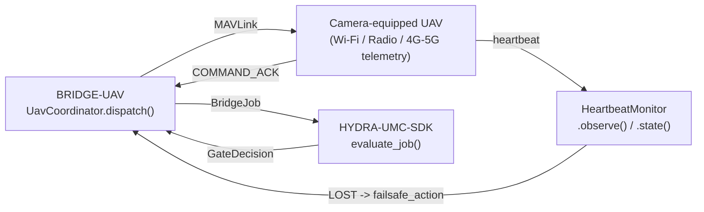

<!-- =============================================================================
HYDRA-UMC-BRIDGE-UAV - Camera-equipped drone bidirectional coordination bridge
Copyright (C) 2026 JuanenRac (Electro Hobby 3D) <electrohobby3d@gmail.com>
GPL-3.0-or-later - see LICENSE
============================================================================= -->

<p align="center">
  
</p>

# 🛩️ HYDRA-UMC-BRIDGE-UAV

<p align="center">🇺🇸 <b>English</b> | <a href="README_spa.md">🇪🇸 Español</a> | <a href="README_fra.md">🇫🇷 Français</a> | <a href="README_ita.md">🇮🇹 Italiano</a> | <a href="README_deu.md">🇩🇪 Deutsch</a> | <a href="README_zho.md">🇨🇳 简体中文</a> | <a href="README_jpn.md">🇯🇵 日本語</a> | <a href="README_por.md">🇵🇹 Português</a></p>

### 🔗 Dependency-Free Coordination Boundary Between HYDRA-UMC and Camera-Equipped UAVs

<p align="center">
  
  
  
</p>

---

> **Honesty check - what actually runs today:** the dependency-free flight-request core (`coordinator.py`'s `UavCoordinator`, funneling every dispatch through `HYDRA-UMC-SDK`'s own `evaluate_job()`), the deterministic link-loss heartbeat watchdog (`heartbeat.py`'s `HeartbeatMonitor`), and the real MAVLink command transport (`mavlink_transport.py`'s `MavlinkFlightControl`) are real and covered by 84 passing unit tests (`python tools/build_test.py` - `test_coordinator.py`, `test_heartbeat.py`, `test_mavlink_transport.py`, plus `test_mavlink_emulator.py` running the bridge against a protocol-faithful, hand-written MAVLink autopilot emulator, not a live one). None of it has been exercised against a real `pymavlink` install, a real radio/telemetry link, or a physical UAV/flight controller - `test_mavlink_transport.py`'s own fake MAVLink connection stands in for `pymavlink` entirely (the real library isn't even required to be installed for these tests to pass), and there is no live `run` command yet because no real MAVLink/OSDK transport has been selected or validated. See "Current Status & Next Steps" below, which already states this plainly, and `CHANGELOG.md` for exactly what has shipped so far.

---

> **Safety and security status:** this ecosystem is not a certified safety system. There is no hardware E-STOP path, no firmware-enforced limits or interlocks and no verified motion command yet; firmware images are checked with CRC32 and a shared-key HMAC-SHA256, not with an asymmetric signature; TLS and mutual TLS are optional and off by default; no custom board has been populated or tested yet. Read the [security baseline](https://github.com/JuanenRac/HYDRA-UMC-DOCS/blob/main/docs/SECURITY_BASELINE.md) and the [threat model](https://github.com/JuanenRac/HYDRA-UMC-DOCS/blob/main/docs/THREAT_MODEL.md) before relying on any statement here for the safety of a person.

## 📋 At a glance

| | |
|---|---|
| Version | `0.1.4` |
| Maturity | Functional |
| Tests | 84 (`python tools/build_test.py`) |
| Stack | Python / MAVLink / HYDRA-UMC-SDK |
| On real hardware | Simulated only: tested against emulators, fakes or simulators; no run on real hardware is recorded for this version |

## 1. 🛠️ TECHNICAL OVERVIEW

**HYDRA-UMC-BRIDGE-UAV** is the high-level coordination boundary between HYDRA-UMC and a camera-equipped drone (UAV), reachable over Wi-Fi, a radio link or a cellular (4G/5G) telemetry connection. It validates and forwards a small, named vocabulary of high-level flight requests (`ARM`, `TAKEOFF`, `GOTO_WAYPOINT`, `HOVER_AND_CAPTURE`, `RETURN_TO_LAUNCH`, `LAND`), and separately runs a real, required link-loss heartbeat watchdog. It never computes flight control or stabilization, and it cannot bypass HYDRA-UMC-SERVER, MCU limits, watchdogs or E-STOP. Today the only way back from the vehicle is the command acknowledgement (`COMMAND_ACK`); no telemetry is read.

It belongs to the **Mobile & Autonomous Bridges** family alongside `HYDRA-UMC-BRIDGE-DROIDS` and `HYDRA-UMC-BRIDGE-AMR`, and shares the same `HYDRA-UMC-SDK` job-and-safety contract as the stationary **External Automation Bridges** (CNC, LASER, OPENPNP, PRINTER3D, ROS2).

### Key Features:
* ✅ **Real, dependency-free flight-request core:** `coordinator.py`'s `UavCoordinator` has zero MAVLink/vendor-SDK import - it is deliberately plain Python, testable on any host without a real UAV connected. *(implemented, tested in `tests/test_coordinator.py`)*
* ✅ **Real named flight-request vocabulary:** `ARM`, `TAKEOFF`, `GOTO_WAYPOINT`, `HOVER_AND_CAPTURE`, `RETURN_TO_LAUNCH`, `LAND` - never a raw attitude/throttle command. A normal mission `COMPLETE` and an emergency `ABORT` both resolve to the same real `RETURN_TO_LAUNCH` request. `LAND` is real and genuinely distinct - MAVLink's own `MAV_CMD_NAV_LAND` vs `MAV_CMD_NAV_RETURN_TO_LAUNCH` (checked against the [official MAVLink common message set](https://mavlink.io/en/messages/common.html)) - for the real case RTL alone can't cover: descend now, not fly home first (e.g. battery too low, or the path home isn't safe). `emergency_land_request()` exposes it as a standalone request, deliberately outside the `JobPhase`-driven `dispatch()` flow - same reasoning as `HeartbeatMonitor`'s own separate signal. *(implemented)*
* ✅ **A real, required link-loss heartbeat watchdog:** `HeartbeatMonitor` is a deterministic, explicit-`now`-driven failsafe state machine - never reads a real clock, reports `LOST` from the very first check if never observed, and treats exactly-at-the-timeout as still `OK` (only genuinely exceeding it trips the configured `RETURN_TO_LAUNCH`/`LAND` failsafe). *(implemented, tested with a full deterministic boundary suite in `tests/test_heartbeat.py`)*
* ✅ **Real shared safety gate:** every job dispatched through `UavCoordinator.dispatch()` is evaluated by `evaluate_job()` from `HYDRA-UMC-SDK`'s `bridge_contract`, the same gate every sibling bridge and HYDRA-UMC-SERVER use; a productive phase requires an `IDLE` external machine and a `READY` HYDRA-UMC cell, while `ABORT` remains requestable during a fault. *(implemented)*
* ✅ **Fail-closed phase routing and static evidence:** an unknown future SDK phase is denied. `inspect_request_plan.py` emits the static schema `1.1` flight-request plan (now including the standalone `LAND` request) without opening any transport. *(implemented, tested)*
* ✅ **Real MAVLink command transport:** `mavlink_transport.py`'s `MavlinkFlightControl` sends an already-gated dispatch as a real `COMMAND_LONG`, mapped to a real, numbered `MAV_CMD` (`MAV_CMD_NAV_TAKEOFF`/`MAV_CMD_DO_REPOSITION`/`MAV_CMD_NAV_LOITER_UNLIM`/`MAV_CMD_IMAGE_START_CAPTURE`/`MAV_CMD_NAV_RETURN_TO_LAUNCH`/`MAV_CMD_NAV_LAND`/`MAV_CMD_COMPONENT_ARM_DISARM`) - a rejected dispatch never reaches the network. *(implemented, tested in `tests/test_mavlink_transport.py`)*
* ✅ **Explicit altitude frame, flight envelope and safe-state requests:** `GOTO_WAYPOINT` goes out as a `COMMAND_INT` (position in degrees × 1e7, heading kept) whose `altitude_frame` is explicit - `"relative"` (metres above the takeoff point, the default) or `"amsl"`; an optional `FlightEnvelope` (ceiling and radius from home, set by the deployment) refuses whatever lies outside it; `RETURN_TO_LAUNCH`, `LAND` and the standalone `DISARM` (never forced) are sent even when the gate refused them, and a normal `COMPLETE` return home is accepted whatever the cell and machine say; the `COMMAND_ACK` wait skips acknowledgements of other commands and other systems and treats `IN_PROGRESS` as not yet done. *(implemented, tested; the wire format is checked against the emulator only - never against PX4/ArduPilot SITL or a real autopilot, and `TAKEOFF`'s altitude is still the autopilot's own reference, because a `COMMAND_LONG` carries no frame)*
* ✅ **Non-mutating build/test:** `build-test.bat`/`.sh` compile the source and run deterministic unit tests without changing version or CHANGELOG. *(implemented, see BUILD & RUN below)*
* 🔜 **A DJI OSDK transport adapter** (for a non-MAVLink platform) - introduced only after that SDK is selected and tested. *(planned)*
* ✅ **Observed machine state:** `UavCoordinator.dispatch()` accepts the state the autopilot reported, which the shared gate uses instead of the `machine_state` written in the job (a message anybody on the broker may publish); without a report the claim is still used. *(implemented, tested in `tests/test_observed_state.py`)*

---

## 2. 🔄 UAV COORDINATION FLOW



---

## 3. 🧱 ARCHITECTURE & DESIGN DECISIONS

* **Why the heartbeat watchdog is its own module, not folded into the coordinator.** Link loss is a real, distinct failure mode from "is this job allowed right now" - `HeartbeatMonitor` answers "can I still trust what I last heard from this UAV" independently of any particular job, so it can be checked continuously (e.g. every telemetry tick) rather than only when a job happens to be dispatched.
* **Why `HeartbeatMonitor` takes an explicit `now` instead of reading a real clock.** The pasted architecture note this project started from is explicit that a UAV bridge REQUIRES this watchdog - the only way to prove its exact timeout-boundary behavior (not just "it eventually times out") without a flaky, slow, real-sleep-based test suite is to make time an explicit, testable input.
* **Why `COMPLETE` and `ABORT` both resolve to `RETURN_TO_LAUNCH`.** A finished mission and an emergency abort have the same real correct outcome for a UAV: come home. Collapsing them onto the same request name in the static plan (deduplicated, not repeated) reflects that honestly instead of inventing two different "go home" verbs.
* **Why this bridge's own heartbeat is explicitly NOT a replacement for the flight controller's own failsafe.** Pixhawk/PX4 and DJI's own firmware already implement a real, certified-adjacent link-loss failsafe at the radio/telemetry level - this bridge's `HeartbeatMonitor` is a coordination-layer signal for HYDRA-UMC's own state, and both must exist independently; see `docs/BRIDGE_GUIDE.md`'s own hardware acceptance gate.
* **Why there is no DJI OSDK transport adapter in this repo yet.** (The MAVLink transport exists, see above.) Committing to one flight controller's real command/telemetry protocol before it is selected and tested would risk baking in assumptions this local, dependency-free core cannot verify.
* **How this fits the rest of the ecosystem.** BRIDGE-UAV sits between a real UAV and `HYDRA-UMC-SDK` → `HYDRA-UMC-SERVER` → MCU safety - it is a coordination boundary, never a flight-control node, and it cannot bypass HYDRA-UMC-SERVER, MCU limits, watchdogs or E-STOP.

---

## 📂 DIRECTORY STRUCTURE

```text
HYDRA-UMC-BRIDGE-UAV/
├── src/
│   └── hydra_umc_bridge_uav/
│       ├── __init__.py
│       ├── coordinator.py       # UavCoordinator: dependency-free flight-request gate
│       ├── heartbeat.py         # HeartbeatMonitor: real, deterministic link-loss failsafe
│       ├── mavlink_transport.py # Sends an already-gated UavDispatch as a real MAVLink COMMAND_LONG / COMMAND_INT
│       └── simulated_uav.py     # Flight-state table + simulated vehicle: telemetry, authorization and arming kept apart, no transport
├── tests/
│   ├── test_coordinator.py      # Deterministic unit tests for the coordination core
│   ├── test_observed_state.py   # The gate uses the machine state the autopilot reports
│   ├── test_heartbeat.py        # Deterministic boundary tests for the heartbeat watchdog
│   ├── test_simulated_uav.py    # Tests of the state table and the simulated vehicle
│   ├── test_mavlink_transport.py # Real MAV_CMD shape tests against a fake MAVLink connection
│   ├── mavlink_emulator.py       # Protocol-faithful MAVLink autopilot emulator (realistic test double)
│   └── test_mavlink_emulator.py  # Bridge behaviour against the MAVLink autopilot emulator
├── tools/
│   ├── build_test.py            # Non-mutating compile + test runner (build-test.bat/.sh)
│   ├── bump_version.py          # Synchronizes pyproject.toml, manifest and CHANGELOG.md
│   ├── ci_validate.py           # Dependency-free, non-destructive CI baseline (used by .github/workflows/ci.yml)
│   └── inspect_request_plan.py  # Prints the static flight-request plan (no transport opened)
├── docs/
│   └── BRIDGE_GUIDE.md          # Scope, compatible platforms, scripts, hardware acceptance gate
├── images/
│   └── HYDRA_UMC_BANNER.svg     # README banner
├── build-test.bat / build-test.sh  # Validate only, never modifies the repository
├── build.bat / build.sh            # Validate and build (building never changes the version)
├── pyproject.toml               # Package metadata; depends on HYDRA-UMC-SDK (git)
├── hydra-umc.project.json       # Ecosystem manifest (version, maturity, family)
├── CHANGELOG.md
├── CODE_OF_CONDUCT.md / CONTRIBUTING.md / SECURITY.md / SUPPORT.md
├── LICENSE / LICENSE.md
└── README.md / README_*.md      # This file and its 7 translations
```

---

## 4. ⚙️ BUILD & RUN

Requires Python 3.11+. `tools/build_test.py` expects `HYDRA-UMC-SDK` checked out as a sibling directory (`../HYDRA-UMC-SDK`) or pointed at via the `HYDRA_UMC_SDK_ROOT` environment variable.

```bash
# Windows
build-test.bat      # validate only — no version/CHANGELOG change
build.bat            # Validate and build (building never changes the version)

# Linux/macOS
bash build-test.sh
bash build.sh
```

`build-test` compiles every module under `src/` with `py_compile` and runs the full `unittest` suite (every `test_*.py` file under `tests/`) - deterministically, with no real UAV connection, no network and no version/CHANGELOG change. `build` runs that same validation first and, only on success, calls `tools/bump_version.py` to synchronize the version across `pyproject.toml`, `hydra-umc.project.json` and `CHANGELOG.md`. There is no live hardware `run` command yet - that requires a validated MAVLink/OSDK transport adapter and a real UAV.

---

## ✅ Current Status & Next Steps

**Real today:** version `0.1.4`, functional as a dependency-free coordination core (`UavCoordinator`) plus a real, fully boundary-tested link-loss heartbeat watchdog (`HeartbeatMonitor`), fail-closed phase routing, a static `plan-only` flight-request schema, a real MAVLink command sender (`MavlinkFlightControl`) mapping every request to its real, numbered `MAV_CMD` - arming now requires the literal boolean `confirm_arm is True` (never a merely-truthy value like the string `'false'`), every numeric flight parameter is checked to be a real, non-boolean number before any finite/range check, and a sent command is only ever reported as confirmed once its matching real `COMMAND_ACK` comes back with `MAV_RESULT_ACCEPTED` - and non-mutating build-test scripts wired into CI with an SDK checkout.

**Integration boundary:** this bridge is a coordination boundary only - it is not a flight-control node, and it cannot bypass HYDRA-UMC-SERVER, MCU limits, watchdogs or E-STOP; every dispatched job still passes through the same shared gate every sibling bridge uses. `HeartbeatMonitor`'s own failsafe signal is a coordination-layer concern, never a replacement for the flight controller's own independent link-loss failsafe.

**Still ahead:** no real MAVLink (Pixhawk/PX4) or DJI OSDK transport, and no physical UAV, has been validated yet - a real adapter will be introduced only after a specific flight controller/SDK is selected and tested.

---

## 🔗 Related Projects

This project is part of the HYDRA-UMC robotics ecosystem by the same author (JuanenRac / Electro Hobby 3D). Worth knowing about, since a request might actually be about one of these rather than this repository.

**Parent Project**
- **[HYDRA-UMC-SERVER](https://github.com/JuanenRac/HYDRA-UMC-SERVER)** — the real headless backend (REST/WebSocket) every control client actually talks to; the authenticated ecosystem boundary this bridge reports to once each command has cleared this bridge's own local safety gate.

**Sibling Projects** — also talk to HYDRA-UMC-SERVER's own API, each their own client
- **[HYDRA-UMC-STUDIO](https://github.com/JuanenRac/HYDRA-UMC-STUDIO)** — web control dashboard with real-time multi-robot 3D visualization.
- **[HYDRA-UMC-SUITE](https://github.com/JuanenRac/HYDRA-UMC-SUITE)** — desktop (PySide6) swarm command center for multiple servers at once, packaged as a standalone executable.
- **[HYDRA-UMC-ANDROID-CONTROL](https://github.com/JuanenRac/HYDRA-UMC-ANDROID-CONTROL)** — native Android control app with biometric login and a paired Wear OS companion.
- **[HYDRA-UMC-IOS-CONTROL](https://github.com/JuanenRac/HYDRA-UMC-IOS-CONTROL)** — iOS/iPadOS control app (Flutter) with real-time WebSocket sync.
- **[HYDRA-UMC-DSI](https://github.com/JuanenRac/HYDRA-UMC-DSI)** — native touch UI for the onboard 7" DSI touchscreen, embedded on the CM5 itself.
- **[HYDRA-UMC-BRIDGE-AMR](https://github.com/JuanenRac/HYDRA-UMC-BRIDGE-AMR)** — coordination boundary for AGV/AMR fleets via a VDA 5050 MQTT publisher (tested against an emulated fleet only) — one of the ecosystem's 3 mobile-fleet bridges.
- **[HYDRA-UMC-BRIDGE-CNC](https://github.com/JuanenRac/HYDRA-UMC-BRIDGE-CNC)** — high-level CNC-cell coordinator with GRBL status/control-byte access (tested against an emulator only).
- **[HYDRA-UMC-BRIDGE-DROIDS](https://github.com/JuanenRac/HYDRA-UMC-BRIDGE-DROIDS)** — coordination boundary for legged/humanoid droids, with a Boston Dynamics Spot command sender (tested against an emulator only) — one of the ecosystem's 3 mobile-fleet bridges.
- **[HYDRA-UMC-BRIDGE-LASER](https://github.com/JuanenRac/HYDRA-UMC-BRIDGE-LASER)** — laser-cell coordinator reading 3 key/enclosure/interlock GPIO signals (tested against a fake chip only; it cannot arm or fire a laser).
- **[HYDRA-UMC-BRIDGE-OPENPNP](https://github.com/JuanenRac/HYDRA-UMC-BRIDGE-OPENPNP)** — safe high-level board-flow coordinator for OpenPnP pick-and-place.
- **[HYDRA-UMC-BRIDGE-PRINTER3D](https://github.com/JuanenRac/HYDRA-UMC-BRIDGE-PRINTER3D)** — safe coordination boundary for Moonraker/Klipper 3D printers, with real gated job commands.
- **[HYDRA-UMC-BRIDGE-ROS2](https://github.com/JuanenRac/HYDRA-UMC-BRIDGE-ROS2)** — coordinator with a lazily imported rclpy ROS 2 transport (not yet run against a ROS 2 installation).

**Directly Related**
- **[HYDRA-UMC-SDK](https://github.com/JuanenRac/HYDRA-UMC-SDK)** — the shared JSON-Schema contract and software job-gate boundary every bridge validates its commands against (not a certified safety function).
- **[HYDRA-UMC-CONNECTOR-HUB](https://github.com/JuanenRac/HYDRA-UMC-CONNECTOR-HUB)** — declarative adapter-manifest registry and validator for external-machine connectors; extends the SDK's own contract idea to external machines without replacing the industrial-gateway projects.

**Also Part of the Ecosystem**

*Core Hardware & Platform*
- **[HYDRA-UMC](https://github.com/JuanenRac/HYDRA-UMC)** — the robot-arm motherboard design: CM5 host + dual-core STM32H745, meant to orchestrate up to 8 tool arms over CAN-OTA/SPI-OTA (firmware at an early stage; no populated board yet).
- **[HYDRA-UMC-OS](https://github.com/JuanenRac/HYDRA-UMC-OS)** — reproducible Raspberry Pi OS product layer for the CM5: read-only agent, validated config/profiles, WiFi first-contact provisioning.

*Core Backend & Clients*
- **[HYDRA-UMC-EDITOR-URDF](https://github.com/JuanenRac/HYDRA-UMC-EDITOR-URDF)** — desktop graphical URDF creator/editor that pushes finished models into STUDIO's own catalog.
- **[HYDRA-UMC-EDITOR-STL](https://github.com/JuanenRac/HYDRA-UMC-EDITOR-STL)** — desktop STL model editor, transforming/replacing/removing/adding real parts in the same model catalog HYDRA-UMC-EDITOR-URDF also edits.

*URTC Tool Platform*
- **[URTC](https://github.com/JuanenRac/URTC)** — firmware for the physical Universal Robot Tool Controller PCB, 25+ tool profiles over CAN bus.
- **[URTC-FLASHER](https://github.com/JuanenRac/URTC-FLASHER)** — desktop GUI flashing tool for URTC boards, CAN-OTA plus full-chip SWD/JTAG.
- **[URTC-TESTER](https://github.com/JuanenRac/URTC-TESTER)** — desktop live CAN-bus diagnostic tool for URTC boards, one panel per tool profile.
- **[URTC-WEB-STUDIO](https://github.com/JuanenRac/URTC-WEB-STUDIO)** — browser-based alternative to URTC-TESTER via the Web Serial API, no local install needed.
- **[URTC-GATEWAY](https://github.com/JuanenRac/URTC-GATEWAY)** — gateway in front of the URTC CAN bus: an allowed list of identifiers, a rate limit and a session key; software tested on a computer, not yet on a real bus.

*Vision AI Node (Hailo-8)*
- **[HYDRA-UMC-VISION-NODE](https://github.com/JuanenRac/HYDRA-UMC-VISION-NODE)** — integration hub for the Hailo-8 vision pipeline, with a real per-stage hardware-readiness check.
- **[HYDRA-UMC-DETECTION-HEF](https://github.com/JuanenRac/HYDRA-UMC-DETECTION-HEF)** — real compiled-model registry with Hailo-architecture/checksum safe-load verification.
- **[HYDRA-UMC-VISION-STREAMER](https://github.com/JuanenRac/HYDRA-UMC-VISION-STREAMER)** — real GStreamer pipeline + MediaMTX config generator with a real HailoRT integration boundary.
- **[HYDRA-UMC-VISUAL-SERVOING-API](https://github.com/JuanenRac/HYDRA-UMC-VISUAL-SERVOING-API)** — Position-Based Visual Servoing correction law with authorisation gated on the zone state; no camera pose estimation yet.
- **[HYDRA-UMC-SAFETY-ZONES](https://github.com/JuanenRac/HYDRA-UMC-SAFETY-ZONES)** — v0 zone-breach, calibration-freshness and E-STOP-request logic that takes object positions from a file; no detector feeds it and no physical E-STOP is wired to it yet.

*Cognitive AI Node (Hailo-10)*
- **[HYDRA-UMC-COGNITIVE-NODE](https://github.com/JuanenRac/HYDRA-UMC-COGNITIVE-NODE)** — integration hub for the Hailo-10 cognitive pipeline (LLM/VLA/voice orchestration).
- **[HYDRA-UMC-VLA-ENGINE](https://github.com/JuanenRac/HYDRA-UMC-VLA-ENGINE)** — real action-token encoding/decoding and trajectory generation for a Vision-Language-Action model.
- **[HYDRA-UMC-VOICE-UI](https://github.com/JuanenRac/HYDRA-UMC-VOICE-UI)** — real voice front-end (VAD + intent parser) with a bounded, confirmation-gated Watch relay.
- **[HYDRA-UMC-SEMANTIC-PLANNER](https://github.com/JuanenRac/HYDRA-UMC-SEMANTIC-PLANNER)** — real rule-based task decomposition and semantic error recovery over MCU error codes.
- **[HYDRA-UMC-DOCS-QA](https://github.com/JuanenRac/HYDRA-UMC-DOCS-QA)** — real stdlib-only TF-IDF document search over this ecosystem's own Markdown docs.
- **[HYDRA-UMC-LOCAL-TECHNICIAN](https://github.com/JuanenRac/HYDRA-UMC-LOCAL-TECHNICIAN)** — local, policy-gated AI maintenance technician for the ecosystem itself - observes, diagnoses and proposes fixes; the two highest risk levels are deliberately not implemented yet.

*Orchestration & Swarm*
- **[HYDRA-UMC-ORCHESTRATOR](https://github.com/JuanenRac/HYDRA-UMC-ORCHESTRATOR)** — integration hub with a real gRPC/Protobuf health-report contract and mission state machine.
- **[HYDRA-UMC-JOB-DISPATCHER](https://github.com/JuanenRac/HYDRA-UMC-JOB-DISPATCHER)** — real priority-based job queue with deduplication, over a real HTTP API.
- **[HYDRA-UMC-NODE-HEALING](https://github.com/JuanenRac/HYDRA-UMC-NODE-HEALING)** — real gRPC-based fleet health watchdog with retry/backoff and identity-mismatch detection.
- **[HYDRA-UMC-PATH-PLANNER-3D](https://github.com/JuanenRac/HYDRA-UMC-PATH-PLANNER-3D)** — real RRT-based 3D path planner with real obstacle/workspace collision validation.
- **[HYDRA-UMC-SWARM-SYNC](https://github.com/JuanenRac/HYDRA-UMC-SWARM-SYNC)** — real CRDT LWW-Element-Map state sync, property-tested for multi-cell convergence.

*Digital Twin & Simulation*
- **[HYDRA-UMC-TWIN](https://github.com/JuanenRac/HYDRA-UMC-TWIN)** — integration hub for the digital-twin engine, with a real version-compatibility sync contract.
- **[HYDRA-UMC-HIL-BRIDGE](https://github.com/JuanenRac/HYDRA-UMC-HIL-BRIDGE)** — hardware-in-the-loop router with a software collision interlock between simulation and real hardware (tested without real hardware).
- **[HYDRA-UMC-PHYSICS-REPLICA](https://github.com/JuanenRac/HYDRA-UMC-PHYSICS-REPLICA)** — real forward kinematics and joint-limit validation over a real URDF subset.
- **[HYDRA-UMC-SYNTHETIC-DATA-GEN](https://github.com/JuanenRac/HYDRA-UMC-SYNTHETIC-DATA-GEN)** — real procedural 2D scene generator with YOLO/COCO annotation export.

*Data & Analytics*
- **[HYDRA-UMC-DATALAKE](https://github.com/JuanenRac/HYDRA-UMC-DATALAKE)** — real sqlite3-backed time-series store with a real ingest/query HTTP API.
- **[HYDRA-UMC-ANOMALY-DETECTOR](https://github.com/JuanenRac/HYDRA-UMC-ANOMALY-DETECTOR)** — real FFT + statistical baseline anomaly detector with drift monitoring.
- **[HYDRA-UMC-PRODUCTION-REPORTS](https://github.com/JuanenRac/HYDRA-UMC-PRODUCTION-REPORTS)** — real OEE/availability calculation over DATALAKE history, with reproducible CSV export.
- **[HYDRA-UMC-TELEMETRY-COLLECTOR](https://github.com/JuanenRac/HYDRA-UMC-TELEMETRY-COLLECTOR)** — real CAN/WebSocket ingestion pipeline into DATALAKE, with sequence deduplication.

*Industrial Gateway*
- **[HYDRA-UMC-GATEWAY-INDUSTRIAL](https://github.com/JuanenRac/HYDRA-UMC-GATEWAY-INDUSTRIAL)** — integration hub relaying to industrial protocols, with a real command allowlist/backpressure layer.
- **[HYDRA-UMC-OPCUA-SERVER](https://github.com/JuanenRac/HYDRA-UMC-OPCUA-SERVER)** — real OPC-UA address space, verified with a real binary-protocol client session.
- **[HYDRA-UMC-MQTT-BROKER](https://github.com/JuanenRac/HYDRA-UMC-MQTT-BROKER)** — real MQTT broker with optional per-client authentication and topic ACLs.
- **[HYDRA-UMC-MTCONNECT-ADAPTER](https://github.com/JuanenRac/HYDRA-UMC-MTCONNECT-ADAPTER)** — real MTConnect `/probe` and `/current` XML endpoints with degraded-mode output.

*Complementary Tools & Ecosystem Operations*
- **[HYDRA-UMC-DASHBOARD-AI](https://github.com/JuanenRac/HYDRA-UMC-DASHBOARD-AI)** — Smart Summaries and Anomaly Highlighting panels over DATALAKE/ANOMALY-DETECTOR, with an honest statistical fallback.
- **[HYDRA-UMC-TOOL-CLI](https://github.com/JuanenRac/HYDRA-UMC-TOOL-CLI)** — fleet CLI with a real, stable exit-code contract, a genuine live client of HYDRA-UMC-SERVER's own API.
- **[HYDRA-UMC-WATCH](https://github.com/JuanenRac/HYDRA-UMC-WATCH)** — WearOS companion app with haptic alert patterns and a paired-phone voice relay (not yet run on a physical watch).
- **[URTC-SMART-RACK](https://github.com/JuanenRac/URTC-SMART-RACK)** — firmware for a board-mounting rack with real tool-ID decoding and Smart Idle pre-heating logic.
- **[URTC-VISION-TOOL](https://github.com/JuanenRac/URTC-VISION-TOOL)** — firmware plus a real Python vision companion for a thermal/RGB inspection tool head.
- **[HYDRA-UMC-UPDATER](https://github.com/JuanenRac/HYDRA-UMC-UPDATER)** — administrative desktop tool that discovers, clones and updates every repo in this ecosystem.
- **[HYDRA-UMC-OS-REBUILDER](https://github.com/JuanenRac/HYDRA-UMC-OS-REBUILDER)** — Windows/Linux desktop tool that builds a ready-to-flash CM5 image pre-loaded with the ecosystem's most current versions, with Raspberry-Pi-Imager-style first-boot Wi-Fi/user/SSH configuration.
- **[HYDRA-UMC-OPS-AGENT](https://github.com/JuanenRac/HYDRA-UMC-OPS-AGENT)** — maintenance-incident coordinator: a low-privilege edge role collects a sanitized inventory/health snapshot, a control-plane role renders it read-only and asks an AI provider to suggest a diagnosis - never applies a patch or deploys anything.
- **[HYDRA-UMC-DEV-SERVER](https://github.com/JuanenRac/HYDRA-UMC-DEV-SERVER)** — reproducible development host (Raspberry Pi 5 / CM5) that stores the ecosystem's source and runs bounded build/test tasks under a durable queue; a dedicated dev role, explicitly not an operational CM5.

---

## 📚 Documentation & Community

- **[CONTRIBUTING.md](CONTRIBUTING.md)** — tech stack and coding guidelines for a pull request.
- **[CODE_OF_CONDUCT.md](CODE_OF_CONDUCT.md)** — the standards of behavior expected in this community.
- **[SECURITY.md](SECURITY.md)** — how to report a vulnerability, and this project's own real security focus areas.
- **[SUPPORT.md](SUPPORT.md)** — where to ask questions and report bugs.
- **[LICENSE.md](LICENSE.md)** — this project's own license.

## 👤 AUTHOR
**JuanenRac** (Electro Hobby 3D)
📧 electrohobby3d@gmail.com
📺 [youtube.com/@electrohobby3d](https://youtube.com/@electrohobby3d)

## 📜 LICENSE
GPL-3.0-or-later - See LICENSE for details.
