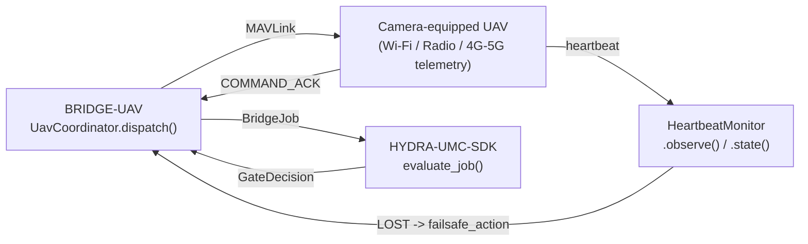

<!-- =============================================================================
HYDRA-UMC-BRIDGE-UAV - UAV coordination bridge
Copyright (C) JuanenRac (Electro Hobby 3D) <electrohobby3d@gmail.com>
GPL-3.0-or-later - see LICENSE
============================================================================= -->

<p align="center">
  
</p>

# 🚁 HYDRA-UMC-BRIDGE-UAV

<p align="center">🇺🇸 <b>English</b> | <a href="README_spa.md">🇪🇸 Español</a> | <a href="README_fra.md">🇫🇷 Français</a> | <a href="README_ita.md">🇮🇹 Italiano</a> | <a href="README_deu.md">🇩🇪 Deutsch</a> | <a href="README_zho.md">🇨🇳 简体中文</a> | <a href="README_jpn.md">🇯🇵 日本語</a> | <a href="README_por.md">🇵🇹 Português</a></p>

### 🔗 Dependency-Free Coordination Boundary Between HYDRA-UMC and Camera-Equipped UAVs

<p align="center">
  
  
  
  
  
  
</p>

---

> **Honesty check - what actually runs today:** the dependency-free flight-request core (`coordinator.py`'s `UavCoordinator`, funneling every dispatch through `HYDRA-UMC-SDK`'s own `evaluate_job()`), the deterministic link-loss heartbeat watchdog (`heartbeat.py`'s `HeartbeatMonitor`), and the real MAVLink command transport (`mavlink_transport.py`'s `MavlinkFlightControl`) are real and covered by 84 passing unit tests (`python tools/build_test.py` - `test_coordinator.py`, `test_heartbeat.py`, `test_mavlink_transport.py`, plus `test_mavlink_emulator.py` running the bridge against a protocol-faithful, hand-written MAVLink autopilot emulator, not a live one). None of it has been exercised against a real `pymavlink` install, a real radio/telemetry link, or a physical UAV/flight controller - `test_mavlink_transport.py`'s own fake MAVLink connection stands in for `pymavlink` entirely (the real library isn't even required to be installed for these tests to pass), and there is no live `run` command yet because no real MAVLink/OSDK transport has been selected or validated. See "Roadmap & Known limits" below, which already states this plainly, and `CHANGELOG.md` for exactly what has shipped so far.

> **Safety and security status:** this ecosystem is not a certified safety system. There is no hardware E-STOP path, no firmware-enforced limits or interlocks and no verified motion command yet; firmware images are checked with CRC-32 and an Ed25519 signature, and a release build refuses the published development keys (the tool heads and expansion boards behind the relay still run URTC bootloaders, which take a shared-key HMAC-SHA256 instead of a signature); TLS and mutual TLS are optional and off by default; no custom board has been populated or tested yet. Read the [security baseline](https://github.com/JuanenRac/HYDRA-UMC-DOCS/blob/main/docs/SECURITY_BASELINE.md) and the [threat model](https://github.com/JuanenRac/HYDRA-UMC-DOCS/blob/main/docs/THREAT_MODEL.md) before relying on any statement here for the safety of a person.

---

## 📋 At a glance

| | |
|---|---|
| Version | `0.1.5` |
| Maturity | Functional |
| Tests | 146 (`python tools/build_test.py`) |
| Stack | Python / MAVLink / HYDRA-UMC-SDK |
| On real hardware | Simulated only: tested against emulators, fakes or simulators; no run on real hardware is recorded for this version |

**Jump to:** [Overview](#-overview) · [Architecture](#-architecture) · [Features](#-features) · [Security & Safety](#-security--safety) · [Interfaces](#-interfaces) · [Configuration](#-configuration) · [Quick start](#-quick-start) · [Testing](#-testing) · [Troubleshooting](#-troubleshooting) · [Repository Structure](#-repository-structure) · [Related Projects](#-related-projects)

## 🚦 Project status

Each line is one part of this repository and the light says how far it is today. It is written from what the repository can show (tests, builds, runs), not from what is planned.

🟢 Done and verified · 🟡 Works, with known limits · 🟠 Partly done or not verified yet · 🔴 Not done or not working

| Area | State | What it means here |
|---|---|---|
| Software | 🟡 | Works for its main purpose; the honesty check above lists what is still missing |
| Tests | 🟢 | 146 automated tests, run on every change |
| Real hardware | 🟠 | Simulated only: tested against emulators, fakes or simulators; no run on real hardware is recorded for this version |
| Documentation | 🟢 | README in eight languages, checked against the manifest on every change |

## 🎯 Overview

**HYDRA-UMC-BRIDGE-UAV** is the high-level coordination boundary between HYDRA-UMC and a camera-equipped drone (UAV), reachable over Wi-Fi, a radio link or a cellular (4G/5G) telemetry connection. It validates and forwards a small, named vocabulary of high-level flight requests (`ARM`, `TAKEOFF`, `GOTO_WAYPOINT`, `HOVER_AND_CAPTURE`, `RETURN_TO_LAUNCH`, `LAND`), and separately runs a real, required link-loss heartbeat watchdog. It never computes flight control or stabilization, and it cannot bypass HYDRA-UMC-SERVER, MCU limits, watchdogs or E-STOP. Today the only way back from the vehicle is the command acknowledgement (`COMMAND_ACK`); no telemetry is read.

It belongs to the **Mobile & Autonomous Bridges** family alongside `HYDRA-UMC-BRIDGE-DROIDS` and `HYDRA-UMC-BRIDGE-AMR`, and shares the same `HYDRA-UMC-SDK` job-and-safety contract as the stationary **External Automation Bridges** (CNC, LASER, OPENPNP, PRINTER3D, ROS2).

## 🧩 Role in HYDRA-UMC

**HYDRA-UMC-BRIDGE-UAV** sits between a camera-equipped UAV (MAVLink) and the robot cell. It reports what that side says, asks the shared gate before any auxiliary work and never takes over the authority of the machine it coordinates with.

It shares the safety contract of `HYDRA-UMC-SDK` with every bridge: a job is accepted only after the shared `evaluate_job()` gate says so, and the gate fails closed. This bridge has no MQTT transport; it runs as the command `hydra-umc-bridge-uav run`.

## 🏛️ Architecture

<p align="center">
  
</p>

<details>
<summary>Text version of the diagram (Mermaid)</summary>



</details>

**Why it is built this way**

* **Why the heartbeat watchdog is its own module, not folded into the coordinator.** Link loss is a real, distinct failure mode from "is this job allowed right now" - `HeartbeatMonitor` answers "can I still trust what I last heard from this UAV" independently of any particular job, so it can be checked continuously (e.g. every telemetry tick) rather than only when a job happens to be dispatched.
* **Why `HeartbeatMonitor` takes an explicit `now` instead of reading a real clock.** The pasted architecture note this project started from is explicit that a UAV bridge REQUIRES this watchdog - the only way to prove its exact timeout-boundary behavior (not just "it eventually times out") without a flaky, slow, real-sleep-based test suite is to make time an explicit, testable input.
* **Why `COMPLETE` and `ABORT` both resolve to `RETURN_TO_LAUNCH`.** A finished mission and an emergency abort have the same real correct outcome for a UAV: come home. Collapsing them onto the same request name in the static plan (deduplicated, not repeated) reflects that honestly instead of inventing two different "go home" verbs.
* **Why this bridge's own heartbeat is explicitly NOT a replacement for the flight controller's own failsafe.** Pixhawk/PX4 and DJI's own firmware already implement a real, certified-adjacent link-loss failsafe at the radio/telemetry level - this bridge's `HeartbeatMonitor` is a coordination-layer signal for HYDRA-UMC's own state, and both must exist independently; see `docs/BRIDGE_GUIDE.md`'s own hardware acceptance gate.
* **Why there is no DJI OSDK transport adapter in this repo yet.** (The MAVLink transport exists, see above.) Committing to one flight controller's real command/telemetry protocol before it is selected and tested would risk baking in assumptions this local, dependency-free core cannot verify.
* **How this fits the rest of the ecosystem.** BRIDGE-UAV sits between a real UAV and `HYDRA-UMC-SDK` → `HYDRA-UMC-SERVER` → MCU safety - it is a coordination boundary, never a flight-control node, and it cannot bypass HYDRA-UMC-SERVER, MCU limits, watchdogs or E-STOP.

## ✨ Features

* ✅ **Real, dependency-free flight-request core:** `coordinator.py`'s `UavCoordinator` has zero MAVLink/vendor-SDK import - it is deliberately plain Python, testable on any host without a real UAV connected. *(implemented, tested in `tests/test_coordinator.py`)*
* ✅ **Real named flight-request vocabulary:** `ARM`, `TAKEOFF`, `GOTO_WAYPOINT`, `HOVER_AND_CAPTURE`, `RETURN_TO_LAUNCH`, `LAND` - never a raw attitude/throttle command. A normal mission `COMPLETE` and an emergency `ABORT` both resolve to the same real `RETURN_TO_LAUNCH` request. `LAND` is real and genuinely distinct - MAVLink's own `MAV_CMD_NAV_LAND` vs `MAV_CMD_NAV_RETURN_TO_LAUNCH` (checked against the [official MAVLink common message set](https://mavlink.io/en/messages/common.html)) - for the real case RTL alone can't cover: descend now, not fly home first (e.g. battery too low, or the path home isn't safe). `emergency_land_request()` exposes it as a standalone request, deliberately outside the `JobPhase`-driven `dispatch()` flow - same reasoning as `HeartbeatMonitor`'s own separate signal. *(implemented)*
* ✅ **A real, required link-loss heartbeat watchdog:** `HeartbeatMonitor` is a deterministic, explicit-`now`-driven failsafe state machine - never reads a real clock, reports `LOST` from the very first check if never observed, and treats exactly-at-the-timeout as still `OK` (only genuinely exceeding it trips the configured `RETURN_TO_LAUNCH`/`LAND` failsafe). *(implemented, tested with a full deterministic boundary suite in `tests/test_heartbeat.py`)*
* ✅ **The bridge's own ground-station heartbeat:** `gcs_heartbeat.py`'s `GcsHeartbeat` sends a MAVLink `HEARTBEAT` of type `MAV_TYPE_GCS` on a background thread (1 Hz by default, `HYDRA_UAV_GCS_HEARTBEAT_HZ` between 0.1 and 10, `0` for off), so the autopilot's own lost-station failsafe fires if the bridge dies. A beat that cannot be sent is counted and reported, never raised. *(implemented, tested against a fake link in `tests/test_gcs_heartbeat.py`; not yet tried against a real autopilot)* `hydra-umc-bridge-uav run --connection <URL>` (or `python -m hydra_umc_bridge_uav run ...`) opens the MAVLink link and keeps this heartbeat going, prints a status line every few seconds and stops cleanly on Ctrl-C, SIGTERM or `--duration`; it sends nothing else to the vehicle. Tested against a recorder of the link; never run against a real autopilot or SITL.
* ✅ **Real shared safety gate:** every job dispatched through `UavCoordinator.dispatch()` is evaluated by `evaluate_job()` from `HYDRA-UMC-SDK`'s `bridge_contract`, the same gate every sibling bridge and HYDRA-UMC-SERVER use; a productive phase requires an `IDLE` external machine and a `READY` HYDRA-UMC cell, while `ABORT` remains requestable during a fault. *(implemented)*
* ✅ **Fail-closed phase routing and static evidence:** an unknown future SDK phase is denied. `inspect_request_plan.py` emits the static schema `1.1` flight-request plan (now including the standalone `LAND` request) without opening any transport. *(implemented, tested)*
* ✅ **Real MAVLink command transport:** `mavlink_transport.py`'s `MavlinkFlightControl` sends an already-gated dispatch as a real `COMMAND_LONG`, mapped to a real, numbered `MAV_CMD` (`MAV_CMD_NAV_TAKEOFF`/`MAV_CMD_DO_REPOSITION`/`MAV_CMD_NAV_LOITER_UNLIM`/`MAV_CMD_IMAGE_START_CAPTURE`/`MAV_CMD_NAV_RETURN_TO_LAUNCH`/`MAV_CMD_NAV_LAND`/`MAV_CMD_COMPONENT_ARM_DISARM`) - a rejected dispatch never reaches the network. *(implemented, tested in `tests/test_mavlink_transport.py`)*
* ✅ **Explicit altitude frame, flight envelope and safe-state requests:** `GOTO_WAYPOINT` goes out as a `COMMAND_INT` (position in degrees × 1e7, heading kept) whose `altitude_frame` is explicit - `"relative"` (metres above the takeoff point, the default) or `"amsl"`; an optional `FlightEnvelope` (ceiling and radius from home, set by the deployment) refuses whatever lies outside it; `RETURN_TO_LAUNCH`, `LAND` and the standalone `DISARM` (never forced) are sent even when the gate refused them, and a normal `COMPLETE` return home is accepted whatever the cell and machine say; the `COMMAND_ACK` wait skips acknowledgements of other commands and other systems and treats `IN_PROGRESS` as not yet done. *(implemented, tested; the wire format is checked against the emulator only - never against PX4/ArduPilot SITL or a real autopilot, and `TAKEOFF`'s altitude is still the autopilot's own reference, because a `COMMAND_LONG` carries no frame)*
* ✅ **Non-mutating build/test:** `build-test.bat`/`.sh` compile the source and run deterministic unit tests without changing version or CHANGELOG. *(implemented, see Build & Release below)*
* 🔜 **A DJI OSDK transport adapter** (for a non-MAVLink platform) - introduced only after that SDK is selected and tested. *(planned)*
* ✅ **Observed machine state:** `UavCoordinator.dispatch()` accepts the state the autopilot reported, which the shared gate uses instead of the `machine_state` written in the job (a message anybody on the broker may publish); without a report the claim is still used. *(implemented, tested in `tests/test_observed_state.py`)*

## 🔒 Security & Safety

| Threat | Defence | Where |
|---|---|---|
| A job for a cell or machine that is not in a safe state | Every job goes through the shared `evaluate_job()` gate of the SDK, which fails closed; the bridge has no accept/reject logic of its own | SDK `bridge_contract` |
| Oversized or unbounded job data | At most 32 parameters, keys up to 64 characters, values up to 1024, identifiers up to 128 (`MAX_PARAMETERS`, `MAX_PARAMETER_KEY_CHARS`, `MAX_PARAMETER_VALUE_CHARS`, `MAX_IDENTIFIER_CHARS`) | SDK `bridge_contract` |
| A repeated or replayed order | An `IdempotencyStore` remembers each key for 24 hours and at most 10 000 entries; a repeat gets the first answer instead of being evaluated again | SDK `job_intake` |
| Losing the link to the vehicle | `HeartbeatMonitor` is a deterministic state machine whose failsafe is `RETURN_TO_LAUNCH` or `LAND`; the bridge sends its own ground-station HEARTBEAT at 1 Hz by default (0.1 to 10 Hz, `HYDRA_UAV_GCS_HEARTBEAT_HZ`) | `heartbeat.py`, `gcs_heartbeat.py` |
| An order nobody authorised | `ARM`, `TAKEOFF`, `GOTO_WAYPOINT` and `HOVER_AND_CAPTURE` need authorisation; the safe-state requests except `DISARM` are always accepted | `simulated_uav.py` |
| A forged MAVLink message | MAVLink 2 signing with a 32-byte key (a raw file or 64 hexadecimal characters) from `--signing-key-file` or `HYDRA_UMC_BRIDGE_UAV_SIGNING_KEY_FILE`; unsigned messages are refused unless `--signing-allow-unsigned` is given for a vehicle that does not sign yet | `mavlink_transport.py`, `cli.py` |
| A mixed-up altitude frame | The altitude frame is explicit: `relative` (`GLOBAL_RELATIVE_ALT_INT`) or `amsl` (`GLOBAL_INT`) | `mavlink_transport.py` |

**What it never does:** it only turns high-level flight requests that the gate approved into real MAVLink commands (ARM/DISARM, TAKEOFF, DO_REPOSITION, LOITER_UNLIM, RTL, LAND, IMAGE_START_CAPTURE) and never sends raw motion.

## 🔌 Interfaces

The command `hydra-umc-bridge-uav run` (or `python -m hydra_umc_bridge_uav run`) opens the MAVLink link and keeps the ground-station heartbeat going. Exit codes: `0` stopped normally, `1` the link could not be opened or no heartbeat could be sent, `2` a bad option.

| Variable | Default | What it sets |
|---|---|---|
| `--connection` | required | a pymavlink URL, for example `udpin:0.0.0.0:14550` or `/dev/ttyUSB0` |
| `--heartbeat-hz` | `1.0` | 0.1 to 10; the default comes from `HYDRA_UAV_GCS_HEARTBEAT_HZ` |
| `--heartbeat-timeout` | `10.0` | seconds to wait for the vehicle's first heartbeat |
| `--status-every`, `--duration` | `10.0`, `0` | seconds between status lines (`0` prints none); stop after this many seconds (`0` runs until stopped) |
| `--signing-key-file`, `--signing-allow-unsigned` | off | MAVLink 2 signing key file; accept unsigned messages from a vehicle that does not sign yet |
| `--server-config` | off | the Server's `data/server-config.json`: its `mavlink` section (set from Server Admin) gives the key file and the unsigned switch when the option and the environment do not |

## ⚙️ Configuration

| Variable | Default | What it sets |
|---|---|---|
| `HYDRA_UAV_GCS_HEARTBEAT_HZ` | `1.0` | rate of the bridge's ground-station heartbeat, 0.1 to 10; `0` switches it off |
| `HYDRA_UMC_BRIDGE_UAV_SIGNING_KEY_FILE` | unset | path of the MAVLink 2 signing key (32 bytes, raw or 64 hexadecimal characters); `--signing-key-file` wins |
| `HYDRA_UMC_BRIDGE_UAV_SIGNING_ALLOW_UNSIGNED` | unset | `1` accepts unsigned messages with a key; `--signing-allow-unsigned` wins, else this, else the Server configuration |
| `HYDRA_UMC_BRIDGE_UAV_SERVER_CONFIG` | unset | path of the Server's `data/server-config.json` (`--server-config` wins) |

## 🚀 Quick start

Requires Python 3.11 or newer. The tests and the build scripts expect `HYDRA-UMC-SDK` checked out next to this repository (`../HYDRA-UMC-SDK`) or pointed at with `HYDRA_UMC_SDK_ROOT`.

Try it without hardware (this checks the whole bridge against its emulators and fakes):

```bash
py -3 tools/build_test.py          # Windows
python3 tools/build_test.py         # Linux, macOS
```

Run the bridge (needs the `mavlink` extra: `pip install ".[mavlink]"`):

```bash
hydra-umc-bridge-uav run --connection udpin:0.0.0.0:14550 --signing-key-file ~/uav-signing.key
```

## 🧪 Testing

146 automated `unittest` cases run with `python tools/build_test.py` (it also compiles every module). The tests need no hardware, no network and no optional package: the ones that would need `paho-mqtt`, `pyserial` or a vendor library use a stand-in or are skipped when the package is missing.

| Test file | Tests | What it covers |
|---|---|---|
| `test_coordinator.py`, `test_observed_state.py`, `test_simulated_uav.py` | - | job to flight request mapping, the observed vehicle state, which request is legal from which state |
| `test_mavlink_transport.py`, `test_mavlink_emulator.py`, `mavlink_emulator.py` | - | real MAVLink commands against fakes and an emulator, altitude frames, signing |
| `test_heartbeat.py`, `test_gcs_heartbeat.py`, `test_cli.py`, `test_edge_cases.py` | - | the link-loss failsafe, the ground-station heartbeat, the command line and its exit codes, edge cases |

The CI runs `HYDRA_UMC_CI=1 python tools/ci_validate.py`, which checks the manifest, the documents, the eight READMEs and the pictures, and runs the tests with an SDK checkout.

## 🏗️ Build & Release

Requires Python 3.11+. `tools/build_test.py` expects `HYDRA-UMC-SDK` checked out as a sibling directory (`../HYDRA-UMC-SDK`) or pointed at via the `HYDRA_UMC_SDK_ROOT` environment variable.

```bash
# Windows
build-test.bat      # validate only — no version/CHANGELOG change
build.bat            # Validate and build (building never changes the version)

# Linux/macOS
bash build-test.sh
bash build.sh
```

`build-test` compiles every module under `src/` with `py_compile` and runs the full `unittest` suite (every `test_*.py` file under `tests/`) - deterministically, with no real UAV connection, no network and no version/CHANGELOG change. `build` runs that same validation first and, only on success, calls `tools/bump_version.py` to synchronize the version across `pyproject.toml`, `hydra-umc.project.json` and `CHANGELOG.md`. There is no live hardware `run` command yet - that requires a validated MAVLink/OSDK transport adapter and a real UAV.

## 🩺 Troubleshooting

| You see | Because | Do |
|---|---|---|
| `ModuleNotFoundError: hydra_umc_sdk` | The SDK is not installed or not next to this repository | Check out `HYDRA-UMC-SDK` next to this repository or set `HYDRA_UMC_SDK_ROOT` |
| exit code `1` | The MAVLink link could not be opened, or no heartbeat could be sent | Check `--connection` (URL or serial device) and that `pymavlink` is installed (`.[mavlink]`) |
| exit code `2` | A bad option, for example a heartbeat rate outside 0.1 to 10 or an unreadable signing key | Fix the option; the key file must hold exactly 32 bytes (raw or 64 hexadecimal characters) |
| `"allowed": false` + `reason` | The shared gate or a guard refused the order | Read `reason` and fix the cause; do not retry blindly |

## 📂 Repository Structure

<p align="center">
  
</p>

<details>
<summary>Text version of the tree</summary>

```text
HYDRA-UMC-BRIDGE-UAV/
├── src/hydra_umc_bridge_uav/
│   ├── coordinator.py             job to a named flight request
│   ├── mavlink_transport.py       approved requests as real MAVLink commands
│   ├── heartbeat.py               link-loss failsafe state machine
│   ├── gcs_heartbeat.py           the bridge's own ground-station HEARTBEAT
│   ├── cli.py                     `hydra-umc-bridge-uav run`
│   └── simulated_uav.py           which request is legal from which state
├── tests/                         146 tests, with a MAVLink emulator
├── docs/                          bridge guide
├── tools/                         build and test runner, version bump, CI validator, README and picture generators and checks
├── images/                        banner and the pictures of the README
├── .github/                       CI workflow and issue templates
├── pyproject.toml                 package metadata and dependencies
├── hydra-umc.project.json         manifest: version, maturity, family
├── CHANGELOG.md                   what changed in each version
├── build.sh build.bat             build scripts (they never change the version)
├── build-test.sh build-test.bat   build scripts (they never change the version)
├── test.sh test.bat               run the tests
└── SECURITY.md SUPPORT.md CONTRIBUTING.md CODE_OF_CONDUCT.md LICENSE LICENSE.md
```

</details>

## 🗺️ Roadmap & Known limits

**Known limits today**

**Real today:** version `0.1.5`, functional as a dependency-free coordination core (`UavCoordinator`) plus a real, fully boundary-tested link-loss heartbeat watchdog (`HeartbeatMonitor`), fail-closed phase routing, a static `plan-only` flight-request schema, a real MAVLink command sender (`MavlinkFlightControl`) mapping every request to its real, numbered `MAV_CMD` - arming now requires the literal boolean `confirm_arm is True` (never a merely-truthy value like the string `'false'`), every numeric flight parameter is checked to be a real, non-boolean number before any finite/range check, and a sent command is only ever reported as confirmed once its matching real `COMMAND_ACK` comes back with `MAV_RESULT_ACCEPTED` - and non-mutating build-test scripts wired into CI with an SDK checkout.

**Integration boundary:** this bridge is a coordination boundary only - it is not a flight-control node, and it cannot bypass HYDRA-UMC-SERVER, MCU limits, watchdogs or E-STOP; every dispatched job still passes through the same shared gate every sibling bridge uses. `HeartbeatMonitor`'s own failsafe signal is a coordination-layer concern, never a replacement for the flight controller's own independent link-loss failsafe.

**Still ahead:** no real MAVLink (Pixhawk/PX4) or DJI OSDK transport, and no physical UAV, has been validated yet - a real adapter will be introduced only after a specific flight controller/SDK is selected and tested.

## 🌍 Languages

This README and the documents of the repository exist in eight languages: English, Spanish, German, French, Italian, Japanese, Chinese and Portuguese (Portugal). They are written together and checked in the CI so that the eight files have the same sections and the same links. This repository has no screen or message catalogue of its own, so there are no interface strings to translate.

## 🔗 Related Projects

This project is part of the HYDRA-UMC robotics ecosystem by the same author (JuanenRac / Electro Hobby 3D). Worth knowing about, since a request might actually be about one of these rather than this repository.

**Parent Project**
- **[HYDRA-UMC-SERVER](https://github.com/JuanenRac/HYDRA-UMC-SERVER)** — the real headless backend (REST/WebSocket) every control client actually talks to; the authenticated ecosystem boundary this bridge reports to once each command has cleared this bridge's own local safety gate.

**Sibling Projects** — also talk to HYDRA-UMC-SERVER's own API, each their own client
- **[HYDRA-UMC-STUDIO](https://github.com/JuanenRac/HYDRA-UMC-STUDIO)** — web control dashboard with real-time multi-robot 3D visualization.
- **[HYDRA-UMC-SUITE](https://github.com/JuanenRac/HYDRA-UMC-SUITE)** — desktop (PySide6) swarm command center for multiple servers at once, packaged as a standalone executable.
- **[HYDRA-UMC-ANDROID-CONTROL](https://github.com/JuanenRac/HYDRA-UMC-ANDROID-CONTROL)** — native Android control app with biometric login and a paired Wear OS companion.
- **[HYDRA-UMC-IOS-CONTROL](https://github.com/JuanenRac/HYDRA-UMC-IOS-CONTROL)** — iOS/iPadOS control app (Flutter) with real-time WebSocket sync.
- **[HYDRA-UMC-DSI](https://github.com/JuanenRac/HYDRA-UMC-DSI)** — native touch UI for the onboard 7" DSI touchscreen, embedded on the CM5 itself.
- **[HYDRA-UMC-BRIDGE-AMR](https://github.com/JuanenRac/HYDRA-UMC-BRIDGE-AMR)** — coordination boundary for AGV/AMR fleets via a VDA 5050 MQTT publisher (tested against an emulated fleet only) — one of the ecosystem's 3 mobile-fleet bridges.
- **[HYDRA-UMC-BRIDGE-CNC](https://github.com/JuanenRac/HYDRA-UMC-BRIDGE-CNC)** — high-level CNC-cell coordinator with GRBL status/control-byte access (tested against an emulator only).
- **[HYDRA-UMC-BRIDGE-DROIDS](https://github.com/JuanenRac/HYDRA-UMC-BRIDGE-DROIDS)** — coordination boundary for legged/humanoid droids, with a Boston Dynamics Spot command sender (tested against an emulator only) — one of the ecosystem's 3 mobile-fleet bridges.
- **[HYDRA-UMC-BRIDGE-LASER](https://github.com/JuanenRac/HYDRA-UMC-BRIDGE-LASER)** — laser-cell coordinator reading 3 key/enclosure/interlock GPIO signals (tested against a fake chip only; it cannot arm or fire a laser).
- **[HYDRA-UMC-BRIDGE-OPENPNP](https://github.com/JuanenRac/HYDRA-UMC-BRIDGE-OPENPNP)** — safe high-level board-flow coordinator for OpenPnP pick-and-place.
- **[HYDRA-UMC-BRIDGE-PRINTER3D](https://github.com/JuanenRac/HYDRA-UMC-BRIDGE-PRINTER3D)** — safe coordination boundary for Moonraker/Klipper 3D printers, with real gated job commands.
- **[HYDRA-UMC-BRIDGE-ROS2](https://github.com/JuanenRac/HYDRA-UMC-BRIDGE-ROS2)** — coordinator with a lazily imported rclpy ROS 2 transport (not yet run against a ROS 2 installation).

**Directly Related**
- **[HYDRA-UMC-SDK](https://github.com/JuanenRac/HYDRA-UMC-SDK)** — the shared JSON-Schema contract and software job-gate boundary every bridge validates its commands against (not a certified safety function).
- **[HYDRA-UMC-CONNECTOR-HUB](https://github.com/JuanenRac/HYDRA-UMC-CONNECTOR-HUB)** — declarative adapter-manifest registry and validator for external-machine connectors; extends the SDK's own contract idea to external machines without replacing the industrial-gateway projects.

**Also Part of the Ecosystem**

*Core Hardware & Platform*
- **[HYDRA-UMC](https://github.com/JuanenRac/HYDRA-UMC)** — the robot-arm motherboard design: CM5 host + dual-core STM32H745, meant to orchestrate up to 8 tool arms over CAN-OTA/SPI-OTA (firmware at an early stage; no populated board yet).
- **[HYDRA-UMC-OS](https://github.com/JuanenRac/HYDRA-UMC-OS)** — reproducible Raspberry Pi OS product layer for the CM5: read-only agent, validated config/profiles, WiFi first-contact provisioning.

*Core Backend & Clients*
- **[HYDRA-UMC-EDITOR-URDF](https://github.com/JuanenRac/HYDRA-UMC-EDITOR-URDF)** — desktop graphical URDF creator/editor that pushes finished models into STUDIO's own catalog.
- **[HYDRA-UMC-EDITOR-STL](https://github.com/JuanenRac/HYDRA-UMC-EDITOR-STL)** — desktop STL model editor, transforming/replacing/removing/adding real parts in the same model catalog HYDRA-UMC-EDITOR-URDF also edits.

*URTC Tool Platform*
- **[URTC](https://github.com/JuanenRac/URTC)** — firmware for the physical Universal Robot Tool Controller PCB, 25+ tool profiles over CAN bus.
- **[URTC-FLASHER](https://github.com/JuanenRac/URTC-FLASHER)** — desktop GUI flashing tool for URTC boards, CAN-OTA plus full-chip SWD/JTAG.
- **[URTC-TESTER](https://github.com/JuanenRac/URTC-TESTER)** — desktop live CAN-bus diagnostic tool for URTC boards, one panel per tool profile.
- **[URTC-WEB-STUDIO](https://github.com/JuanenRac/URTC-WEB-STUDIO)** — browser-based alternative to URTC-TESTER via the Web Serial API, no local install needed.
- **[URTC-GATEWAY](https://github.com/JuanenRac/URTC-GATEWAY)** — gateway in front of the URTC CAN bus: an allowed list of identifiers, a rate limit and a session key; software tested on a computer, not yet on a real bus.

*Vision AI Node (Hailo-8)*
- **[HYDRA-UMC-VISION-NODE](https://github.com/JuanenRac/HYDRA-UMC-VISION-NODE)** — integration hub for the Hailo-8 vision pipeline, with a real per-stage hardware-readiness check.
- **[HYDRA-UMC-DETECTION-HEF](https://github.com/JuanenRac/HYDRA-UMC-DETECTION-HEF)** — real compiled-model registry with Hailo-architecture/checksum safe-load verification.
- **[HYDRA-UMC-VISION-STREAMER](https://github.com/JuanenRac/HYDRA-UMC-VISION-STREAMER)** — real GStreamer pipeline + MediaMTX config generator with a real HailoRT integration boundary.
- **[HYDRA-UMC-VISUAL-SERVOING-API](https://github.com/JuanenRac/HYDRA-UMC-VISUAL-SERVOING-API)** — Position-Based Visual Servoing correction law with authorisation gated on the zone state; no camera pose estimation yet.
- **[HYDRA-UMC-SAFETY-ZONES](https://github.com/JuanenRac/HYDRA-UMC-SAFETY-ZONES)** — v0 zone-breach, calibration-freshness and E-STOP-request logic that takes object positions from a file; no detector feeds it and no physical E-STOP is wired to it yet.

*Cognitive AI Node (Hailo-10)*
- **[HYDRA-UMC-COGNITIVE-NODE](https://github.com/JuanenRac/HYDRA-UMC-COGNITIVE-NODE)** — integration hub for the Hailo-10 cognitive pipeline (LLM/VLA/voice orchestration).
- **[HYDRA-UMC-VLA-ENGINE](https://github.com/JuanenRac/HYDRA-UMC-VLA-ENGINE)** — real action-token encoding/decoding and trajectory generation for a Vision-Language-Action model.
- **[HYDRA-UMC-VOICE-UI](https://github.com/JuanenRac/HYDRA-UMC-VOICE-UI)** — real voice front-end (VAD + intent parser) with a bounded, confirmation-gated Watch relay.
- **[HYDRA-UMC-SEMANTIC-PLANNER](https://github.com/JuanenRac/HYDRA-UMC-SEMANTIC-PLANNER)** — real rule-based task decomposition and semantic error recovery over MCU error codes.
- **[HYDRA-UMC-DOCS-QA](https://github.com/JuanenRac/HYDRA-UMC-DOCS-QA)** — real stdlib-only TF-IDF document search over this ecosystem's own Markdown docs.
- **[HYDRA-UMC-LOCAL-TECHNICIAN](https://github.com/JuanenRac/HYDRA-UMC-LOCAL-TECHNICIAN)** — local, policy-gated AI maintenance technician for the ecosystem itself - observes, diagnoses and proposes fixes; the two highest risk levels are deliberately not implemented yet.

*Orchestration & Swarm*
- **[HYDRA-UMC-ORCHESTRATOR](https://github.com/JuanenRac/HYDRA-UMC-ORCHESTRATOR)** — integration hub with a real gRPC/Protobuf health-report contract and mission state machine.
- **[HYDRA-UMC-JOB-DISPATCHER](https://github.com/JuanenRac/HYDRA-UMC-JOB-DISPATCHER)** — real priority-based job queue with deduplication, over a real HTTP API.
- **[HYDRA-UMC-NODE-HEALING](https://github.com/JuanenRac/HYDRA-UMC-NODE-HEALING)** — real gRPC-based fleet health watchdog with retry/backoff and identity-mismatch detection.
- **[HYDRA-UMC-PATH-PLANNER-3D](https://github.com/JuanenRac/HYDRA-UMC-PATH-PLANNER-3D)** — real RRT-based 3D path planner with real obstacle/workspace collision validation.
- **[HYDRA-UMC-SWARM-SYNC](https://github.com/JuanenRac/HYDRA-UMC-SWARM-SYNC)** — real CRDT LWW-Element-Map state sync, property-tested for multi-cell convergence.

*Digital Twin & Simulation*
- **[HYDRA-UMC-TWIN](https://github.com/JuanenRac/HYDRA-UMC-TWIN)** — integration hub for the digital-twin engine, with a real version-compatibility sync contract.
- **[HYDRA-UMC-HIL-BRIDGE](https://github.com/JuanenRac/HYDRA-UMC-HIL-BRIDGE)** — hardware-in-the-loop router with a software collision interlock between simulation and real hardware (tested without real hardware).
- **[HYDRA-UMC-PHYSICS-REPLICA](https://github.com/JuanenRac/HYDRA-UMC-PHYSICS-REPLICA)** — real forward kinematics and joint-limit validation over a real URDF subset.
- **[HYDRA-UMC-SYNTHETIC-DATA-GEN](https://github.com/JuanenRac/HYDRA-UMC-SYNTHETIC-DATA-GEN)** — real procedural 2D scene generator with YOLO/COCO annotation export.

*Data & Analytics*
- **[HYDRA-UMC-DATALAKE](https://github.com/JuanenRac/HYDRA-UMC-DATALAKE)** — real sqlite3-backed time-series store with a real ingest/query HTTP API.
- **[HYDRA-UMC-ANOMALY-DETECTOR](https://github.com/JuanenRac/HYDRA-UMC-ANOMALY-DETECTOR)** — real FFT + statistical baseline anomaly detector with drift monitoring.
- **[HYDRA-UMC-PRODUCTION-REPORTS](https://github.com/JuanenRac/HYDRA-UMC-PRODUCTION-REPORTS)** — real OEE/availability calculation over DATALAKE history, with reproducible CSV export.
- **[HYDRA-UMC-TELEMETRY-COLLECTOR](https://github.com/JuanenRac/HYDRA-UMC-TELEMETRY-COLLECTOR)** — real CAN/WebSocket ingestion pipeline into DATALAKE, with sequence deduplication.

*Industrial Gateway*
- **[HYDRA-UMC-GATEWAY-INDUSTRIAL](https://github.com/JuanenRac/HYDRA-UMC-GATEWAY-INDUSTRIAL)** — integration hub relaying to industrial protocols, with a real command allowlist/backpressure layer.
- **[HYDRA-UMC-OPCUA-SERVER](https://github.com/JuanenRac/HYDRA-UMC-OPCUA-SERVER)** — real OPC-UA address space, verified with a real binary-protocol client session.
- **[HYDRA-UMC-MQTT-BROKER](https://github.com/JuanenRac/HYDRA-UMC-MQTT-BROKER)** — real MQTT broker with optional per-client authentication and topic ACLs.
- **[HYDRA-UMC-MTCONNECT-ADAPTER](https://github.com/JuanenRac/HYDRA-UMC-MTCONNECT-ADAPTER)** — real MTConnect `/probe` and `/current` XML endpoints with degraded-mode output.

*Complementary Tools & Ecosystem Operations*
- **[HYDRA-UMC-DASHBOARD-AI](https://github.com/JuanenRac/HYDRA-UMC-DASHBOARD-AI)** — Smart Summaries and Anomaly Highlighting panels over DATALAKE/ANOMALY-DETECTOR, with an honest statistical fallback.
- **[HYDRA-UMC-TOOL-CLI](https://github.com/JuanenRac/HYDRA-UMC-TOOL-CLI)** — fleet CLI with a real, stable exit-code contract, a genuine live client of HYDRA-UMC-SERVER's own API.
- **[HYDRA-UMC-WATCH](https://github.com/JuanenRac/HYDRA-UMC-WATCH)** — WearOS companion app with haptic alert patterns and a paired-phone voice relay (not yet run on a physical watch).
- **[URTC-SMART-RACK](https://github.com/JuanenRac/URTC-SMART-RACK)** — firmware for a board-mounting rack with real tool-ID decoding and Smart Idle pre-heating logic.
- **[URTC-VISION-TOOL](https://github.com/JuanenRac/URTC-VISION-TOOL)** — firmware plus a real Python vision companion for a thermal/RGB inspection tool head.
- **[HYDRA-UMC-UPDATER](https://github.com/JuanenRac/HYDRA-UMC-UPDATER)** — administrative desktop tool that discovers, clones and updates every repo in this ecosystem.
- **[HYDRA-UMC-OS-REBUILDER](https://github.com/JuanenRac/HYDRA-UMC-OS-REBUILDER)** — Windows/Linux desktop tool that builds a ready-to-flash CM5 image pre-loaded with the ecosystem's most current versions, with Raspberry-Pi-Imager-style first-boot Wi-Fi/user/SSH configuration.
- **[HYDRA-UMC-OPS-AGENT](https://github.com/JuanenRac/HYDRA-UMC-OPS-AGENT)** — maintenance-incident coordinator: a low-privilege edge role collects a sanitized inventory/health snapshot, a control-plane role renders it read-only and asks an AI provider to suggest a diagnosis - never applies a patch or deploys anything.
- **[HYDRA-UMC-DEV-SERVER](https://github.com/JuanenRac/HYDRA-UMC-DEV-SERVER)** — reproducible development host (Raspberry Pi 5 / CM5) that stores the ecosystem's source and runs bounded build/test tasks under a durable queue; a dedicated dev role, explicitly not an operational CM5.

## 📚 Documentation

Where to read more:

* [docs/BRIDGE_GUIDE.md](docs/BRIDGE_GUIDE.md) - scope, flight requests, MAVLink, signing, the failsafe, scripts
* [Security baseline of the ecosystem](https://github.com/JuanenRac/HYDRA-UMC-DOCS/blob/main/docs/SECURITY_BASELINE.md)
* [Threat model of the ecosystem](https://github.com/JuanenRac/HYDRA-UMC-DOCS/blob/main/docs/THREAT_MODEL.md)
* [Changelog of this repository](CHANGELOG.md)
* [License of this repository](LICENSE.md)

## 🤝 Contributing & Community

* Before a pull request run `HYDRA_UMC_CI=1 py -3 tools/ci_validate.py` (or `HYDRA_UMC_CI=1 python3 tools/ci_validate.py`): it must print `CI_VALIDATION=PASS`. Do not run `build.sh` or `build.bat` for this check; building is not a check.
* The eight READMEs are written from one source in HYDRA-UMC-DOCS; do not edit them by hand. Change the source and write them again with `tools/make_readmes.py`.
* Do not state in a README what has not run: say "simulated" or "not tried on hardware" where that is the truth.
* See [CONTRIBUTING.md](CONTRIBUTING.md), the [code of conduct](CODE_OF_CONDUCT.md), [SECURITY.md](SECURITY.md) and [SUPPORT.md](SUPPORT.md).

## 👤 AUTHOR

**JuanenRac (Electro Hobby 3D)** · electrohobby3d@gmail.com

## 📜 LICENSE

GPL-3.0-or-later - [LICENSE](LICENSE).
