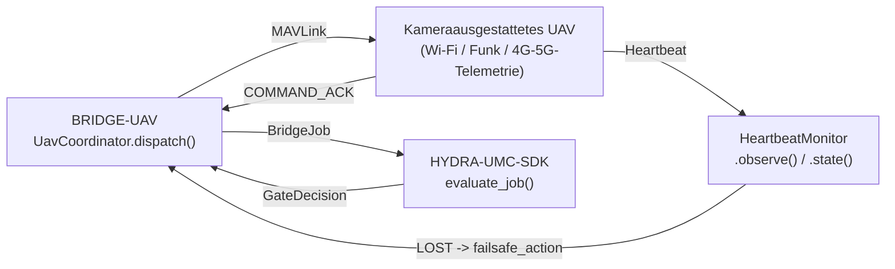

<!-- =============================================================================
HYDRA-UMC-BRIDGE-UAV - UAV coordination bridge
Copyright (C) JuanenRac (Electro Hobby 3D) <electrohobby3d@gmail.com>
GPL-3.0-or-later - see LICENSE
============================================================================= -->

<p align="center">
  
</p>

# 🚁 HYDRA-UMC-BRIDGE-UAV

<p align="center"><a href="README.md">🇺🇸 English</a> | <a href="README_spa.md">🇪🇸 Español</a> | <a href="README_fra.md">🇫🇷 Français</a> | <a href="README_ita.md">🇮🇹 Italiano</a> | 🇩🇪 <b>Deutsch</b> | <a href="README_zho.md">🇨🇳 简体中文</a> | <a href="README_jpn.md">🇯🇵 日本語</a> | <a href="README_por.md">🇵🇹 Português</a></p>

### 🔗 Abhängigkeitsfreie Koordinationsgrenze zwischen HYDRA-UMC und kameraausgestatteten UAVs

<p align="center">
  
  
  
  
  
  
</p>

---

> **Ehrlichkeitscheck - was heute wirklich läuft:** der abhängigkeitsfreie Flugantrags-Kern (`coordinator.py` mit `UavCoordinator`, das jeden Dispatch durch das echte `evaluate_job()` von `HYDRA-UMC-SDK` leitet), der deterministische Verbindungsverlust-Heartbeat-Watchdog (`heartbeat.py` mit `HeartbeatMonitor`) und der echte MAVLink-Befehlstransport (`mavlink_transport.py` mit `MavlinkFlightControl`) sind real und durch 84 bestehende Unit-Tests abgedeckt (`python tools/build_test.py` - `test_coordinator.py`, `test_heartbeat.py`, `test_mavlink_transport.py`, plus `test_mavlink_emulator.py`, das die Bridge gegen einen protokolltreuen, von Hand geschriebenen MAVLink-Autopilot-Emulator laufen lässt, keinen echten). Nichts davon wurde gegen eine echte `pymavlink`-Installation, eine echte Funk-/Telemetrieverbindung oder einen physischen UAV/Flugcontroller getestet - die eigene simulierte MAVLink-Verbindung von `test_mavlink_transport.py` ersetzt `pymavlink` vollständig (die echte Bibliothek muss für das Bestehen dieser Tests nicht einmal installiert sein), und es gibt noch keinen echten `run`-Befehl, weil noch kein realer MAVLink-/OSDK-Transport ausgewählt oder validiert wurde. Siehe „Aktueller Status & Nächste Schritte" weiter unten, das dies bereits klar sagt, sowie `CHANGELOG.md` für das, was bisher genau ausgeliefert wurde.

> **Stand von Sicherheit (Safety) und Security:** Dieses Ökosystem ist kein zertifiziertes Sicherheitssystem. Es gibt noch keinen Hardware-E-STOP-Pfad, keine von der Firmware durchgesetzten Grenzen oder Verriegelungen und keinen verifizierten Bewegungsbefehl; Firmware-Images werden mit CRC-32 und einer Ed25519-Signatur geprüft, und ein Release-Build verweigert die veröffentlichten Entwicklungsschlüssel (die Werkzeugköpfe und Erweiterungsplatinen hinter dem Relais laufen noch mit URTC-Bootloadern, die statt einer Signatur ein HMAC-SHA256 mit gemeinsamem Schlüssel verwenden); TLS und gegenseitiges TLS sind optional und standardmäßig aus; noch keine eigene Platine wurde bestückt oder getestet. Lesen Sie die [Sicherheitsbasis](https://github.com/JuanenRac/HYDRA-UMC-DOCS/blob/main/docs/SECURITY_BASELINE.md) und das [Bedrohungsmodell](https://github.com/JuanenRac/HYDRA-UMC-DOCS/blob/main/docs/THREAT_MODEL.md), bevor Sie sich für die Sicherheit einer Person auf eine Aussage hier verlassen.

---

## 📋 Auf einen Blick

| | |
|---|---|
| Version | `0.1.5` |
| Reifegrad | Funktionsfähig |
| Tests | 146 (`python tools/build_test.py`) |
| Technik | Python / MAVLink / HYDRA-UMC-SDK |
| Auf echter Hardware | Nur simuliert: gegen Emulatoren, Attrappen oder Simulatoren getestet; für diese Version ist kein Lauf auf echter Hardware vermerkt |

**Springe zu:** [Überblick](#-überblick) · [Architektur](#-architektur) · [Funktionen](#-funktionen) · [Sicherheit und Schutz](#-sicherheit-und-schutz) · [Schnittstellen](#-schnittstellen) · [Konfiguration](#-konfiguration) · [Schnellstart](#-schnellstart) · [Tests](#-tests) · [Fehlerbehebung](#-fehlerbehebung) · [Struktur des Repositorys](#-struktur-des-repositorys) · [Verwandte Projekte](#-verwandte-projekte)

## 🚦 Projektstatus

Jede Zeile ist ein Teil dieses Repositorys, und die Ampel sagt, wie weit er heute ist. Sie beruht auf dem, was das Repository zeigen kann (Tests, Builds, Läufe), nicht auf dem, was geplant ist.

🟢 Fertig und überprüft · 🟡 Funktioniert, mit bekannten Grenzen · 🟠 Teilweise fertig oder noch nicht überprüft · 🔴 Nicht gemacht oder funktioniert nicht

| Bereich | Stand | Was das hier bedeutet |
|---|---|---|
| Software | 🟡 | Funktioniert für seinen Hauptzweck; die Ehrlichkeitsprüfung oben nennt, was noch fehlt |
| Tests | 🟢 | 146 automatische Tests, bei jeder Änderung ausgeführt |
| Echte Hardware | 🟠 | Nur simuliert: gegen Emulatoren, Attrappen oder Simulatoren getestet; für diese Version ist kein Lauf auf echter Hardware vermerkt |
| Dokumentation | 🟢 | README in acht Sprachen, bei jeder Änderung gegen das Manifest geprüft |

## 🎯 Überblick

**HYDRA-UMC-BRIDGE-UAV** ist die High-Level-Koordinationsgrenze zwischen HYDRA-UMC und einer kameraausgestatteten Drohne (UAV), erreichbar über Wi-Fi, eine Funkverbindung oder eine Mobilfunk-Telemetrieverbindung (4G/5G). Sie validiert und leitet ein kleines, benanntes Vokabular von High-Level-Fluganfragen weiter (`ARM`, `TAKEOFF`, `GOTO_WAYPOINT`, `HOVER_AND_CAPTURE`, `RETURN_TO_LAUNCH`) und betreibt separat einen echten, verpflichtenden Heartbeat-Watchdog für Verbindungsverlust. Sie berechnet niemals Flugsteuerung oder Stabilisierung und kann HYDRA-UMC-SERVER, MCU-Grenzen, Watchdogs oder den E-STOP nicht umgehen. Heute ist der einzige Rückweg vom Fahrzeug die Befehlsbestätigung (`COMMAND_ACK`); Telemetrie wird nicht gelesen.

Sie gehört zur Familie **Mobile & Autonomous Bridges** neben `HYDRA-UMC-BRIDGE-DROIDS` und `HYDRA-UMC-BRIDGE-AMR` und teilt denselben `HYDRA-UMC-SDK`-Auftrags- und Sicherheitsvertrag wie die stationären **External Automation Bridges** (CNC, LASER, OPENPNP, PRINTER3D, ROS2).

## 🧩 Rolle in HYDRA-UMC

**HYDRA-UMC-BRIDGE-UAV** sitzt zwischen einem kameragestützten UAV (MAVLink) und der Roboterzelle. Er meldet, was diese Seite sagt, fragt vor jeder Hilfsarbeit das gemeinsame Tor und übernimmt nie die Hoheit der Maschine, mit der er sich abstimmt.

Er teilt mit jedem Bridge den Sicherheitsvertrag von `HYDRA-UMC-SDK`: Ein Auftrag wird nur angenommen, wenn das gemeinsame Tor `evaluate_job()` zustimmt, und das Tor schließt im Zweifel. Dieser Bridge hat keinen MQTT-Transport; er läuft als Befehl `hydra-umc-bridge-uav run`.

## 🏛️ Architektur

<p align="center">
  
</p>

<details>
<summary>Textversion des Diagramms (Mermaid)</summary>



</details>

**Warum es so gebaut ist**

* **Warum der Heartbeat-Watchdog ein eigenes Modul ist und nicht in den Koordinator eingefaltet wurde.** Verbindungsverlust ist ein echter, eigenständiger Fehlermodus, getrennt von "ist dieser Auftrag gerade erlaubt" — `HeartbeatMonitor` beantwortet "kann ich noch dem vertrauen, was ich zuletzt von diesem UAV gehört habe" unabhängig von einem bestimmten Auftrag, sodass es kontinuierlich geprüft werden kann (z. B. bei jedem Telemetrie-Takt) statt nur, wenn zufällig ein Auftrag versendet wird.
* **Warum `HeartbeatMonitor` ein explizites `now` entgegennimmt, statt eine echte Uhr zu lesen.** Die eingefügte Architektur-Notiz, von der dieses Projekt ausging, ist ausdrücklich, dass eine UAV-Brücke diesen Watchdog VERLANGT — der einzige Weg, sein exaktes Verhalten an der Timeout-Grenze zu beweisen (nicht nur "es läuft irgendwann ab") ohne eine instabile, langsame, auf echten Sleeps basierende Testsuite, ist, die Zeit zu einer expliziten, testbaren Eingabe zu machen.
* **Warum `COMPLETE` und `ABORT` beide zu `RETURN_TO_LAUNCH` aufgelöst werden.** Eine abgeschlossene Mission und ein Notfallabbruch haben für ein UAV dasselbe echte, korrekte Ergebnis: nach Hause kommen. Sie im statischen Plan auf denselben Anfragenamen zusammenzufassen (dedupliziert, nicht wiederholt) spiegelt das ehrlich wider, statt zwei verschiedene "Nachhause"-Verben zu erfinden.
* **Warum der eigene Heartbeat dieser Brücke ausdrücklich KEIN Ersatz für den eigenen Failsafe des Flugcontrollers ist.** Die Firmware von Pixhawk/PX4 und DJI implementiert bereits einen echten, nahezu zertifizierten Failsafe für Verbindungsverlust auf Funk-/Telemetrie-Ebene — der `HeartbeatMonitor` dieser Brücke ist ein Signal der Koordinationsschicht für den eigenen Zustand von HYDRA-UMC, und beide müssen unabhängig voneinander existieren; siehe das eigene Hardware-Abnahmegatter in `docs/BRIDGE_GUIDE.md`.
* **Warum es in diesem Repository noch keinen DJI-OSDK-Transportadapter gibt.** (Der MAVLink-Transport existiert, siehe oben.) Sich vor der Auswahl und dem Test auf das echte Befehls-/Telemetrieprotokoll eines bestimmten Flugcontrollers festzulegen, würde riskieren, Annahmen einzubauen, die dieser lokale, abhängigkeitsfreie Kern nicht verifizieren kann.
* **Wie das in den Rest des Ökosystems passt.** BRIDGE-UAV sitzt zwischen einem echten UAV und `HYDRA-UMC-SDK` → `HYDRA-UMC-SERVER` → MCU-Sicherheit — es ist eine Koordinationsgrenze, niemals ein Flugsteuerungsknoten, und es kann HYDRA-UMC-SERVER, MCU-Grenzen, Watchdogs oder den E-STOP nicht umgehen.

## ✨ Funktionen

* ✅ **Echter, abhängigkeitsfreier Flugantragskern:** `coordinator.py`s `UavCoordinator` hat keinerlei MAVLink-/Hersteller-SDK-Import — es ist bewusst reines Python, testbar auf jedem Host ohne angeschlossenes echtes UAV. *(implementiert, getestet in `tests/test_coordinator.py`)*
* ✅ **Echtes benanntes Flugantrags-Vokabular:** `ARM`, `TAKEOFF`, `GOTO_WAYPOINT`, `HOVER_AND_CAPTURE`, `RETURN_TO_LAUNCH`, `LAND` - niemals ein rohes Lage-/Schubkommando. Ein normales Missions-`COMPLETE` und ein Notfall-`ABORT` lösen beide in dieselbe echte `RETURN_TO_LAUNCH`-Anfrage auf. `LAND` ist echt und tatsächlich verschieden - `MAV_CMD_NAV_LAND` gegenüber `MAV_CMD_NAV_RETURN_TO_LAUNCH` von MAVLink (geprüft gegen den [offiziellen MAVLink-Common-Nachrichtensatz](https://mavlink.io/en/messages/common.html)) - für den echten Fall, den RTL allein nicht abdeckt: sofort absteigen, nicht erst nach Hause fliegen (z. B. Akku zu schwach oder Heimweg nicht sicher). `emergency_land_request()` stellt es als eigenständige Anfrage bereit, bewusst außerhalb des `JobPhase`-gesteuerten `dispatch()`-Ablaufs - gleiche Begründung wie beim getrennten Signal von `HeartbeatMonitor`. *(implementiert)*
* ✅ **Ein echter, verpflichtender Heartbeat-Watchdog für Verbindungsverlust:** `HeartbeatMonitor` ist eine deterministische, durch ein explizites `now` gesteuerte Failsafe-Zustandsmaschine — sie liest niemals eine echte Uhr, meldet `LOST` bereits bei der allerersten Prüfung, wenn nie ein Signal beobachtet wurde, und behandelt den exakten Timeout-Zeitpunkt noch als `OK` (erst ein echtes Überschreiten löst den konfigurierten `RETURN_TO_LAUNCH`-/`LAND`-Failsafe aus). *(implementiert, getestet mit einer vollständigen deterministischen Grenzfall-Suite in `tests/test_heartbeat.py`)*
* ✅ **Eigener Bodenstation-Heartbeat der Bridge:** `GcsHeartbeat` in `gcs_heartbeat.py` sendet in einem Hintergrund-Thread einen MAVLink-`HEARTBEAT` vom Typ `MAV_TYPE_GCS` (standardmäßig 1 Hz, `HYDRA_UAV_GCS_HEARTBEAT_HZ` zwischen 0,1 und 10, `0` für aus), damit der Failsafe des Autopiloten bei Verlust der Bodenstation auslöst, wenn die Bridge ausfällt. Ein nicht sendbarer Schlag wird gezählt und gemeldet, nie als Fehler ausgelöst. *(implementiert, gegen eine simulierte Verbindung in `tests/test_gcs_heartbeat.py` getestet; noch nicht mit einem echten Autopiloten erprobt)* `hydra-umc-bridge-uav run --connection <URL>` (oder `python -m hydra_umc_bridge_uav run ...`) öffnet die MAVLink-Verbindung und hält diesen Heartbeat am Laufen, gibt alle paar Sekunden eine Statuszeile aus und endet sauber bei Strg-C, SIGTERM oder `--duration`; mehr sendet es nicht an das Fahrzeug. Gegen einen Aufzeichner der Verbindung getestet; nie gegen einen echten Autopiloten oder SITL gelaufen.
* ✅ **Echtes gemeinsames Sicherheitsgatter:** jeder über `UavCoordinator.dispatch()` versendete Auftrag wird durch `evaluate_job()` aus dem `bridge_contract` von `HYDRA-UMC-SDK` bewertet, demselben Gatter, das jede Schwesterbrücke und HYDRA-UMC-SERVER verwenden; eine produktive Phase erfordert eine externe Maschine im Zustand `IDLE` und eine `READY`-HYDRA-UMC-Zelle, während `ABORT` auch während eines Fehlers anforderbar bleibt. *(implementiert)*
* ✅ **Ausfallsicheres Phasenrouting und statische Evidenz:** eine unbekannte zukünftige SDK-Phase wird abgelehnt. `inspect_request_plan.py` gibt den statischen Flugantrags-Plan des Schemas `1.1` aus (jetzt einschließlich der eigenständigen `LAND`-Anfrage), ohne einen Transport zu öffnen. *(implementiert, getestet)*
* ✅ **Echter MAVLink-Befehlstransport:** `mavlink_transport.py`s `MavlinkFlightControl` sendet einen bereits geprüften Dispatch als echtes `COMMAND_LONG`, abgebildet auf ein echtes, nummeriertes `MAV_CMD` (`MAV_CMD_NAV_TAKEOFF`/`MAV_CMD_DO_REPOSITION`/`MAV_CMD_NAV_LOITER_UNLIM`/`MAV_CMD_IMAGE_START_CAPTURE`/`MAV_CMD_NAV_RETURN_TO_LAUNCH`/`MAV_CMD_NAV_LAND`/`MAV_CMD_COMPONENT_ARM_DISARM`) - ein abgelehnter Dispatch erreicht das Netzwerk nie. *(implementiert, getestet in `tests/test_mavlink_transport.py`)*
* ✅ **Explizites Höhenbezugssystem, Flughüllkurve und Anfragen für den sicheren Zustand:** `GOTO_WAYPOINT` wird als `COMMAND_INT` gesendet (Position in Grad × 1e7, Kurs bleibt erhalten) mit explizitem `altitude_frame` - `"relative"` (Meter über dem Startpunkt, Standard) oder `"amsl"`; eine optionale `FlightEnvelope` (Obergrenze und Radius um den Startpunkt, vom Einsatz festgelegt) weist alles außerhalb ab; `RETURN_TO_LAUNCH`, `LAND` und das eigenständige `DISARM` (nie erzwungen) werden auch dann gesendet, wenn das Gate sie abgelehnt hat, und eine normale Rückkehr bei `COMPLETE` wird unabhängig von Zelle und Maschine akzeptiert; das Warten auf das `COMMAND_ACK` überspringt Bestätigungen anderer Befehle und anderer Systeme und behandelt `IN_PROGRESS` als noch nicht abgeschlossen. *(implementiert, getestet; das Drahtformat wird nur gegen den Emulator geprüft - nie gegen PX4/ArduPilot-SITL oder einen echten Autopiloten, und die Höhe bei `TAKEOFF` bleibt die eigene Referenz des Autopiloten, da ein `COMMAND_LONG` kein Bezugssystem trägt)*
* ✅ **Nicht-mutierender Build/Test:** `build-test.bat`/`.sh` kompilieren den Quellcode und führen deterministische Unit-Tests aus, ohne Version oder CHANGELOG zu ändern. *(implementiert, siehe Build und Veröffentlichung unten)*
* 🔜 **Ein DJI-OSDK-Transportadapter** (für eine Nicht-MAVLink-Plattform) — wird erst eingeführt, nachdem dieses SDK ausgewählt und getestet wurde. *(geplant)*
* ✅ **Beobachteter Maschinenzustand:** `UavCoordinator.dispatch()` nimmt den Zustand an, den der Autopilot gemeldet hat und den das gemeinsame Tor statt des im Auftrag stehenden `machine_state` verwendet (eine Nachricht, die jeder am Broker veröffentlichen kann); ohne Meldung gilt weiterhin die Angabe. *(implementiert, getestet in `tests/test_observed_state.py`)*

## 🔒 Sicherheit und Schutz

| Bedrohung | Abwehr | Wo |
|---|---|---|
| Ein Auftrag für eine Zelle oder Maschine, die nicht sicher ist | Jeder Auftrag läuft durch das gemeinsame Tor `evaluate_job()` des SDK, das im Zweifel schließt; der Bridge hat keine eigene Annahmelogik | SDK `bridge_contract` |
| Überlange oder unbegrenzte Auftragsdaten | Höchstens 32 Parameter, Schlüssel bis 64 Zeichen, Werte bis 1024, Bezeichner bis 128 (`MAX_PARAMETERS`, `MAX_PARAMETER_KEY_CHARS`, `MAX_PARAMETER_VALUE_CHARS`, `MAX_IDENTIFIER_CHARS`) | SDK `bridge_contract` |
| Ein wiederholter oder erneut gesendeter Befehl | Ein `IdempotencyStore` merkt sich jeden Schlüssel 24 Stunden und höchstens 10 000 Einträge; eine Wiederholung bekommt die erste Antwort, statt neu bewertet zu werden | SDK `job_intake` |
| Der Verlust der Verbindung zum Fahrzeug | `HeartbeatMonitor` ist ein deterministischer Zustandsautomat, dessen Rückfall `RETURN_TO_LAUNCH` oder `LAND` ist; der Bridge sendet standardmäßig mit 1 Hz seinen eigenen Bodenstation-HEARTBEAT (0,1 bis 10 Hz, `HYDRA_UAV_GCS_HEARTBEAT_HZ`) | `heartbeat.py`, `gcs_heartbeat.py` |
| Ein Befehl, den niemand freigegeben hat | `ARM`, `TAKEOFF`, `GOTO_WAYPOINT` und `HOVER_AND_CAPTURE` brauchen eine Freigabe; die Anforderungen für den sicheren Zustand außer `DISARM` werden immer angenommen | `simulated_uav.py` |
| Eine gefälschte MAVLink-Nachricht | MAVLink-2-Signierung mit einem 32-Byte-Schlüssel (Rohdatei oder 64 Hexzeichen) aus `--signing-key-file` oder `HYDRA_UMC_BRIDGE_UAV_SIGNING_KEY_FILE`; unsignierte Nachrichten werden abgelehnt, außer `--signing-allow-unsigned` wird für ein noch nicht signierendes Fahrzeug gesetzt | `mavlink_transport.py`, `cli.py` |
| Ein verwechselter Höhenbezug | Der Höhenbezug ist ausdrücklich: `relative` (`GLOBAL_RELATIVE_ALT_INT`) oder `amsl` (`GLOBAL_INT`) | `mavlink_transport.py` |

**Was er nie tut:** er setzt nur freigegebene Flugaufforderungen auf hoher Ebene in echte MAVLink-Befehle um (ARM/DISARM, TAKEOFF, DO_REPOSITION, LOITER_UNLIM, RTL, LAND, IMAGE_START_CAPTURE) und sendet nie rohe Bewegung.

## 🔌 Schnittstellen

Der Befehl `hydra-umc-bridge-uav run` (oder `python -m hydra_umc_bridge_uav run`) öffnet die MAVLink-Verbindung und hält den Bodenstation-Heartbeat aufrecht. Exit-Codes: `0` normal beendet, `1` die Verbindung ließ sich nicht öffnen oder kein Heartbeat senden, `2` falsche Option.

| Variable | Standard | Was sie festlegt |
|---|---|---|
| `--connection` | erforderlich | eine pymavlink-URL, zum Beispiel `udpin:0.0.0.0:14550` oder `/dev/ttyUSB0` |
| `--heartbeat-hz` | `1.0` | 0,1 bis 10; der Standard kommt aus `HYDRA_UAV_GCS_HEARTBEAT_HZ` |
| `--heartbeat-timeout` | `10.0` | Sekunden Wartezeit auf den ersten Heartbeat des Fahrzeugs |
| `--status-every`, `--duration` | `10.0`, `0` | Sekunden zwischen Statuszeilen (`0` gibt keine aus); nach so vielen Sekunden beenden (`0` läuft bis zum Stopp) |
| `--signing-key-file`, `--signing-allow-unsigned` | aus | Schlüsseldatei für die MAVLink-2-Signierung; unsignierte Nachrichten eines noch nicht signierenden Fahrzeugs annehmen |
| `--server-config` | aus | die `data/server-config.json` des Servers: ihr Abschnitt `mavlink` (in Server Admin gesetzt) liefert die Schlüsseldatei und den Schalter für unsignierte Nachrichten, wenn Option und Umgebung sie nicht vorgeben |

## ⚙️ Konfiguration

| Variable | Standard | Was sie festlegt |
|---|---|---|
| `HYDRA_UAV_GCS_HEARTBEAT_HZ` | `1.0` | Rate des Bodenstation-Heartbeats des Bridge, 0,1 bis 10; `0` schaltet ihn ab |
| `HYDRA_UMC_BRIDGE_UAV_SIGNING_KEY_FILE` | nicht gesetzt | Pfad des MAVLink-2-Signierschlüssels (32 Byte, roh oder 64 Hexzeichen); `--signing-key-file` hat Vorrang |
| `HYDRA_UMC_BRIDGE_UAV_SIGNING_ALLOW_UNSIGNED` | nicht gesetzt | `1` nimmt mit Schlüssel unsignierte Nachrichten an; `--signing-allow-unsigned` hat Vorrang, dann dies, dann die Server-Konfiguration |
| `HYDRA_UMC_BRIDGE_UAV_SERVER_CONFIG` | nicht gesetzt | Pfad der `data/server-config.json` des Servers (`--server-config` hat Vorrang) |

## 🚀 Schnellstart

Benötigt Python 3.11 oder neuer. Die Tests und die Build-Skripte erwarten `HYDRA-UMC-SDK` neben diesem Repository (`../HYDRA-UMC-SDK`) oder über `HYDRA_UMC_SDK_ROOT` angegeben.

Ohne Hardware ausprobieren (das prüft den ganzen Bridge gegen seine Emulatoren und Attrappen):

```bash
py -3 tools/build_test.py          # Windows
python3 tools/build_test.py         # Linux, macOS
```

Den Bridge starten (braucht das Extra `mavlink`: `pip install ".[mavlink]"`):

```bash
hydra-umc-bridge-uav run --connection udpin:0.0.0.0:14550 --signing-key-file ~/uav-signing.key
```

## 🧪 Tests

146 automatische `unittest`-Fälle laufen mit `python tools/build_test.py` (das kompiliert auch jedes Modul). Die Tests brauchen weder Hardware noch Netz noch optionale Pakete: Die, die `paho-mqtt`, `pyserial` oder eine Herstellerbibliothek bräuchten, nutzen einen Ersatz oder werden übersprungen, wenn das Paket fehlt.

| Testdatei | Tests | Was sie abdeckt |
|---|---|---|
| `test_coordinator.py`, `test_observed_state.py`, `test_simulated_uav.py` | - | Auftrag-zu-Flugaufforderung-Abbildung, der beobachtete Fahrzeugzustand, welche Anforderung aus welchem Zustand erlaubt ist |
| `test_mavlink_transport.py`, `test_mavlink_emulator.py`, `mavlink_emulator.py` | - | echte MAVLink-Befehle gegen Attrappen und einen Emulator, Höhenbezüge, Signierung |
| `test_heartbeat.py`, `test_gcs_heartbeat.py`, `test_cli.py`, `test_edge_cases.py` | - | der Rückfall bei Verbindungsverlust, der Bodenstation-Heartbeat, die Kommandozeile und ihre Exit-Codes, Randfälle |

Die CI führt `HYDRA_UMC_CI=1 python tools/ci_validate.py` aus; das prüft das Manifest, die Dokumente, die acht READMEs und die Bilder und führt die Tests mit einem SDK-Checkout aus.

## 🏗️ Build und Veröffentlichung

Erfordert Python 3.11+. `tools/build_test.py` erwartet, dass `HYDRA-UMC-SDK` als Schwesterverzeichnis (`../HYDRA-UMC-SDK`) ausgecheckt oder über die Umgebungsvariable `HYDRA_UMC_SDK_ROOT` angegeben ist.

```bash
# Windows
build-test.bat      # nur Validierung — keine Versions-/CHANGELOG-Änderung
build.bat            # Validiert und baut (Bauen ändert nie die Version)

# Linux/macOS
bash build-test.sh
bash build.sh
```

`build-test` kompiliert jedes Modul unter `src/` mit `py_compile` und führt die vollständige `unittest`-Suite aus (jede Datei `test_*.py` unter `tests/`) — deterministisch, ohne echte UAV-Verbindung, ohne Netzwerk und ohne Versions-/CHANGELOG-Änderung. `build` führt zuerst dieselbe Validierung aus und ruft nur bei Erfolg `tools/bump_version.py` auf, um die Version in `pyproject.toml`, `hydra-umc.project.json` und `CHANGELOG.md` zu synchronisieren. Es gibt noch keinen echten Hardware-`run`-Befehl — dafür sind ein validierter MAVLink-/OSDK-Transportadapter und ein echtes UAV erforderlich.

## 🩺 Fehlerbehebung

| Du siehst | Weil | Tu |
|---|---|---|
| `ModuleNotFoundError: hydra_umc_sdk` | Das SDK ist nicht installiert oder liegt nicht neben diesem Repository | `HYDRA-UMC-SDK` neben dieses Repository klonen oder `HYDRA_UMC_SDK_ROOT` setzen |
| exit code `1` | Die MAVLink-Verbindung ließ sich nicht öffnen oder es konnte kein Heartbeat gesendet werden | Prüfe `--connection` (URL oder serielles Gerät) und ob `pymavlink` installiert ist (`.[mavlink]`) |
| exit code `2` | Eine falsche Option, etwa eine Rate außerhalb von 0,1 bis 10 oder ein unlesbarer Signierschlüssel | Korrigiere die Option; die Schlüsseldatei muss genau 32 Byte enthalten (roh oder 64 Hexzeichen) |
| `"allowed": false` + `reason` | Das gemeinsame Tor oder eine Sperre hat den Befehl abgelehnt | Lies `reason` und behebe die Ursache; nicht blind wiederholen |

## 📂 Struktur des Repositorys

<p align="center">
  
</p>

<details>
<summary>Textversion des Baums</summary>

```text
HYDRA-UMC-BRIDGE-UAV/
├── src/hydra_umc_bridge_uav/
│   ├── coordinator.py             Auftrag zu einer benannten Flugaufforderung
│   ├── mavlink_transport.py       freigegebene Anforderungen als echte MAVLink-Befehle
│   ├── heartbeat.py               Zustandsautomat für Verbindungsverlust
│   ├── gcs_heartbeat.py           der eigene Bodenstation-HEARTBEAT
│   ├── cli.py                     `hydra-umc-bridge-uav run`
│   └── simulated_uav.py           welche Anforderung aus welchem Zustand erlaubt ist
├── tests/                         146 Tests, mit einem MAVLink-Emulator
├── docs/                          Bridge-Leitfaden
├── tools/                         Build- und Testläufer, Versionserhöhung, CI-Prüfer, README- und Bildgeneratoren samt Prüfungen
├── images/                        Banner und die Bilder der README
├── .github/                       CI-Workflow und Issue-Vorlagen
├── pyproject.toml                 Paketmetadaten und Abhängigkeiten
├── hydra-umc.project.json         Manifest: Version, Reifegrad, Familie
├── CHANGELOG.md                   was sich in jeder Version geändert hat
├── build.sh build.bat             Build-Skripte (ändern die Version nie)
├── build-test.sh build-test.bat   Build-Skripte (ändern die Version nie)
├── test.sh test.bat               führen die Tests aus
└── SECURITY.md SUPPORT.md CONTRIBUTING.md CODE_OF_CONDUCT.md LICENSE LICENSE.md
```

</details>

## 🗺️ Roadmap und bekannte Grenzen

**Bekannte Grenzen heute**

**Heute real:** Version `0.1.5`, funktionsfähig als abhängigkeitsfreier Koordinationskern (`UavCoordinator`) plus ein echter, vollständig grenzwertgetesteter Heartbeat-Watchdog für Verbindungsverlust (`HeartbeatMonitor`), ausfallsicherem Phasenrouting, einem statischen `plan-only`-Flugantragsschema, einem echten MAVLink-Befehlstransport (`MavlinkFlightControl`), der jede Anfrage auf ihr echtes, nummeriertes `MAV_CMD` abbildet - das Bewaffnen erfordert jetzt das buchstäbliche Boolesche `confirm_arm is True` (niemals einen bloß wahrheitswertigen Wert wie die Zeichenkette `'false'`), jeder numerische Flugparameter wird vor jeder Endlichkeits-/Bereichsprüfung als echte, nicht-boolesche Zahl geprüft, und ein gesendeter Befehl wird erst bestätigt, sobald sein echtes `COMMAND_ACK` mit `MAV_RESULT_ACCEPTED` eintrifft -, sowie nicht-mutierenden Build-Test-Skripten, die in CI mit SDK-Checkout eingebunden sind.

**Integrationsgrenze:** diese Brücke ist ausschließlich eine Koordinationsgrenze — sie ist kein Flugsteuerungsknoten und kann HYDRA-UMC-SERVER, MCU-Grenzen, Watchdogs oder den E-STOP nicht umgehen; jeder versendete Auftrag durchläuft weiterhin dasselbe gemeinsame Gatter, das jede Schwesterbrücke verwendet. Das eigene Failsafe-Signal von `HeartbeatMonitor` ist eine Angelegenheit der Koordinationsschicht, niemals ein Ersatz für den eigenen, unabhängigen Failsafe des Flugcontrollers bei Verbindungsverlust.

**Noch offen:** es wurde noch kein echter MAVLink- (Pixhawk/PX4) oder DJI-OSDK-Transport und kein physisches UAV validiert — ein echter Adapter wird erst eingeführt, nachdem ein bestimmter Flugcontroller/SDK ausgewählt und getestet wurde.

## 🌍 Sprachen

Diese README und die Dokumente des Repositorys gibt es in acht Sprachen: Englisch, Spanisch, Deutsch, Französisch, Italienisch, Japanisch, Chinesisch und Portugiesisch (Portugal). Sie entstehen gemeinsam, und die CI prüft, dass die acht Dateien dieselben Abschnitte und dieselben Links haben. Dieses Repository hat weder eine eigene Oberfläche noch einen eigenen Meldungskatalog, es gibt also keine Oberflächentexte zu übersetzen.

## 🔗 Verwandte Projekte

Dieses Projekt ist Teil des HYDRA-UMC-Robotik-Ökosystems desselben Autors (JuanenRac / Electro Hobby 3D). Gut zu wissen, da eine Anfrage eigentlich eines dieser Projekte betreffen könnte statt dieses Repositorys.

**Übergeordnetes Projekt**
- **[HYDRA-UMC-SERVER](https://github.com/JuanenRac/HYDRA-UMC-SERVER)** — das reale Headless-Backend (REST/WebSocket), mit dem jeder Steuerungsclient tatsächlich spricht; die authentifizierte Ökosystemgrenze, an die diese Bridge berichtet, sobald jeder Befehl die eigene lokale Sicherheitsschranke dieser Bridge durchlaufen hat.

**Geschwisterprojekte** — sprechen ebenfalls mit der eigenen API von HYDRA-UMC-SERVER, jeweils als eigener Client
- **[HYDRA-UMC-STUDIO](https://github.com/JuanenRac/HYDRA-UMC-STUDIO)** — Web-Steuerungs-Dashboard mit Echtzeit-3D-Visualisierung mehrerer Roboter.
- **[HYDRA-UMC-SUITE](https://github.com/JuanenRac/HYDRA-UMC-SUITE)** — Desktop-Schwarmleitstand (PySide6) für mehrere Server gleichzeitig, verpackt als eigenständige ausführbare Datei.
- **[HYDRA-UMC-ANDROID-CONTROL](https://github.com/JuanenRac/HYDRA-UMC-ANDROID-CONTROL)** — native Android-Steuerungs-App mit biometrischem Login und einer gekoppelten Wear-OS-Begleit-App.
- **[HYDRA-UMC-IOS-CONTROL](https://github.com/JuanenRac/HYDRA-UMC-IOS-CONTROL)** — iOS/iPadOS-Steuerungs-App (Flutter) mit Echtzeit-WebSocket-Synchronisierung.
- **[HYDRA-UMC-DSI](https://github.com/JuanenRac/HYDRA-UMC-DSI)** — native Touch-UI für das eingebaute 7"-DSI-Touchscreen, direkt auf dem CM5 eingebettet.
- **[HYDRA-UMC-BRIDGE-AMR](https://github.com/JuanenRac/HYDRA-UMC-BRIDGE-AMR)** — Koordinationsschranke für AGV-/AMR-Flotten über einen VDA-5050-MQTT-Publisher (nur gegen eine emulierte Flotte getestet) — eine von 3 mobilen Flotten-Bridges des Ökosystems.
- **[HYDRA-UMC-BRIDGE-CNC](https://github.com/JuanenRac/HYDRA-UMC-BRIDGE-CNC)** — High-Level-Koordinator für CNC-Zellen mit GRBL-Status-/Steuerbyte-Zugriff (nur gegen einen Emulator getestet).
- **[HYDRA-UMC-BRIDGE-DROIDS](https://github.com/JuanenRac/HYDRA-UMC-BRIDGE-DROIDS)** — Koordinationsschranke für laufende/humanoide Droiden, mit einem Boston-Dynamics-Spot-Befehlssender (nur gegen einen Emulator getestet) — eine von 3 mobilen Flotten-Bridges des Ökosystems.
- **[HYDRA-UMC-BRIDGE-LASER](https://github.com/JuanenRac/HYDRA-UMC-BRIDGE-LASER)** — Koordinator für Laserzellen, liest 3 Schlüssel-/Gehäuse-/Verriegelungs-GPIO-Signale (nur gegen einen simulierten Chip getestet; kann keinen Laser scharfschalten oder auslösen).
- **[HYDRA-UMC-BRIDGE-OPENPNP](https://github.com/JuanenRac/HYDRA-UMC-BRIDGE-OPENPNP)** — sicherer High-Level-Koordinator für den Leiterplattenfluss von OpenPnP Pick-and-Place.
- **[HYDRA-UMC-BRIDGE-PRINTER3D](https://github.com/JuanenRac/HYDRA-UMC-BRIDGE-PRINTER3D)** — sichere Koordinationsschranke für Moonraker/Klipper-3D-Drucker, mit echten gesicherten Job-Befehlen.
- **[HYDRA-UMC-BRIDGE-ROS2](https://github.com/JuanenRac/HYDRA-UMC-BRIDGE-ROS2)** — Koordinator mit einem träge importierten rclpy-ROS-2-Transport (noch nicht gegen eine ROS-2-Installation ausgeführt).

**Direkt verwandt**
- **[HYDRA-UMC-SDK](https://github.com/JuanenRac/HYDRA-UMC-SDK)** — der gemeinsame JSON-Schema-Vertrag und die Software-Auftragsschranke, gegen die jede Bridge ihre Befehle validiert (keine zertifizierte Sicherheitsfunktion).
- **[HYDRA-UMC-CONNECTOR-HUB](https://github.com/JuanenRac/HYDRA-UMC-CONNECTOR-HUB)** — deklaratives Adapter-Manifest-Register und Validator für Konnektoren externer Maschinen; erweitert die eigene Vertragsidee des SDK auf externe Maschinen, ohne die Industrie-Gateway-Projekte zu ersetzen.

**Ebenfalls Teil des Ökosystems**

*Kern-Hardware & Plattform*
- **[HYDRA-UMC](https://github.com/JuanenRac/HYDRA-UMC)** — der Entwurf des Motherboards des Roboterarms: CM5-Host + Dual-Core-STM32H745, gedacht zur Koordination von bis zu 8 Werkzeugarmen über CAN-OTA/SPI-OTA (Firmware in einer frühen Phase; noch keine bestückte Platine).
- **[HYDRA-UMC-OS](https://github.com/JuanenRac/HYDRA-UMC-OS)** — reproduzierbare Raspberry-Pi-OS-Produktschicht für den CM5: schreibgeschützter Agent, validierte Konfiguration/Profile, WiFi-Ersteinrichtung.

*Kern-Backend & Clients*
- **[HYDRA-UMC-EDITOR-URDF](https://github.com/JuanenRac/HYDRA-UMC-EDITOR-URDF)** — grafischer Desktop-URDF-Ersteller/-Editor, der fertige Modelle in STUDIOs eigenen Katalog überträgt.
- **[HYDRA-UMC-EDITOR-STL](https://github.com/JuanenRac/HYDRA-UMC-EDITOR-STL)** — Desktop-STL-Modelleditor, der echte Teile im selben Modellkatalog transformiert/ersetzt/entfernt/hinzufügt, den auch HYDRA-UMC-EDITOR-URDF bearbeitet.

*URTC-Werkzeugplattform*
- **[URTC](https://github.com/JuanenRac/URTC)** — Firmware für die physische Universal-Robot-Tool-Controller-Platine, 25+ Werkzeugprofile über CAN-Bus.
- **[URTC-FLASHER](https://github.com/JuanenRac/URTC-FLASHER)** — Desktop-GUI-Flash-Tool für URTC-Platinen, CAN-OTA plus Full-Chip-SWD/JTAG.
- **[URTC-TESTER](https://github.com/JuanenRac/URTC-TESTER)** — Desktop-Live-CAN-Bus-Diagnosetool für URTC-Platinen, ein Panel pro Werkzeugprofil.
- **[URTC-WEB-STUDIO](https://github.com/JuanenRac/URTC-WEB-STUDIO)** — browserbasierte Alternative zu URTC-TESTER über die Web-Serial-API, ohne lokale Installation.
- **[URTC-GATEWAY](https://github.com/JuanenRac/URTC-GATEWAY)** — Gateway vor dem CAN-Bus von URTC: Liste erlaubter Kennungen, Ratenbegrenzung und Sitzungsschlüssel; Software auf dem Computer getestet, noch nicht an einem echten Bus.

*Vision-KI-Knoten (Hailo-8)*
- **[HYDRA-UMC-VISION-NODE](https://github.com/JuanenRac/HYDRA-UMC-VISION-NODE)** — Integrationsknoten für die Hailo-8-Vision-Pipeline, mit einer echten stufenweisen Hardware-Bereitschaftsprüfung.
- **[HYDRA-UMC-DETECTION-HEF](https://github.com/JuanenRac/HYDRA-UMC-DETECTION-HEF)** — echte Registry für kompilierte Modelle mit Hailo-Architektur-/Prüfsummen-Safe-Load-Verifizierung.
- **[HYDRA-UMC-VISION-STREAMER](https://github.com/JuanenRac/HYDRA-UMC-VISION-STREAMER)** — echter GStreamer-Pipeline- + MediaMTX-Konfigurationsgenerator mit einer echten HailoRT-Integrationsschranke.
- **[HYDRA-UMC-VISUAL-SERVOING-API](https://github.com/JuanenRac/HYDRA-UMC-VISUAL-SERVOING-API)** — Position-Based-Visual-Servoing-Korrekturgesetz mit Freigabe abhängig vom Zonenstatus; noch keine Posenschätzung per Kamera.
- **[HYDRA-UMC-SAFETY-ZONES](https://github.com/JuanenRac/HYDRA-UMC-SAFETY-ZONES)** — v0-Logik für Zonenverletzung, Kalibrierungsaktualität und E-STOP-Anforderung, die Objektpositionen aus einer Datei nimmt; kein Detektor speist sie, und noch kein physischer E-STOP ist angeschlossen.

*Kognitiver KI-Knoten (Hailo-10)*
- **[HYDRA-UMC-COGNITIVE-NODE](https://github.com/JuanenRac/HYDRA-UMC-COGNITIVE-NODE)** — Integrationsknoten für die Hailo-10-Cognitive-Pipeline (LLM-/VLA-/Sprach-Orchestrierung).
- **[HYDRA-UMC-VLA-ENGINE](https://github.com/JuanenRac/HYDRA-UMC-VLA-ENGINE)** — echte Aktions-Token-Kodierung/-Dekodierung und Trajektoriengenerierung für ein Vision-Language-Action-Modell.
- **[HYDRA-UMC-VOICE-UI](https://github.com/JuanenRac/HYDRA-UMC-VOICE-UI)** — echtes Sprach-Frontend (VAD + Intent-Parser) mit einem begrenzten, bestätigungsgesicherten Watch-Relay.
- **[HYDRA-UMC-SEMANTIC-PLANNER](https://github.com/JuanenRac/HYDRA-UMC-SEMANTIC-PLANNER)** — echte regelbasierte Aufgabenzerlegung und semantische Fehlerbehebung über MCU-Fehlercodes.
- **[HYDRA-UMC-DOCS-QA](https://github.com/JuanenRac/HYDRA-UMC-DOCS-QA)** — echte, nur auf der Standardbibliothek basierende TF-IDF-Dokumentensuche über die eigenen Markdown-Dokumente dieses Ökosystems.
- **[HYDRA-UMC-LOCAL-TECHNICIAN](https://github.com/JuanenRac/HYDRA-UMC-LOCAL-TECHNICIAN)** — lokaler, richtlinien-gesteuerter KI-Wartungstechniker für das Ökosystem selbst - beobachtet, diagnostiziert und schlägt Korrekturen vor; die zwei höchsten Risikostufen sind absichtlich noch nicht implementiert.

*Orchestrierung & Schwarm*
- **[HYDRA-UMC-ORCHESTRATOR](https://github.com/JuanenRac/HYDRA-UMC-ORCHESTRATOR)** — Integrationsknoten mit einem echten gRPC/Protobuf-Health-Report-Vertrag und einer Missions-Zustandsmaschine.
- **[HYDRA-UMC-JOB-DISPATCHER](https://github.com/JuanenRac/HYDRA-UMC-JOB-DISPATCHER)** — echte prioritätsbasierte Job-Queue mit Deduplizierung, über eine echte HTTP-API.
- **[HYDRA-UMC-NODE-HEALING](https://github.com/JuanenRac/HYDRA-UMC-NODE-HEALING)** — echter gRPC-basierter Flotten-Health-Watchdog mit Retry/Backoff und Identitäts-Mismatch-Erkennung.
- **[HYDRA-UMC-PATH-PLANNER-3D](https://github.com/JuanenRac/HYDRA-UMC-PATH-PLANNER-3D)** — echter RRT-basierter 3D-Pfadplaner mit echter Hindernis-/Arbeitsraum-Kollisionsvalidierung.
- **[HYDRA-UMC-SWARM-SYNC](https://github.com/JuanenRac/HYDRA-UMC-SWARM-SYNC)** — echte CRDT-LWW-Element-Map-Zustandssynchronisation, eigenschaftsgetestet auf Multi-Zellen-Konvergenz.

*Digitaler Zwilling & Simulation*
- **[HYDRA-UMC-TWIN](https://github.com/JuanenRac/HYDRA-UMC-TWIN)** — Integrationsknoten für die Digital-Twin-Engine, mit einem echten Versionskompatibilitäts-Sync-Vertrag.
- **[HYDRA-UMC-HIL-BRIDGE](https://github.com/JuanenRac/HYDRA-UMC-HIL-BRIDGE)** — Hardware-in-the-Loop-Router mit einer Software-Kollisionsverriegelung zwischen Simulation und echter Hardware (ohne echte Hardware getestet).
- **[HYDRA-UMC-PHYSICS-REPLICA](https://github.com/JuanenRac/HYDRA-UMC-PHYSICS-REPLICA)** — echte Vorwärtskinematik und Gelenkgrenzenvalidierung über eine echte URDF-Teilmenge.
- **[HYDRA-UMC-SYNTHETIC-DATA-GEN](https://github.com/JuanenRac/HYDRA-UMC-SYNTHETIC-DATA-GEN)** — echter prozeduraler 2D-Szenengenerator mit YOLO/COCO-Annotationsexport.

*Daten & Analytik*
- **[HYDRA-UMC-DATALAKE](https://github.com/JuanenRac/HYDRA-UMC-DATALAKE)** — echter sqlite3-gestützter Zeitreihenspeicher mit einer echten Ingest-/Abfrage-HTTP-API.
- **[HYDRA-UMC-ANOMALY-DETECTOR](https://github.com/JuanenRac/HYDRA-UMC-ANOMALY-DETECTOR)** — echter FFT- + statistischer Basislinien-Anomaliedetektor mit Drift-Überwachung.
- **[HYDRA-UMC-PRODUCTION-REPORTS](https://github.com/JuanenRac/HYDRA-UMC-PRODUCTION-REPORTS)** — echte OEE-/Verfügbarkeitsberechnung über den DATALAKE-Verlauf, mit reproduzierbarem CSV-Export.
- **[HYDRA-UMC-TELEMETRY-COLLECTOR](https://github.com/JuanenRac/HYDRA-UMC-TELEMETRY-COLLECTOR)** — echte CAN/WebSocket-Ingestion-Pipeline in DATALAKE, mit Sequenz-Deduplizierung.

*Industrie-Gateway*
- **[HYDRA-UMC-GATEWAY-INDUSTRIAL](https://github.com/JuanenRac/HYDRA-UMC-GATEWAY-INDUSTRIAL)** — Integrationsknoten, der zu Industrieprotokollen weiterleitet, mit einer echten Befehls-Allowlist-/Backpressure-Schicht.
- **[HYDRA-UMC-OPCUA-SERVER](https://github.com/JuanenRac/HYDRA-UMC-OPCUA-SERVER)** — echter OPC-UA-Adressraum, verifiziert mit einer echten Binärprotokoll-Client-Session.
- **[HYDRA-UMC-MQTT-BROKER](https://github.com/JuanenRac/HYDRA-UMC-MQTT-BROKER)** — echter MQTT-Broker mit optionaler Pro-Client-Authentifizierung und Topic-ACLs.
- **[HYDRA-UMC-MTCONNECT-ADAPTER](https://github.com/JuanenRac/HYDRA-UMC-MTCONNECT-ADAPTER)** — echte MTConnect-`/probe`- und `/current`-XML-Endpunkte mit Degraded-Mode-Ausgabe.

*Ergänzende Tools & Ökosystembetrieb*
- **[HYDRA-UMC-DASHBOARD-AI](https://github.com/JuanenRac/HYDRA-UMC-DASHBOARD-AI)** — Smart-Summaries- und Anomaly-Highlighting-Panels über DATALAKE/ANOMALY-DETECTOR, mit einem ehrlichen statistischen Fallback.
- **[HYDRA-UMC-TOOL-CLI](https://github.com/JuanenRac/HYDRA-UMC-TOOL-CLI)** — Flotten-CLI mit einem echten, stabilen Exit-Code-Vertrag, ein echter Live-Client der eigenen API von HYDRA-UMC-SERVER.
- **[HYDRA-UMC-WATCH](https://github.com/JuanenRac/HYDRA-UMC-WATCH)** — WearOS-Begleit-App mit haptischen Alarmmustern und einem Sprach-Relay zum gekoppelten Telefon (noch nicht auf einer physischen Uhr ausgeführt).
- **[URTC-SMART-RACK](https://github.com/JuanenRac/URTC-SMART-RACK)** — Firmware für ein Platinenmontagegestell mit echter Werkzeug-ID-Dekodierung und Smart-Idle-Vorheizlogik.
- **[URTC-VISION-TOOL](https://github.com/JuanenRac/URTC-VISION-TOOL)** — Firmware plus ein echter Python-Vision-Begleiter für einen Thermal-/RGB-Inspektionswerkzeugkopf.
- **[HYDRA-UMC-UPDATER](https://github.com/JuanenRac/HYDRA-UMC-UPDATER)** — administratives Desktop-Tool, das jedes Repository in diesem Ökosystem entdeckt, klont und aktualisiert.
- **[HYDRA-UMC-OS-REBUILDER](https://github.com/JuanenRac/HYDRA-UMC-OS-REBUILDER)** — Windows/Linux-Desktop-Tool, das ein flashbereites CM5-Image baut, vorgeladen mit den aktuellsten Versionen des Ökosystems, mit Ersteinrichtungs-Konfiguration für WLAN/Benutzer/SSH im Stil von Raspberry Pi Imager.
- **[HYDRA-UMC-OPS-AGENT](https://github.com/JuanenRac/HYDRA-UMC-OPS-AGENT)** — Wartungsvorfall-Koordinator: eine Edge-Rolle mit niedrigem Privileg sammelt einen bereinigten Inventar-/Gesundheits-Snapshot, eine Control-Plane-Rolle rendert ihn schreibgeschützt und bittet einen KI-Anbieter um einen Diagnosevorschlag - wendet nie einen Patch an und stellt nie etwas bereit.
- **[HYDRA-UMC-DEV-SERVER](https://github.com/JuanenRac/HYDRA-UMC-DEV-SERVER)** — reproduzierbarer Entwicklungshost (Raspberry Pi 5 / CM5), der den Quellcode des Ökosystems vorhält und begrenzte Build-/Test-Aufgaben über eine dauerhafte Warteschlange ausführt; eine dedizierte Entwicklerrolle, ausdrücklich kein operativer CM5.

## 📚 Dokumentation

Hier steht mehr:

* [docs/BRIDGE_GUIDE.md](docs/BRIDGE_GUIDE.md) - Umfang, Flugaufforderungen, MAVLink, Signierung, die Rückfallebene, Skripte
* [Sicherheitsgrundlage des Ökosystems](https://github.com/JuanenRac/HYDRA-UMC-DOCS/blob/main/docs/SECURITY_BASELINE.md)
* [Bedrohungsmodell des Ökosystems](https://github.com/JuanenRac/HYDRA-UMC-DOCS/blob/main/docs/THREAT_MODEL.md)
* [Änderungsprotokoll dieses Repositorys](CHANGELOG.md)
* [Lizenz dieses Repositorys](LICENSE.md)

## 🤝 Mitwirken und Community

* Führe vor einem Pull Request `HYDRA_UMC_CI=1 py -3 tools/ci_validate.py` (oder `HYDRA_UMC_CI=1 python3 tools/ci_validate.py`) aus: Es muss `CI_VALIDATION=PASS` ausgeben. Führe dafür nicht `build.sh` oder `build.bat` aus; Bauen ist keine Prüfung.
* Die acht READMEs entstehen aus einer einzigen Quelle in HYDRA-UMC-DOCS; bearbeite sie nicht von Hand. Ändere die Quelle und schreibe sie mit `tools/make_readmes.py` neu.
* Behaupte in einer README nichts, was nicht gelaufen ist: Schreibe „simuliert“ oder „nicht auf Hardware erprobt“, wo das stimmt.
* Siehe [CONTRIBUTING.md](CONTRIBUTING.md), den [Verhaltenskodex](CODE_OF_CONDUCT.md), [SECURITY.md](SECURITY.md) und [SUPPORT.md](SUPPORT.md).

## 👤 AUTOR

**JuanenRac (Electro Hobby 3D)** · electrohobby3d@gmail.com

## 📜 LIZENZ

GPL-3.0-or-later - [LICENSE](LICENSE).
