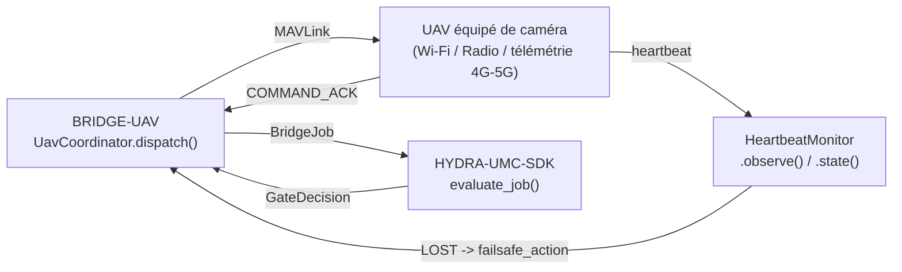

<!-- =============================================================================
HYDRA-UMC-BRIDGE-UAV - UAV coordination bridge
Copyright (C) JuanenRac (Electro Hobby 3D) <electrohobby3d@gmail.com>
GPL-3.0-or-later - see LICENSE
============================================================================= -->

<p align="center">
  
</p>

# 🚁 HYDRA-UMC-BRIDGE-UAV

<p align="center"><a href="README.md">🇺🇸 English</a> | <a href="README_spa.md">🇪🇸 Español</a> | 🇫🇷 <b>Français</b> | <a href="README_ita.md">🇮🇹 Italiano</a> | <a href="README_deu.md">🇩🇪 Deutsch</a> | <a href="README_zho.md">🇨🇳 简体中文</a> | <a href="README_jpn.md">🇯🇵 日本語</a> | <a href="README_por.md">🇵🇹 Português</a></p>

### 🔗 Frontière de coordination sans dépendance entre HYDRA-UMC et les UAV équipés de caméra

<p align="center">
  
  
  
  
  
  
</p>

---

> **Vérification d'honnêteté - ce qui fonctionne réellement aujourd'hui :** le cœur de requêtes de vol sans dépendance (`coordinator.py` avec `UavCoordinator`, faisant passer chaque envoi par le propre `evaluate_job()` de `HYDRA-UMC-SDK`), le chien de garde déterministe de perte de liaison par heartbeat (`heartbeat.py` avec `HeartbeatMonitor`), et le vrai transport de commandes MAVLink (`mavlink_transport.py` avec `MavlinkFlightControl`) sont réels et couverts par 84 tests unitaires qui passent (`python tools/build_test.py` - `test_coordinator.py`, `test_heartbeat.py`, `test_mavlink_transport.py`, plus `test_mavlink_emulator.py` qui fait tourner le bridge contre un émulateur de pilote automatique MAVLink fidèle au protocole mais écrit à la main, pas un vrai). Rien de tout cela n'a été testé contre une vraie installation `pymavlink`, une vraie liaison radio/télémétrie, ou un UAV/contrôleur de vol physique - la fausse connexion MAVLink propre à `test_mavlink_transport.py` remplace entièrement `pymavlink` (la vraie bibliothèque n'a même pas besoin d'être installée pour que ces tests passent), et il n'existe pas encore de commande `run` en direct car aucun transport MAVLink/OSDK réel n'a été choisi ni validé. Voir « Feuille de route et limites connues » ci-dessous, qui le dit déjà clairement, et `CHANGELOG.md` pour ce qui a été exactement livré jusqu'à présent.

> **État de la sûreté et de la cybersécurité :** cet écosystème n'est pas un système de sécurité certifié. Il n'existe pas encore de chaîne d'E-STOP matérielle, ni de limites ou de verrouillages imposés par le firmware, ni de commande de mouvement vérifiée ; les images de firmware sont contrôlées par CRC-32 et une signature Ed25519, et une compilation de version refuse les clés de développement publiées (les têtes d'outil et les cartes d'extension derrière le relais utilisent encore les chargeurs d'URTC, qui prennent un HMAC-SHA256 à clé partagée au lieu d'une signature) ; TLS et TLS mutuel sont optionnels et désactivés par défaut ; aucune carte propre n'a encore été assemblée ni testée. Lisez la [base de sécurité](https://github.com/JuanenRac/HYDRA-UMC-DOCS/blob/main/docs/SECURITY_BASELINE.md) et le [modèle de menaces](https://github.com/JuanenRac/HYDRA-UMC-DOCS/blob/main/docs/THREAT_MODEL.md) avant de vous fier à une affirmation d'ici pour la sécurité d'une personne.

---

## 📋 En un coup d'œil

| | |
|---|---|
| Version | `0.1.5` |
| Maturité | Fonctionnel |
| Tests | 139 (`python tools/build_test.py`) |
| Technologie | Python / MAVLink / HYDRA-UMC-SDK |
| Sur matériel réel | Simulé seulement : testé avec des émulateurs, des doubles de test ou des simulateurs ; aucune exécution sur du matériel réel n'est consignée pour cette version |

**Aller à :** [Présentation](#-présentation) · [Architecture](#-architecture) · [Fonctionnalités](#-fonctionnalités) · [Sécurité et protection](#-sécurité-et-protection) · [Interfaces](#-interfaces) · [Configuration](#-configuration) · [Démarrage rapide](#-démarrage-rapide) · [Tests](#-tests) · [Dépannage](#-dépannage) · [Structure du dépôt](#-structure-du-dépôt) · [Projets liés](#-projets-liés)

## 🚦 État du projet

Chaque ligne est une partie de ce dépôt et le feu dit où elle en est aujourd'hui. Elle est écrite d'après ce que le dépôt peut montrer (tests, compilations, exécutions), pas d'après ce qui est prévu.

🟢 Fait et vérifié · 🟡 Fonctionne, avec des limites connues · 🟠 À moitié fait ou pas encore vérifié · 🔴 Pas fait ou ne fonctionne pas

| Domaine | État | Ce que cela veut dire ici |
|---|---|---|
| Logiciel | 🟡 | Fonctionne pour son usage principal ; la vérification d'honnêteté ci-dessus liste ce qui manque encore |
| Tests | 🟢 | 139 tests automatiques, exécutés à chaque modification |
| Matériel réel | 🟠 | Simulé seulement : testé avec des émulateurs, des doubles de test ou des simulateurs ; aucune exécution sur du matériel réel n'est consignée pour cette version |
| Documentation | 🟢 | README en huit langues, vérifié par rapport au manifeste à chaque modification |

## 🎯 Présentation

**HYDRA-UMC-BRIDGE-UAV** est la frontière de coordination haut niveau entre HYDRA-UMC et un drone équipé de caméra (UAV), accessible par Wi-Fi, une liaison radio ou une connexion de télémétrie cellulaire (4G/5G). Elle valide et transmet un vocabulaire réduit et nommé de requêtes de vol haut niveau (`ARM`, `TAKEOFF`, `GOTO_WAYPOINT`, `HOVER_AND_CAPTURE`, `RETURN_TO_LAUNCH`), et exécute séparément un watchdog réel et obligatoire de perte de liaison (heartbeat). Elle ne calcule jamais le contrôle de vol ni la stabilisation, et elle ne peut pas contourner HYDRA-UMC-SERVER, les limites du MCU, les watchdogs ou l'E-STOP. Aujourd'hui, le seul chemin de retour depuis le véhicule est l'accusé de réception de la commande (`COMMAND_ACK`) ; aucune télémétrie n'est lue.

Il appartient à la famille **Mobile & Autonomous Bridges**, aux côtés de `HYDRA-UMC-BRIDGE-DROIDS` et `HYDRA-UMC-BRIDGE-AMR`, et partage le même contrat de tâches et de sécurité `HYDRA-UMC-SDK` que les **External Automation Bridges** stationnaires (CNC, LASER, OPENPNP, PRINTER3D, ROS2).

## 🧩 Rôle dans HYDRA-UMC

**HYDRA-UMC-BRIDGE-UAV** se place entre un UAV équipé d'une caméra (MAVLink) et la cellule de robots. Il rapporte ce que dit ce côté, interroge la porte partagée avant tout travail auxiliaire et ne prend jamais l'autorité de la machine avec laquelle il coordonne.

Il partage avec tous les bridges le contrat de sécurité de `HYDRA-UMC-SDK` : un travail n'est accepté que si la porte partagée `evaluate_job()` le permet, et cette porte échoue en position fermée. Ce bridge n'a pas de transport MQTT ; il s'exécute comme la commande `hydra-umc-bridge-uav run`.

## 🏛️ Architecture

<p align="center">
  
</p>

<details>
<summary>Version texte du diagramme (Mermaid)</summary>



</details>

**Pourquoi il est construit ainsi**

* **Pourquoi le watchdog de heartbeat est son propre module, et non intégré au coordinateur.** La perte de liaison est un mode de défaillance réel et distinct de « cette tâche est-elle autorisée maintenant » — `HeartbeatMonitor` répond à « puis-je encore faire confiance à la dernière information reçue de cet UAV », indépendamment de toute tâche particulière, si bien qu'il peut être vérifié en continu (par ex. à chaque trame de télémétrie) plutôt que seulement lorsqu'une tâche est justement envoyée.
* **Pourquoi `HeartbeatMonitor` reçoit un `now` explicite plutôt que de lire une horloge réelle.** La note d'architecture collée dont ce projet est parti est explicite : un pont UAV EXIGE ce watchdog — la seule façon de démontrer son comportement exact à la limite du délai d'expiration (pas seulement « il finit par expirer ») sans une suite de tests lente et instable fondée sur de vraies pauses (`sleep`) est de faire du temps une entrée explicite et testable.
* **Pourquoi `COMPLETE` et `ABORT` se résolvent tous deux vers `RETURN_TO_LAUNCH`.** Une mission terminée et un abandon d'urgence ont le même véritable résultat correct pour un UAV : rentrer. Les fusionner sous le même nom de requête dans le plan statique (dédupliqué, non répété) reflète cela honnêtement plutôt que d'inventer deux verbes distincts de « retour ».
* **Pourquoi le heartbeat propre à ce pont n'est explicitement PAS un remplacement du failsafe propre du contrôleur de vol.** Le firmware propre de Pixhawk/PX4 et de DJI implémente déjà un failsafe réel, quasi certifié, de perte de liaison au niveau radio/télémétrie — le `HeartbeatMonitor` de ce pont est un signal de la couche de coordination pour l'état propre de HYDRA-UMC, et les deux doivent exister indépendamment ; voir le portail d'acceptation matérielle propre de `docs/BRIDGE_GUIDE.md`.
* **Pourquoi il n'y a pas encore d'adaptateur de transport DJI OSDK dans ce dépôt.** (Le transport MAVLink existe, voir ci-dessus.) S'engager sur le protocole réel de commandes/télémétrie d'un contrôleur de vol donné avant qu'il ne soit sélectionné et testé risquerait d'intégrer des hypothèses que ce noyau local sans dépendance ne peut pas vérifier.
* **Comment cela s'intègre dans le reste de l'écosystème.** BRIDGE-UAV se situe entre un UAV réel et `HYDRA-UMC-SDK` → `HYDRA-UMC-SERVER` → sécurité MCU : c'est une frontière de coordination, jamais un nœud de contrôle de vol, et elle ne peut pas contourner HYDRA-UMC-SERVER, les limites du MCU, les watchdogs ou l'E-STOP.

## ✨ Fonctionnalités

* ✅ **Noyau réel de requêtes de vol, sans dépendance :** `UavCoordinator` de `coordinator.py` n'importe ni MAVLink ni aucun SDK constructeur — c'est délibérément du Python pur, testable sur n'importe quel hôte sans UAV réel connecté. *(implémenté, testé dans `tests/test_coordinator.py`)*
* ✅ **Vocabulaire réel de requêtes de vol nommées :** `ARM`, `TAKEOFF`, `GOTO_WAYPOINT`, `HOVER_AND_CAPTURE`, `RETURN_TO_LAUNCH`, `LAND` - jamais une commande brute d'attitude/de poussée. Un `COMPLETE` de mission normale et un `ABORT` d'urgence se résolvent tous deux en la même requête réelle `RETURN_TO_LAUNCH`. `LAND` est réel et réellement distinct - `MAV_CMD_NAV_LAND` face à `MAV_CMD_NAV_RETURN_TO_LAUNCH` de MAVLink (vérifié avec l'[ensemble officiel de messages communs MAVLink](https://mavlink.io/en/messages/common.html)) - pour le cas réel que RTL seul ne couvre pas : descendre maintenant, sans d'abord rentrer (p. ex. batterie trop faible, ou trajet de retour peu sûr). `emergency_land_request()` l'expose comme requête autonome, délibérément hors du flux `dispatch()` piloté par `JobPhase` - même raisonnement que le signal séparé de `HeartbeatMonitor`. *(implémenté)*
* ✅ **Un watchdog réel et obligatoire de perte de liaison :** `HeartbeatMonitor` est une machine à états de sécurité déterministe, pilotée par un `now` explicite — elle ne lit jamais une horloge réelle, signale `LOST` dès la toute première vérification si rien n'a jamais été observé, et traite l'instant exact du délai d'expiration comme encore `OK` (seul un dépassement réel déclenche le failsafe configuré `RETURN_TO_LAUNCH`/`LAND`). *(implémenté, testé avec une suite déterministe complète de cas limites dans `tests/test_heartbeat.py`)*
* ✅ **HEARTBEAT propre du pont comme station au sol :** `GcsHeartbeat` de `gcs_heartbeat.py` envoie un `HEARTBEAT` MAVLink de type `MAV_TYPE_GCS` dans un thread (1 Hz par défaut, `HYDRA_UAV_GCS_HEARTBEAT_HZ` entre 0,1 et 10, `0` pour l'arrêter), afin que le failsafe de perte de station de l'autopilote se déclenche si le pont meurt. Un battement impossible à envoyer est compté et signalé, jamais levé comme erreur. *(implémenté, testé avec une liaison simulée dans `tests/test_gcs_heartbeat.py` ; pas encore essayé avec un vrai autopilote)* `hydra-umc-bridge-uav run --connection <URL>` (ou `python -m hydra_umc_bridge_uav run ...`) ouvre la liaison MAVLink et entretient ce battement, affiche une ligne d'état toutes les quelques secondes et s'arrête proprement sur Ctrl-C, SIGTERM ou `--duration` ; il n'envoie rien d'autre au véhicule. Testé contre un enregistreur de la liaison ; jamais exécuté contre un vrai pilote automatique ni SITL.
* ✅ **Portail de sécurité partagé, réel :** chaque tâche envoyée via `UavCoordinator.dispatch()` est évaluée par `evaluate_job()` du `bridge_contract` de `HYDRA-UMC-SDK`, le même portail utilisé par tous les ponts frères et HYDRA-UMC-SERVER ; une phase productive nécessite une machine externe `IDLE` et une cellule HYDRA-UMC `READY`, tandis qu'`ABORT` reste demandable pendant un défaut. *(implémenté)*
* ✅ **Routage de phases fermé et évidence statique :** une future phase SDK inconnue est refusée. `inspect_request_plan.py` émet le plan de requêtes de vol statique de schéma `1.1` (incluant désormais la requête autonome `LAND`) sans ouvrir aucun transport. *(implémenté, testé)*
* ✅ **Transport de commandes MAVLink réel :** `mavlink_transport.py`'s `MavlinkFlightControl` envoie un dispatch déjà validé comme un vrai `COMMAND_LONG`, mappé vers un `MAV_CMD` réel et numéroté (`MAV_CMD_NAV_TAKEOFF`/`MAV_CMD_DO_REPOSITION`/`MAV_CMD_NAV_LOITER_UNLIM`/`MAV_CMD_IMAGE_START_CAPTURE`/`MAV_CMD_NAV_RETURN_TO_LAUNCH`/`MAV_CMD_NAV_LAND`/`MAV_CMD_COMPONENT_ARM_DISARM`) - un dispatch rejeté n'atteint jamais le réseau. *(implémenté, testé dans `tests/test_mavlink_transport.py`)*
* ✅ **Repère d'altitude explicite, enveloppe de vol et requêtes d'état sûr :** `GOTO_WAYPOINT` part en `COMMAND_INT` (position en degrés × 1e7, cap conservé) avec un `altitude_frame` explicite - `"relative"` (mètres au-dessus du point de décollage, valeur par défaut) ou `"amsl"` ; une `FlightEnvelope` optionnelle (plafond et rayon autour du point de départ, fixés par le déploiement) refuse ce qui est en dehors ; `RETURN_TO_LAUNCH`, `LAND` et le `DISARM` autonome (jamais forcé) sont envoyés même si la porte les a refusés, et un retour normal de `COMPLETE` est accepté quoi que disent la cellule et la machine ; l'attente du `COMMAND_ACK` ignore les accusés d'autres commandes et d'autres systèmes et traite `IN_PROGRESS` comme non terminé. *(implémenté, testé ; le format sur le fil n'est vérifié que contre l'émulateur - jamais contre le SITL de PX4/ArduPilot ni un vrai pilote automatique, et l'altitude de `TAKEOFF` reste la référence propre du pilote automatique, car un `COMMAND_LONG` ne porte pas de repère)*
* ✅ **Build/test non mutant :** `build-test.bat`/`.sh` compilent le code source et exécutent des tests unitaires déterministes sans changer la version ni le CHANGELOG. *(implémenté, voir COMPILATION ET EXÉCUTION ci-dessous)*
* 🔜 **Un adaptateur de transport DJI OSDK** (pour une plateforme non-MAVLink) — introduit seulement après la sélection et le test de ce SDK. *(prévu)*
* ✅ **État observé de la machine :** `UavCoordinator.dispatch()` accepte l'état rapporté par le pilote automatique, que la porte partagée utilise à la place du `machine_state` écrit dans le travail (un message que n'importe qui sur le broker peut publier) ; sans rapport, la déclaration est toujours utilisée. *(implémenté, testé dans `tests/test_observed_state.py`)*

## 🔒 Sécurité et protection

| Menace | Défense | Où |
|---|---|---|
| Un travail pour une cellule ou une machine qui n'est pas en état sûr | Chaque travail passe par la porte partagée `evaluate_job()` du SDK, qui échoue en position fermée ; le bridge n'a aucune logique propre d'acceptation | SDK `bridge_contract` |
| Données de travail démesurées | Au plus 32 paramètres, clés jusqu'à 64 caractères, valeurs jusqu'à 1024, identifiants jusqu'à 128 (`MAX_PARAMETERS`, `MAX_PARAMETER_KEY_CHARS`, `MAX_PARAMETER_VALUE_CHARS`, `MAX_IDENTIFIER_CHARS`) | SDK `bridge_contract` |
| Un ordre répété ou rejoué | Un `IdempotencyStore` retient chaque clé 24 heures et au plus 10 000 entrées ; une répétition reçoit la première réponse au lieu d'être réévaluée | SDK `job_intake` |
| Perdre la liaison avec le véhicule | `HeartbeatMonitor` est une machine d'états déterministe dont le repli est `RETURN_TO_LAUNCH` ou `LAND` ; le bridge envoie son propre HEARTBEAT de station sol à 1 Hz par défaut (0,1 à 10 Hz, `HYDRA_UAV_GCS_HEARTBEAT_HZ`) | `heartbeat.py`, `gcs_heartbeat.py` |
| Un ordre que personne n'a autorisé | `ARM`, `TAKEOFF`, `GOTO_WAYPOINT` et `HOVER_AND_CAPTURE` exigent une autorisation ; les demandes d'état sûr, sauf `DISARM`, sont toujours acceptées | `simulated_uav.py` |
| Un message MAVLink falsifié | Signature MAVLink 2 avec une clé de 32 octets (fichier brut ou 64 caractères hexadécimaux) issue de `--signing-key-file` ou `HYDRA_UMC_BRIDGE_UAV_SIGNING_KEY_FILE` ; les messages non signés sont refusés sauf `--signing-allow-unsigned` pour un véhicule qui ne signe pas encore | `mavlink_transport.py`, `cli.py` |
| Un repère d'altitude confondu | Le repère d'altitude est explicite : `relative` (`GLOBAL_RELATIVE_ALT_INT`) ou `amsl` (`GLOBAL_INT`) | `mavlink_transport.py` |

**Ce qu'il ne fait jamais :** il ne transforme en vraies commandes MAVLink que les demandes de vol de haut niveau approuvées par la porte (ARM/DISARM, TAKEOFF, DO_REPOSITION, LOITER_UNLIM, RTL, LAND, IMAGE_START_CAPTURE) et n'envoie jamais de mouvement brut.

## 🔌 Interfaces

La commande `hydra-umc-bridge-uav run` (ou `python -m hydra_umc_bridge_uav run`) ouvre la liaison MAVLink et maintient le battement de station sol. Codes de sortie : `0` arrêt normal, `1` la liaison n'a pas pu être ouverte ou aucun battement n'a pu être envoyé, `2` option incorrecte.

| Variable | Par défaut | Ce qu'elle définit |
|---|---|---|
| `--connection` | obligatoire | une URL pymavlink, par exemple `udpin:0.0.0.0:14550` ou `/dev/ttyUSB0` |
| `--heartbeat-hz` | `1.0` | de 0,1 à 10 ; la valeur par défaut vient de `HYDRA_UAV_GCS_HEARTBEAT_HZ` |
| `--heartbeat-timeout` | `10.0` | secondes d'attente du premier battement du véhicule |
| `--status-every`, `--duration` | `10.0`, `0` | secondes entre les lignes d'état (`0` n'en affiche aucune) ; arrêt après ce nombre de secondes (`0` tourne jusqu'à l'arrêt) |
| `--signing-key-file`, `--signing-allow-unsigned` | désactivé | fichier de clé de signature MAVLink 2 ; accepter les messages non signés d'un véhicule qui ne signe pas encore |
| `--server-config` | désactivé | le `data/server-config.json` du Server : sa section `mavlink` (réglée depuis Server Admin) donne le fichier de clé et l'interrupteur des messages non signés quand ni l'option ni l'environnement ne le disent |

## ⚙️ Configuration

| Variable | Par défaut | Ce qu'elle définit |
|---|---|---|
| `HYDRA_UAV_GCS_HEARTBEAT_HZ` | `1.0` | fréquence du battement de station sol du bridge, de 0,1 à 10 ; `0` le coupe |
| `HYDRA_UMC_BRIDGE_UAV_SIGNING_KEY_FILE` | non défini | chemin de la clé de signature MAVLink 2 (32 octets, brute ou 64 caractères hexadécimaux) ; `--signing-key-file` l'emporte |
| `HYDRA_UMC_BRIDGE_UAV_SIGNING_ALLOW_UNSIGNED` | non défini | `1` accepte les messages non signés avec une clé ; `--signing-allow-unsigned` l'emporte, puis ceci, puis la configuration du Server |
| `HYDRA_UMC_BRIDGE_UAV_SERVER_CONFIG` | non défini | chemin du `data/server-config.json` du Server (`--server-config` l'emporte) |

## 🚀 Démarrage rapide

Nécessite Python 3.11 ou plus récent. Les tests et les scripts de build attendent `HYDRA-UMC-SDK` cloné à côté de ce dépôt (`../HYDRA-UMC-SDK`) ou indiqué par `HYDRA_UMC_SDK_ROOT`.

Essayez-le sans matériel (cela vérifie tout le bridge avec ses émulateurs et ses doubles de test) :

```bash
py -3 tools/build_test.py          # Windows
python3 tools/build_test.py         # Linux, macOS
```

Lancer le bridge (nécessite l'extra `mavlink` : `pip install ".[mavlink]"`) :

```bash
hydra-umc-bridge-uav run --connection udpin:0.0.0.0:14550 --signing-key-file ~/uav-signing.key
```

## 🧪 Tests

139 cas `unittest` automatiques s'exécutent avec `python tools/build_test.py` (qui compile aussi chaque module). Les tests n'ont besoin ni de matériel, ni de réseau, ni de paquet optionnel : ceux qui exigeraient `paho-mqtt`, `pyserial` ou une bibliothèque de fabricant utilisent un substitut ou sont ignorés si le paquet manque.

| Fichier de tests | Tests | Ce qu'il couvre |
|---|---|---|
| `test_coordinator.py`, `test_observed_state.py`, `test_simulated_uav.py` | - | passage du travail à la demande de vol, état observé du véhicule, quelle demande est légale depuis quel état |
| `test_mavlink_transport.py`, `test_mavlink_emulator.py`, `mavlink_emulator.py` | - | vraies commandes MAVLink contre des doubles et un émulateur, repères d'altitude, signature |
| `test_heartbeat.py`, `test_gcs_heartbeat.py`, `test_cli.py`, `test_edge_cases.py` | - | la perte de liaison, le battement de station sol, la ligne de commande et ses codes de sortie, cas limites |

La CI exécute `HYDRA_UMC_CI=1 python tools/ci_validate.py`, qui vérifie le manifeste, les documents, les huit README et les images, et lance les tests avec une copie du SDK.

## 🏗️ Compilation et publication

Nécessite Python 3.11+. `tools/build_test.py` attend que `HYDRA-UMC-SDK` soit cloné en tant que répertoire frère (`../HYDRA-UMC-SDK`) ou indiqué via la variable d'environnement `HYDRA_UMC_SDK_ROOT`.

```bash
# Windows
build-test.bat      # validation uniquement — pas de changement de version/CHANGELOG
build.bat            # Valide et compile (compiler ne change jamais la version)

# Linux/macOS
bash build-test.sh
bash build.sh
```

`build-test` compile chaque module sous `src/` avec `py_compile` et exécute la suite complète `unittest` (tous les fichiers `test_*.py` de `tests/`) — de manière déterministe, sans connexion réelle à un UAV, sans réseau et sans changement de version/CHANGELOG. `build` exécute d'abord cette même validation et, seulement en cas de succès, appelle `tools/bump_version.py` pour synchroniser la version dans `pyproject.toml`, `hydra-umc.project.json` et `CHANGELOG.md`. Il n'existe pas encore de commande `run` avec matériel réel — cela nécessite un adaptateur de transport MAVLink/OSDK validé et un UAV réel.

## 🩺 Dépannage

| Vous voyez | Parce que | Faites |
|---|---|---|
| `ModuleNotFoundError: hydra_umc_sdk` | Le SDK n'est ni installé ni à côté de ce dépôt | Clonez `HYDRA-UMC-SDK` à côté de ce dépôt ou définissez `HYDRA_UMC_SDK_ROOT` |
| exit code `1` | La liaison MAVLink n'a pas pu s'ouvrir ou aucun battement n'a pu être envoyé | Vérifiez `--connection` (URL ou périphérique série) et que `pymavlink` est installé (`.[mavlink]`) |
| exit code `2` | Une option incorrecte, par exemple une fréquence hors de 0,1 à 10 ou une clé de signature illisible | Corrigez l'option ; le fichier de clé doit contenir exactement 32 octets (brut ou 64 caractères hexadécimaux) |
| `"allowed": false` + `reason` | La porte partagée ou une garde a refusé l'ordre | Lisez `reason` et corrigez la cause ; ne réessayez pas à l'aveugle |

## 📂 Structure du dépôt

<p align="center">
  
</p>

<details>
<summary>Version texte de l'arborescence</summary>

```text
HYDRA-UMC-BRIDGE-UAV/
├── src/hydra_umc_bridge_uav/
│   ├── coordinator.py             travail vers une demande de vol nommée
│   ├── mavlink_transport.py       demandes approuvées en vraies commandes MAVLink
│   ├── heartbeat.py               machine d'états de perte de liaison
│   ├── gcs_heartbeat.py           le HEARTBEAT de station sol du bridge
│   ├── cli.py                     `hydra-umc-bridge-uav run`
│   └── simulated_uav.py           quelle demande est légale depuis quel état
├── tests/                         139 tests, avec un émulateur MAVLink
├── docs/                          guide du bridge
├── tools/                         exécuteur de build et de tests, montée de version, validateur CI, générateurs et vérifications des README et des images
├── images/                        bannière et images du README
├── .github/                       workflow CI et modèles de tickets
├── pyproject.toml                 métadonnées du paquet et dépendances
├── hydra-umc.project.json         manifeste : version, maturité, famille
├── CHANGELOG.md                   ce qui a changé à chaque version
├── build.sh build.bat             scripts de build (ils ne changent jamais la version)
├── build-test.sh build-test.bat   scripts de build (ils ne changent jamais la version)
├── test.sh test.bat               lancent les tests
└── SECURITY.md SUPPORT.md CONTRIBUTING.md CODE_OF_CONDUCT.md LICENSE LICENSE.md
```

</details>

## 🗺️ Feuille de route et limites connues

**Limites connues aujourd'hui**

**Réel aujourd'hui :** version `0.1.5`, fonctionnel en tant que noyau de coordination sans dépendance (`UavCoordinator`) plus un watchdog réel de perte de liaison entièrement testé sur ses cas limites (`HeartbeatMonitor`), un routage de phases fermé, un schéma de requêtes de vol statique `plan-only`, un transport de commandes MAVLink réel (`MavlinkFlightControl`) mappant chaque requête vers son `MAV_CMD` réel et numéroté - l'armement exige désormais le booléen littéral `confirm_arm is True` (jamais une valeur simplement vraie comme la chaîne `'false'`), chaque paramètre numérique de vol est vérifié comme un nombre réel non booléen avant toute vérification de finitude/plage, et une commande envoyée n'est confirmée qu'une fois son véritable `COMMAND_ACK` reçu avec `MAV_RESULT_ACCEPTED` -, et des scripts build-test non mutants intégrés en CI avec un checkout du SDK.

**Frontière d'intégration :** ce pont n'est qu'une frontière de coordination — ce n'est pas un nœud de contrôle de vol, et il ne peut pas contourner HYDRA-UMC-SERVER, les limites du MCU, les watchdogs ou l'E-STOP ; chaque tâche envoyée passe toujours par le même portail partagé utilisé par tous les ponts frères. Le signal de failsafe propre de `HeartbeatMonitor` relève de la couche de coordination, et n'est jamais un substitut au failsafe indépendant propre du contrôleur de vol.

**Encore à venir :** aucun transport réel MAVLink (Pixhawk/PX4) ni DJI OSDK, ni aucun UAV physique, n'a encore été validé — un adaptateur réel sera introduit seulement après la sélection et le test d'un contrôleur de vol/SDK spécifique.

## 🌍 Langues

Ce README et les documents du dépôt existent en huit langues : anglais, espagnol, allemand, français, italien, japonais, chinois et portugais (Portugal). Ils sont écrits ensemble et la CI vérifie que les huit fichiers ont les mêmes sections et les mêmes liens. Ce dépôt n'a ni écran ni catalogue de messages propre, il n'y a donc aucune chaîne d'interface à traduire.

## 🔗 Projets liés

Ce projet fait partie de l'écosystème robotique HYDRA-UMC du même auteur (JuanenRac / Electro Hobby 3D). Bon à savoir, car une demande pourrait en réalité concerner l'un de ceux-ci plutôt que ce dépôt.

**Projet Parent**
- **[HYDRA-UMC-SERVER](https://github.com/JuanenRac/HYDRA-UMC-SERVER)** — le vrai backend headless (REST/WebSocket) auquel parle réellement chaque client de contrôle ; la frontière authentifiée de l'écosystème à laquelle ce bridge rend compte une fois chaque commande passée par la propre barrière de sécurité locale de ce bridge.

**Projets Frères** — parlent également à la propre API de HYDRA-UMC-SERVER, chacun en tant que son propre client
- **[HYDRA-UMC-STUDIO](https://github.com/JuanenRac/HYDRA-UMC-STUDIO)** — tableau de bord de contrôle web avec visualisation 3D multi-robot en temps réel.
- **[HYDRA-UMC-SUITE](https://github.com/JuanenRac/HYDRA-UMC-SUITE)** — centre de commande d'essaim de bureau (PySide6) pour plusieurs serveurs à la fois, empaqueté en exécutable autonome.
- **[HYDRA-UMC-ANDROID-CONTROL](https://github.com/JuanenRac/HYDRA-UMC-ANDROID-CONTROL)** — application de contrôle Android native avec connexion biométrique et un compagnon Wear OS jumelé.
- **[HYDRA-UMC-IOS-CONTROL](https://github.com/JuanenRac/HYDRA-UMC-IOS-CONTROL)** — application de contrôle iOS/iPadOS (Flutter) avec synchronisation WebSocket en temps réel.
- **[HYDRA-UMC-DSI](https://github.com/JuanenRac/HYDRA-UMC-DSI)** — interface tactile native pour l'écran tactile DSI 7" embarqué, intégrée directement sur le CM5.
- **[HYDRA-UMC-BRIDGE-AMR](https://github.com/JuanenRac/HYDRA-UMC-BRIDGE-AMR)** — frontière de coordination pour les flottes AGV/AMR via un éditeur MQTT VDA 5050 (testé uniquement contre une flotte émulée) — l'un des 3 bridges de flotte mobile de l'écosystème.
- **[HYDRA-UMC-BRIDGE-CNC](https://github.com/JuanenRac/HYDRA-UMC-BRIDGE-CNC)** — coordinateur haut niveau pour cellules CNC avec accès au statut/octets de contrôle GRBL (testé uniquement contre un émulateur).
- **[HYDRA-UMC-BRIDGE-DROIDS](https://github.com/JuanenRac/HYDRA-UMC-BRIDGE-DROIDS)** — frontière de coordination pour droïdes à pattes/humanoïdes, avec un émetteur de commandes Boston Dynamics Spot (testé uniquement contre un émulateur) — l'un des 3 bridges de flotte mobile de l'écosystème.
- **[HYDRA-UMC-BRIDGE-LASER](https://github.com/JuanenRac/HYDRA-UMC-BRIDGE-LASER)** — coordinateur de cellules laser lisant 3 signaux GPIO de clé/enceinte/verrouillage (testé uniquement contre une puce simulée ; il ne peut ni armer ni tirer un laser).
- **[HYDRA-UMC-BRIDGE-OPENPNP](https://github.com/JuanenRac/HYDRA-UMC-BRIDGE-OPENPNP)** — coordinateur haut niveau sûr pour le flux de cartes du pick-and-place OpenPnP.
- **[HYDRA-UMC-BRIDGE-PRINTER3D](https://github.com/JuanenRac/HYDRA-UMC-BRIDGE-PRINTER3D)** — frontière de coordination sûre pour imprimantes 3D Moonraker/Klipper, avec de vraies commandes de tâche contrôlées.
- **[HYDRA-UMC-BRIDGE-ROS2](https://github.com/JuanenRac/HYDRA-UMC-BRIDGE-ROS2)** — coordinateur avec un transport ROS 2 rclpy à importation paresseuse (pas encore exécuté contre une installation ROS 2).

**Directement Liés**
- **[HYDRA-UMC-SDK](https://github.com/JuanenRac/HYDRA-UMC-SDK)** — le contrat JSON-Schema partagé et la barrière logicielle de contrôle des jobs contre laquelle chaque bridge valide ses commandes (pas une fonction de sécurité certifiée).
- **[HYDRA-UMC-CONNECTOR-HUB](https://github.com/JuanenRac/HYDRA-UMC-CONNECTOR-HUB)** — registre déclaratif et validateur de manifestes d'adaptateur pour les connecteurs de machines externes ; étend la propre idée de contrat du SDK aux machines externes sans remplacer les projets de passerelle industrielle.

**Fait Également Partie de l'Écosystème**

*Matériel & Plateforme de Base*
- **[HYDRA-UMC](https://github.com/JuanenRac/HYDRA-UMC)** — la conception de la carte mère du bras robotique : hôte CM5 + coprocesseur STM32H745 double cœur, destinée à coordonner jusqu'à 8 bras-outils via CAN-OTA/SPI-OTA (firmware à un stade précoce ; aucune carte assemblée pour l'instant).
- **[HYDRA-UMC-OS](https://github.com/JuanenRac/HYDRA-UMC-OS)** — couche produit reproductible sur Raspberry Pi OS pour le CM5 : agent en lecture seule, config/profils validés, provisionnement WiFi de premier contact.

*Backend Central & Clients*
- **[HYDRA-UMC-EDITOR-URDF](https://github.com/JuanenRac/HYDRA-UMC-EDITOR-URDF)** — créateur/éditeur graphique de bureau pour URDF qui envoie les modèles terminés vers le propre catalogue de STUDIO.
- **[HYDRA-UMC-EDITOR-STL](https://github.com/JuanenRac/HYDRA-UMC-EDITOR-STL)** — éditeur de bureau de modèles STL, transformant/remplaçant/retirant/ajoutant de vraies pièces dans le même catalogue de modèles qu'édite aussi HYDRA-UMC-EDITOR-URDF.

*Plateforme d'Outils URTC*
- **[URTC](https://github.com/JuanenRac/URTC)** — firmware pour la carte physique Universal Robot Tool Controller, plus de 25 profils d'outil sur bus CAN.
- **[URTC-FLASHER](https://github.com/JuanenRac/URTC-FLASHER)** — outil de bureau à interface graphique pour flasher les cartes URTC, CAN-OTA plus SWD/JTAG puce complète.
- **[URTC-TESTER](https://github.com/JuanenRac/URTC-TESTER)** — outil de bureau de diagnostic CAN-bus en direct pour cartes URTC, un panneau par profil d'outil.
- **[URTC-WEB-STUDIO](https://github.com/JuanenRac/URTC-WEB-STUDIO)** — alternative basée navigateur à URTC-TESTER via la Web Serial API, sans installation locale.
- **[URTC-GATEWAY](https://github.com/JuanenRac/URTC-GATEWAY)** — passerelle devant le bus CAN d'URTC : liste d'identifiants autorisés, limite de débit et clé de session ; logiciel testé sur ordinateur, pas encore sur un bus réel.

*Nœud IA de Vision (Hailo-8)*
- **[HYDRA-UMC-VISION-NODE](https://github.com/JuanenRac/HYDRA-UMC-VISION-NODE)** — hub d'intégration pour le pipeline de vision Hailo-8, avec une vraie vérification de disponibilité matérielle par étape.
- **[HYDRA-UMC-DETECTION-HEF](https://github.com/JuanenRac/HYDRA-UMC-DETECTION-HEF)** — registre réel de modèles compilés avec vérification de chargement sécurisé par architecture Hailo/checksum.
- **[HYDRA-UMC-VISION-STREAMER](https://github.com/JuanenRac/HYDRA-UMC-VISION-STREAMER)** — générateur réel de pipeline GStreamer + config MediaMTX, avec une vraie frontière d'intégration HailoRT.
- **[HYDRA-UMC-VISUAL-SERVOING-API](https://github.com/JuanenRac/HYDRA-UMC-VISUAL-SERVOING-API)** — loi de correction Position-Based Visual Servoing avec autorisation conditionnée à l'état de zone ; pas encore d'estimation de pose par caméra.
- **[HYDRA-UMC-SAFETY-ZONES](https://github.com/JuanenRac/HYDRA-UMC-SAFETY-ZONES)** — logique v0 de violation de zone, de fraîcheur de calibration et de demande d'E-STOP qui lit les positions d'objets dans un fichier ; aucun détecteur ne l'alimente et aucun E-STOP physique n'y est encore relié.

*Nœud IA Cognitif (Hailo-10)*
- **[HYDRA-UMC-COGNITIVE-NODE](https://github.com/JuanenRac/HYDRA-UMC-COGNITIVE-NODE)** — hub d'intégration pour le pipeline cognitif Hailo-10 (orchestration LLM/VLA/voix).
- **[HYDRA-UMC-VLA-ENGINE](https://github.com/JuanenRac/HYDRA-UMC-VLA-ENGINE)** — vrai encodage/décodage de jetons d'action et génération de trajectoire pour un modèle Vision-Language-Action.
- **[HYDRA-UMC-VOICE-UI](https://github.com/JuanenRac/HYDRA-UMC-VOICE-UI)** — vrai front-end vocal (VAD + analyseur d'intention) avec un relais Watch borné et soumis à confirmation.
- **[HYDRA-UMC-SEMANTIC-PLANNER](https://github.com/JuanenRac/HYDRA-UMC-SEMANTIC-PLANNER)** — vraie décomposition de tâches basée sur des règles et récupération sémantique d'erreurs sur les codes d'erreur MCU.
- **[HYDRA-UMC-DOCS-QA](https://github.com/JuanenRac/HYDRA-UMC-DOCS-QA)** — vraie recherche documentaire TF-IDF (bibliothèque standard uniquement) sur les propres documents Markdown de cet écosystème.
- **[HYDRA-UMC-LOCAL-TECHNICIAN](https://github.com/JuanenRac/HYDRA-UMC-LOCAL-TECHNICIAN)** — technicien de maintenance IA local et à portes de politique pour l'écosystème lui-même - observe, diagnostique et propose des corrections ; les deux niveaux de risque les plus élevés ne sont délibérément pas encore implémentés.

*Orchestration & Essaim*
- **[HYDRA-UMC-ORCHESTRATOR](https://github.com/JuanenRac/HYDRA-UMC-ORCHESTRATOR)** — hub d'intégration avec un vrai contrat de rapport de santé gRPC/Protobuf et une machine à états de mission.
- **[HYDRA-UMC-JOB-DISPATCHER](https://github.com/JuanenRac/HYDRA-UMC-JOB-DISPATCHER)** — vraie file de tâches basée sur la priorité avec déduplication, via une vraie API HTTP.
- **[HYDRA-UMC-NODE-HEALING](https://github.com/JuanenRac/HYDRA-UMC-NODE-HEALING)** — vrai chien de garde de santé de flotte basé sur gRPC, avec retry/backoff et détection d'incohérence d'identité.
- **[HYDRA-UMC-PATH-PLANNER-3D](https://github.com/JuanenRac/HYDRA-UMC-PATH-PLANNER-3D)** — vrai planificateur de trajectoire 3D basé sur RRT, avec vraie validation des collisions obstacle/espace de travail.
- **[HYDRA-UMC-SWARM-SYNC](https://github.com/JuanenRac/HYDRA-UMC-SWARM-SYNC)** — vraie synchronisation d'état CRDT LWW-Element-Map, testée par propriétés pour la convergence multi-cellule.

*Jumeau Numérique & Simulation*
- **[HYDRA-UMC-TWIN](https://github.com/JuanenRac/HYDRA-UMC-TWIN)** — hub d'intégration pour le moteur de jumeau numérique, avec un vrai contrat de synchronisation par compatibilité de version.
- **[HYDRA-UMC-HIL-BRIDGE](https://github.com/JuanenRac/HYDRA-UMC-HIL-BRIDGE)** — routeur hardware-in-the-loop avec un verrouillage logiciel de collision entre simulation et matériel réel (testé sans matériel réel).
- **[HYDRA-UMC-PHYSICS-REPLICA](https://github.com/JuanenRac/HYDRA-UMC-PHYSICS-REPLICA)** — vraie cinématique directe et validation des limites articulaires sur un vrai sous-ensemble URDF.
- **[HYDRA-UMC-SYNTHETIC-DATA-GEN](https://github.com/JuanenRac/HYDRA-UMC-SYNTHETIC-DATA-GEN)** — vrai générateur procédural de scènes 2D avec export d'annotations YOLO/COCO.

*Données & Analytique*
- **[HYDRA-UMC-DATALAKE](https://github.com/JuanenRac/HYDRA-UMC-DATALAKE)** — vrai magasin de séries temporelles basé sur sqlite3, avec une vraie API HTTP d'ingestion/requête.
- **[HYDRA-UMC-ANOMALY-DETECTOR](https://github.com/JuanenRac/HYDRA-UMC-ANOMALY-DETECTOR)** — vrai détecteur d'anomalies FFT + ligne de base statistique, avec surveillance de dérive.
- **[HYDRA-UMC-PRODUCTION-REPORTS](https://github.com/JuanenRac/HYDRA-UMC-PRODUCTION-REPORTS)** — vrai calcul OEE/disponibilité sur l'historique de DATALAKE, avec export CSV reproductible.
- **[HYDRA-UMC-TELEMETRY-COLLECTOR](https://github.com/JuanenRac/HYDRA-UMC-TELEMETRY-COLLECTOR)** — vrai pipeline d'ingestion CAN/WebSocket vers DATALAKE, avec déduplication par séquence.

*Passerelle Industrielle*
- **[HYDRA-UMC-GATEWAY-INDUSTRIAL](https://github.com/JuanenRac/HYDRA-UMC-GATEWAY-INDUSTRIAL)** — hub d'intégration relayant vers les protocoles industriels, avec une vraie couche de liste blanche de commandes/contre-pression.
- **[HYDRA-UMC-OPCUA-SERVER](https://github.com/JuanenRac/HYDRA-UMC-OPCUA-SERVER)** — vrai espace d'adressage OPC-UA, vérifié avec une vraie session client du protocole binaire.
- **[HYDRA-UMC-MQTT-BROKER](https://github.com/JuanenRac/HYDRA-UMC-MQTT-BROKER)** — vrai broker MQTT avec authentification par client optionnelle et ACL de sujets.
- **[HYDRA-UMC-MTCONNECT-ADAPTER](https://github.com/JuanenRac/HYDRA-UMC-MTCONNECT-ADAPTER)** — vrais points de terminaison XML MTConnect `/probe` et `/current`, avec sortie en mode dégradé.

*Outils Complémentaires & Opérations de l'Écosystème*
- **[HYDRA-UMC-DASHBOARD-AI](https://github.com/JuanenRac/HYDRA-UMC-DASHBOARD-AI)** — panneaux Smart Summaries et Anomaly Highlighting sur DATALAKE/ANOMALY-DETECTOR, avec un repli statistique honnête.
- **[HYDRA-UMC-TOOL-CLI](https://github.com/JuanenRac/HYDRA-UMC-TOOL-CLI)** — CLI de flotte avec un vrai contrat de codes de sortie stable, un vrai client en direct de la propre API de HYDRA-UMC-SERVER.
- **[HYDRA-UMC-WATCH](https://github.com/JuanenRac/HYDRA-UMC-WATCH)** — application compagnon WearOS avec des motifs d'alerte haptique et un relais vocal vers le téléphone jumelé (pas encore exécutée sur une montre physique).
- **[URTC-SMART-RACK](https://github.com/JuanenRac/URTC-SMART-RACK)** — firmware pour un rack de montage de cartes avec décodage réel d'ID d'outil et logique de préchauffage Smart Idle.
- **[URTC-VISION-TOOL](https://github.com/JuanenRac/URTC-VISION-TOOL)** — firmware plus un vrai compagnon de vision Python pour une tête d'outil d'inspection thermique/RGB.
- **[HYDRA-UMC-UPDATER](https://github.com/JuanenRac/HYDRA-UMC-UPDATER)** — outil administratif de bureau qui découvre, clone et met à jour chaque dépôt de cet écosystème.
- **[HYDRA-UMC-OS-REBUILDER](https://github.com/JuanenRac/HYDRA-UMC-OS-REBUILDER)** — outil de bureau Windows/Linux qui construit une image de la CM5 prête à graver, préchargée avec les versions les plus actuelles de l'écosystème, avec une configuration de premier démarrage Wi-Fi/utilisateur/SSH façon Raspberry Pi Imager.
- **[HYDRA-UMC-OPS-AGENT](https://github.com/JuanenRac/HYDRA-UMC-OPS-AGENT)** — coordinateur d'incidents de maintenance : un rôle edge à faible privilège collecte un instantané d'inventaire/santé assaini, un rôle control-plane le rend en lecture seule et demande à un fournisseur d'IA de suggérer un diagnostic - n'applique jamais de correctif ni ne déploie rien.
- **[HYDRA-UMC-DEV-SERVER](https://github.com/JuanenRac/HYDRA-UMC-DEV-SERVER)** — hôte de développement reproductible (Raspberry Pi 5 / CM5) qui héberge le code source de l'écosystème et exécute des tâches de compilation/test délimitées via une file d'attente durable ; un rôle de développement dédié, explicitement distinct d'un CM5 opérationnel.

## 📚 Documentation

Où lire la suite :

* [docs/BRIDGE_GUIDE.md](docs/BRIDGE_GUIDE.md) - périmètre, demandes de vol, MAVLink, signature, le mode de repli, scripts
* [Base de sécurité de l'écosystème](https://github.com/JuanenRac/HYDRA-UMC-DOCS/blob/main/docs/SECURITY_BASELINE.md)
* [Modèle de menaces de l'écosystème](https://github.com/JuanenRac/HYDRA-UMC-DOCS/blob/main/docs/THREAT_MODEL.md)
* [Journal des modifications de ce dépôt](CHANGELOG.md)
* [Licence de ce dépôt](LICENSE.md)

## 🤝 Contribuer et communauté

* Avant une pull request, exécutez `HYDRA_UMC_CI=1 py -3 tools/ci_validate.py` (ou `HYDRA_UMC_CI=1 python3 tools/ci_validate.py`) : il doit afficher `CI_VALIDATION=PASS`. N'exécutez pas `build.sh` ni `build.bat` pour cette vérification ; compiler n'est pas vérifier.
* Les huit README sont écrits à partir d'une source unique dans HYDRA-UMC-DOCS ; ne les modifiez pas à la main. Changez la source et réécrivez-les avec `tools/make_readmes.py`.
* N'affirmez pas dans un README ce qui n'a pas tourné : écrivez « simulé » ou « non essayé sur matériel » quand c'est la vérité.
* Voir [CONTRIBUTING.md](CONTRIBUTING.md), le [code de conduite](CODE_OF_CONDUCT.md), [SECURITY.md](SECURITY.md) et [SUPPORT.md](SUPPORT.md).

## 👤 AUTEUR

**JuanenRac (Electro Hobby 3D)** · electrohobby3d@gmail.com

## 📜 LICENCE

GPL-3.0-or-later - [LICENSE](LICENSE).
