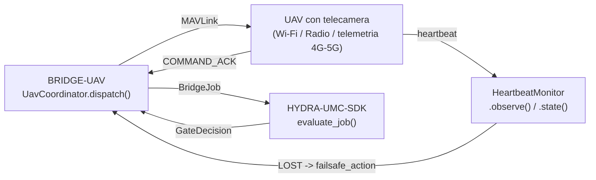

<!-- =============================================================================
HYDRA-UMC-BRIDGE-UAV - Ponte di coordinamento bidirezionale per droni con telecamera
Copyright (C) 2026 JuanenRac (Electro Hobby 3D) <electrohobby3d@gmail.com>
GPL-3.0-or-later - see LICENSE
============================================================================= -->

<p align="center">
  
</p>

# 🛩️ HYDRA-UMC-BRIDGE-UAV

<p align="center"><a href="README.md">🇺🇸 English</a> | <a href="README_spa.md">🇪🇸 Español</a> | <a href="README_fra.md">🇫🇷 Français</a> | 🇮🇹 <b>Italiano</b> | <a href="README_deu.md">🇩🇪 Deutsch</a> | <a href="README_zho.md">🇨🇳 简体中文</a> | <a href="README_jpn.md">🇯🇵 日本語</a> | <a href="README_por.md">🇵🇹 Português</a></p>

### 🔗 Confine di coordinamento privo di dipendenze tra HYDRA-UMC e gli UAV con telecamera

<p align="center">
  
  
  
</p>

---

> **Verifica di onestà - cosa funziona davvero oggi:** il nucleo di richieste di volo senza dipendenze (`coordinator.py` con `UavCoordinator`, che fa passare ogni dispatch attraverso il vero `evaluate_job()` di `HYDRA-UMC-SDK`), il watchdog deterministico di perdita di collegamento tramite heartbeat (`heartbeat.py` con `HeartbeatMonitor`), e il vero trasporto di comandi MAVLink (`mavlink_transport.py` con `MavlinkFlightControl`) sono reali e coperti da 84 test unitari superati (`python tools/build_test.py` - `test_coordinator.py`, `test_heartbeat.py`, `test_mavlink_transport.py`, più `test_mavlink_emulator.py` che esegue il bridge contro un emulatore di autopilota MAVLink fedele al protocollo ma scritto a mano, non uno reale). Nulla di tutto ciò è stato testato contro una vera installazione `pymavlink`, un vero collegamento radio/telemetria, o un UAV/controller di volo fisico - la finta connessione MAVLink propria di `test_mavlink_transport.py` sostituisce interamente `pymavlink` (la libreria reale non deve nemmeno essere installata perché questi test passino), e non esiste ancora un comando `run` dal vivo perché nessun trasporto MAVLink/OSDK reale è stato scelto o validato. Vedi "Stato attuale e prossimi passi" qui sotto, che lo dice già chiaramente, e `CHANGELOG.md` per cosa è stato esattamente consegnato finora.

---

> **Stato di sicurezza (safety e security):** questo ecosistema non è un sistema di sicurezza certificato. Non esiste ancora un percorso E-STOP hardware, né limiti o interblocchi imposti dal firmware, né un comando di movimento verificato; le immagini firmware sono controllate con CRC32 e un HMAC-SHA256 a chiave condivisa, non con una firma asimmetrica; TLS e TLS reciproco sono opzionali e disattivati per impostazione predefinita; nessuna scheda propria è stata ancora assemblata o provata. Leggi la [base di sicurezza](https://github.com/JuanenRac/HYDRA-UMC-DOCS/blob/main/docs/SECURITY_BASELINE.md) e il [modello delle minacce](https://github.com/JuanenRac/HYDRA-UMC-DOCS/blob/main/docs/THREAT_MODEL.md) prima di fidarti di qualsiasi affermazione qui per la sicurezza di una persona.

## 📋 In breve

| | |
|---|---|
| Versione | `0.1.5` |
| Maturità | Funzionale |
| Test | 124 (`python tools/build_test.py`) |
| Tecnologia | Python / MAVLink / HYDRA-UMC-SDK |
| Su hardware reale | Solo simulato: provato con emulatori, test double o simulatori; per questa versione non risulta alcuna esecuzione su hardware reale |

## 🚦 Stato del progetto

Ogni riga è una parte di questo repository e il semaforo dice a che punto è oggi. È scritta in base a ciò che il repository può mostrare (test, compilazioni, esecuzioni), non a ciò che è previsto.

🟢 Fatto e verificato · 🟡 Funziona, con limiti noti · 🟠 Fatto a metà o non ancora verificato · 🔴 Non fatto o non funzionante

| Area | Stato | Cosa significa qui |
|---|---|---|
| Software | 🟡 | Funziona per il suo scopo principale; la verifica di onestà qui sopra elenca ciò che manca ancora |
| Test | 🟢 | 124 test automatici, eseguiti a ogni modifica |
| Hardware reale | 🟠 | Solo simulato: provato con emulatori, test double o simulatori; per questa versione non risulta alcuna esecuzione su hardware reale |
| Documentazione | 🟢 | README in otto lingue, verificato rispetto al manifesto a ogni modifica |

## 1. 🛠️ PANORAMICA TECNICA

**HYDRA-UMC-BRIDGE-UAV** è il confine di coordinamento di alto livello tra HYDRA-UMC e un drone (UAV) dotato di telecamera, raggiungibile via Wi-Fi, un collegamento radio o una connessione di telemetria cellulare (4G/5G). Valida e inoltra un vocabolario ridotto e con nome di richieste di volo di alto livello (`ARM`, `TAKEOFF`, `GOTO_WAYPOINT`, `HOVER_AND_CAPTURE`, `RETURN_TO_LAUNCH`), ed esegue separatamente un watchdog reale e obbligatorio di heartbeat per la perdita di collegamento. Non calcola mai il controllo di volo o la stabilizzazione, e non può aggirare HYDRA-UMC-SERVER, i limiti dell'MCU, i watchdog o l'E-STOP. Oggi l'unico percorso di ritorno dal veicolo è la conferma del comando (`COMMAND_ACK`); la telemetria non viene letta.

Appartiene alla famiglia **Mobile & Autonomous Bridges** insieme a `HYDRA-UMC-BRIDGE-DROIDS` e `HYDRA-UMC-BRIDGE-AMR`, e condivide lo stesso contratto di lavoro e sicurezza `HYDRA-UMC-SDK` degli **External Automation Bridges** stazionari (CNC, LASER, OPENPNP, PRINTER3D, ROS2).

### Caratteristiche principali:
* ✅ **Nucleo reale di richieste di volo, privo di dipendenze:** `UavCoordinator` in `coordinator.py` non ha alcun import MAVLink né di SDK del produttore - è deliberatamente Python semplice, testabile su qualsiasi host senza un UAV reale collegato. *(implementato, testato in `tests/test_coordinator.py`)*
* ✅ **Vocabolario reale di richieste di volo con nome:** `ARM`, `TAKEOFF`, `GOTO_WAYPOINT`, `HOVER_AND_CAPTURE`, `RETURN_TO_LAUNCH`, `LAND` - mai un comando grezzo di assetto/manetta. Un `COMPLETE` di missione normale e un `ABORT` di emergenza si risolvono entrambi nella stessa richiesta reale `RETURN_TO_LAUNCH`. `LAND` è reale e genuinamente distinto - `MAV_CMD_NAV_LAND` contro `MAV_CMD_NAV_RETURN_TO_LAUNCH` di MAVLink (verificato con l'[insieme ufficiale di messaggi comuni MAVLink](https://mavlink.io/en/messages/common.html)) - per il caso reale che il solo RTL non copre: scendere subito, senza prima tornare a casa (ad es. batteria troppo scarica, o percorso di ritorno non sicuro). `emergency_land_request()` lo espone come richiesta autonoma, deliberatamente fuori dal flusso `dispatch()` guidato da `JobPhase` - stesso ragionamento del segnale separato di `HeartbeatMonitor`. *(implementato)*
* ✅ **Un watchdog reale e obbligatorio di heartbeat per la perdita di collegamento:** `HeartbeatMonitor` è una macchina a stati failsafe deterministica, guidata da un `now` esplicito - non legge mai un orologio reale, riporta `LOST` fin dal primo controllo se non è mai stato osservato nulla, e tratta l'istante esatto del timeout come ancora `OK` (solo superarlo davvero fa scattare il failsafe configurato `RETURN_TO_LAUNCH`/`LAND`). *(implementato, testato con una suite deterministica completa di casi limite in `tests/test_heartbeat.py`)*
* ✅ **HEARTBEAT proprio del bridge come stazione di terra:** `GcsHeartbeat` di `gcs_heartbeat.py` invia un `HEARTBEAT` MAVLink di tipo `MAV_TYPE_GCS` in un thread (1 Hz per impostazione predefinita, `HYDRA_UAV_GCS_HEARTBEAT_HZ` tra 0,1 e 10, `0` per spegnerlo), così il failsafe di perdita della stazione dell'autopilota scatta se il bridge muore. Un battito che non si può inviare viene contato e segnalato, mai sollevato come errore. *(implementato, provato con un collegamento simulato in `tests/test_gcs_heartbeat.py`; non ancora provato con un autopilota reale)* `hydra-umc-bridge-uav run --connection <URL>` (o `python -m hydra_umc_bridge_uav run ...`) apre il collegamento MAVLink e mantiene questo heartbeat, stampa una riga di stato ogni pochi secondi e si ferma pulito con Ctrl-C, SIGTERM o `--duration`; non invia altro al veicolo. Provato contro un registratore del collegamento; mai eseguito contro un vero autopilota o SITL.
* ✅ **Porta di sicurezza condivisa, reale:** ogni lavoro inviato tramite `UavCoordinator.dispatch()` viene valutato da `evaluate_job()` del `bridge_contract` di `HYDRA-UMC-SDK`, la stessa porta usata da tutti i ponti fratelli e da HYDRA-UMC-SERVER; una fase produttiva richiede una macchina esterna `IDLE` e una cella HYDRA-UMC `READY`, mentre `ABORT` resta richiedibile durante un guasto. *(implementato)*
* ✅ **Instradamento delle fasi chiuso ed evidenza statica:** una futura fase SDK sconosciuta viene negata. `inspect_request_plan.py` emette il piano statico di richieste di volo di schema `1.1` (che ora include la richiesta autonoma `LAND`) senza aprire alcun trasporto. *(implementato, testato)*
* ✅ **Trasporto reale dei comandi MAVLink:** `mavlink_transport.py`'s `MavlinkFlightControl` invia un dispatch già validato come un vero `COMMAND_LONG`, mappato su un `MAV_CMD` reale e numerato (`MAV_CMD_NAV_TAKEOFF`/`MAV_CMD_DO_REPOSITION`/`MAV_CMD_NAV_LOITER_UNLIM`/`MAV_CMD_IMAGE_START_CAPTURE`/`MAV_CMD_NAV_RETURN_TO_LAUNCH`/`MAV_CMD_NAV_LAND`/`MAV_CMD_COMPONENT_ARM_DISARM`) - un dispatch rifiutato non raggiunge mai la rete. *(implementato, testato in `tests/test_mavlink_transport.py`)*
* ✅ **Riferimento di quota esplicito, inviluppo di volo e richieste di stato sicuro:** `GOTO_WAYPOINT` parte come `COMMAND_INT` (posizione in gradi × 1e7, prua mantenuta) con un `altitude_frame` esplicito - `"relative"` (metri sopra il punto di decollo, predefinito) oppure `"amsl"`; una `FlightEnvelope` opzionale (quota massima e raggio dal punto di partenza, stabiliti dall'impianto) rifiuta ciò che sta fuori; `RETURN_TO_LAUNCH`, `LAND` e il `DISARM` autonomo (mai forzato) vengono inviati anche se la porta li ha rifiutati, e un normale ritorno di `COMPLETE` è accettato qualunque cosa dicano cella e macchina; l'attesa del `COMMAND_ACK` salta le conferme di altri comandi e di altri sistemi e considera `IN_PROGRESS` come non ancora concluso. *(implementato, testato; il formato sul filo è verificato solo contro l'emulatore - mai contro il SITL di PX4/ArduPilot né un autopilota reale, e la quota di `TAKEOFF` resta il riferimento proprio dell'autopilota, perché un `COMMAND_LONG` non porta un riferimento)*
* ✅ **Build/test non mutante:** `build-test.bat`/`.sh` compilano il codice sorgente ed eseguono test unitari deterministici senza cambiare versione o CHANGELOG. *(implementato, vedi COMPILAZIONE ED ESECUZIONE più sotto)*
* 🔜 **Un adattatore di trasporto DJI OSDK** (per una piattaforma non-MAVLink) - introdotto solo dopo che quell'SDK sarà selezionato e testato. *(pianificato)*
* ✅ **Stato osservato della macchina:** `UavCoordinator.dispatch()` accetta lo stato riferito da il pilota automatico, che la porta condivisa usa al posto del `machine_state` scritto nel lavoro (un messaggio che chiunque sul broker può pubblicare); senza un rapporto si usa ancora quanto dichiarato. *(implementato, testato in `tests/test_observed_state.py`)*

---

## 2. 🔄 FLUSSO DI COORDINAMENTO DELL'UAV



---

## 3. 🧱 ARCHITETTURA E DECISIONI DI PROGETTAZIONE

* **Perché il watchdog di heartbeat è un modulo a sé, non integrato nel coordinatore.** La perdita di collegamento è una modalità di guasto reale e distinta da "questo lavoro è consentito adesso" - `HeartbeatMonitor` risponde a "posso ancora fidarmi dell'ultima cosa che ho saputo da questo UAV" indipendentemente da qualsiasi lavoro specifico, così può essere verificato in modo continuo (ad es. ad ogni tick di telemetria) e non solo quando un lavoro viene effettivamente inviato.
* **Perché `HeartbeatMonitor` riceve un `now` esplicito invece di leggere un orologio reale.** La nota di architettura incollata da cui è partito questo progetto afferma esplicitamente che un ponte UAV RICHIEDE questo watchdog - l'unico modo per dimostrare il suo comportamento esatto al limite del timeout (non solo "prima o poi scade") senza una suite di test lenta e instabile basata su sleep reali è rendere il tempo un input esplicito e testabile.
* **Perché `COMPLETE` e `ABORT` si risolvono entrambi in `RETURN_TO_LAUNCH`.** Una missione conclusa e un abort di emergenza hanno lo stesso esito reale corretto per un UAV: tornare a casa. Farli confluire nello stesso nome di richiesta nel piano statico (deduplicato, non ripetuto) riflette questo con onestà invece di inventare due verbi diversi per "tornare".
* **Perché l'heartbeat proprio di questo ponte NON è esplicitamente un sostituto del failsafe proprio del controller di volo.** Il firmware di Pixhawk/PX4 e di DJI implementa già un failsafe reale, quasi certificato, di perdita di collegamento a livello di radio/telemetria - l'`HeartbeatMonitor` di questo ponte è un segnale del solo livello di coordinamento per lo stato proprio di HYDRA-UMC, ed entrambi devono esistere in modo indipendente; vedi la porta di accettazione hardware propria di `docs/BRIDGE_GUIDE.md`.
* **Perché in questo repository non c'è ancora un adattatore di trasporto DJI OSDK.** (Il trasporto MAVLink esiste, vedi sopra.) Vincolarsi al protocollo reale di comandi/telemetria di uno specifico controller di volo prima che sia selezionato e testato rischierebbe di incorporare ipotesi che questo nucleo locale privo di dipendenze non può verificare.
* **Come si inserisce nel resto dell'ecosistema.** BRIDGE-UAV si trova tra un UAV reale e `HYDRA-UMC-SDK` → `HYDRA-UMC-SERVER` → sicurezza MCU - è un confine di coordinamento, mai un nodo di controllo di volo, e non può aggirare HYDRA-UMC-SERVER, i limiti dell'MCU, i watchdog o l'E-STOP.

---

## 📂 STRUTTURA DELLE DIRECTORY

```text
HYDRA-UMC-BRIDGE-UAV/
├── src/
│   └── hydra_umc_bridge_uav/
│       ├── __init__.py
│       ├── coordinator.py       # UavCoordinator: porta di richieste di volo priva di dipendenze
│       ├── heartbeat.py         # HeartbeatMonitor: failsafe reale e deterministico di perdita di collegamento
│       ├── gcs_heartbeat.py     # HEARTBEAT proprio di stazione di terra a frequenza configurabile
│       ├── mavlink_transport.py # Invia un UavDispatch già validato come un COMMAND_LONG / COMMAND_INT MAVLink reale
│       └── simulated_uav.py     # Tabella degli stati di volo + veicolo simulato: telemetria, autorizzazione e armamento separati, nessun trasporto
├── tests/
│   ├── test_coordinator.py      # Test unitari deterministici del nucleo di coordinamento
│   ├── test_observed_state.py   # La porta usa lo stato della macchina riferito da il pilota automatico
│   ├── test_heartbeat.py        # Test deterministici dei casi limite del watchdog di heartbeat
│   ├── test_simulated_uav.py    # Test della tabella degli stati e del veicolo simulato
│   ├── test_mavlink_transport.py # Test di forma MAV_CMD reali contro una connessione MAVLink fittizia
│   ├── mavlink_emulator.py       # Emulatore MAVLink autopilot fedele al protocollo (test double realistico)
│   └── test_mavlink_emulator.py  # Comportamento del bridge rispetto all'emulatore MAVLink autopilot
├── tools/
│   ├── build_test.py            # Compilatore + esecutore di test non mutante (build-test.bat/.sh)
│   ├── bump_version.py          # Sincronizza pyproject.toml, manifesto e CHANGELOG.md
│   ├── ci_validate.py           # Base CI priva di dipendenze e non distruttiva (usata da .github/workflows/ci.yml)
│   └── inspect_request_plan.py  # Stampa il piano statico di richieste di volo (nessun trasporto aperto)
├── docs/
│   └── BRIDGE_GUIDE.md          # Ambito, piattaforme compatibili, script, porta di accettazione hardware
├── images/
│   └── HYDRA_UMC_BANNER.svg     # Banner del README
├── build-test.bat / build-test.sh  # Solo valida, non modifica mai il repository
├── build.bat / build.sh            # Valida e, solo in caso di successo, aggiorna versione + CHANGELOG
├── pyproject.toml               # Metadati del pacchetto; dipende da HYDRA-UMC-SDK (git)
├── hydra-umc.project.json       # Manifesto dell'ecosistema (versione, maturità, famiglia)
├── CHANGELOG.md
├── CODE_OF_CONDUCT.md / CONTRIBUTING.md / SECURITY.md / SUPPORT.md
├── LICENSE / LICENSE.md
└── README.md / README_*.md      # Questo file e le sue 6 traduzioni
```

---

## 4. ⚙️ COMPILAZIONE ED ESECUZIONE

Richiede Python 3.11+. `tools/build_test.py` si aspetta che `HYDRA-UMC-SDK` sia clonato come directory fratella (`../HYDRA-UMC-SDK`) o indicato tramite la variabile d'ambiente `HYDRA_UMC_SDK_ROOT`.

```bash
# Windows
build-test.bat      # solo validazione — nessun cambio di versione/CHANGELOG
build.bat            # valida e, se ha successo, aggiorna versione + CHANGELOG

# Linux/macOS
bash build-test.sh
bash build.sh
```

`build-test` compila ogni modulo sotto `src/` con `py_compile` ed esegue l'intera suite `unittest` (tutti i file `test_*.py` in `tests/`) - in modo deterministico, senza connessione reale a un UAV, senza rete e senza cambio di versione/CHANGELOG. `build` esegue prima quella stessa validazione e, solo in caso di successo, chiama `tools/bump_version.py` per sincronizzare la versione tra `pyproject.toml`, `hydra-umc.project.json` e `CHANGELOG.md`. Non esiste ancora un comando `run` con hardware reale - serve un adattatore di trasporto MAVLink/OSDK validato e un UAV reale.

---

## ✅ Stato attuale e prossimi passi

**Reale oggi:** versione `0.1.5`, funzionale come nucleo di coordinamento privo di dipendenze (`UavCoordinator`) più un watchdog reale di heartbeat per la perdita di collegamento completamente testato sui casi limite (`HeartbeatMonitor`), instradamento delle fasi chiuso, uno schema di richieste di volo statico `plan-only`, un trasporto reale dei comandi MAVLink (`MavlinkFlightControl`) che mappa ogni richiesta sul suo `MAV_CMD` reale e numerato - l'armamento ora richiede il booleano letterale `confirm_arm is True` (mai un valore semplicemente veritiero come la stringa `'false'`), ogni parametro numerico di volo viene verificato come numero reale non booleano prima di qualsiasi controllo di finitezza/intervallo, e un comando inviato viene confermato solo quando arriva il suo vero `COMMAND_ACK` con `MAV_RESULT_ACCEPTED` -, e script build-test non mutanti collegati alla CI con un checkout dell'SDK.

**Confine di integrazione:** questo ponte è solo un confine di coordinamento - non è un nodo di controllo di volo, e non può aggirare HYDRA-UMC-SERVER, i limiti dell'MCU, i watchdog o l'E-STOP; ogni lavoro inviato passa comunque attraverso la stessa porta condivisa usata da tutti i ponti fratelli. Il segnale di failsafe proprio di `HeartbeatMonitor` è una questione del livello di coordinamento, mai un sostituto del failsafe indipendente proprio del controller di volo.

**Ancora da fare:** nessun trasporto reale MAVLink (Pixhawk/PX4) o DJI OSDK, né un UAV fisico, è ancora stato validato - un adattatore reale sarà introdotto solo dopo che un controller di volo/SDK specifico sarà selezionato e testato.

---

## 🔗 Progetti Correlati

Questo progetto fa parte dell'ecosistema robotico HYDRA-UMC dello stesso autore (JuanenRac / Electro Hobby 3D). Vale la pena conoscerlo, poiché una richiesta potrebbe in realtà riguardare uno di questi invece di questo repository.

**Progetto Padre**
- **[HYDRA-UMC-SERVER](https://github.com/JuanenRac/HYDRA-UMC-SERVER)** — il vero backend headless (REST/WebSocket) con cui parla davvero ogni client di controllo; il confine autenticato dell'ecosistema a cui questo bridge riporta una volta che ogni comando ha superato la barriera di sicurezza locale di questo stesso bridge.

**Progetti Fratelli** — parlano anch'essi con la stessa API di HYDRA-UMC-SERVER, ciascuno come proprio client
- **[HYDRA-UMC-STUDIO](https://github.com/JuanenRac/HYDRA-UMC-STUDIO)** — dashboard di controllo web con visualizzazione 3D multi-robot in tempo reale.
- **[HYDRA-UMC-SUITE](https://github.com/JuanenRac/HYDRA-UMC-SUITE)** — centro di comando sciame desktop (PySide6) per più server contemporaneamente, pacchettizzato come eseguibile standalone.
- **[HYDRA-UMC-ANDROID-CONTROL](https://github.com/JuanenRac/HYDRA-UMC-ANDROID-CONTROL)** — app di controllo nativa per Android con login biometrico e un companion Wear OS abbinato.
- **[HYDRA-UMC-IOS-CONTROL](https://github.com/JuanenRac/HYDRA-UMC-IOS-CONTROL)** — app di controllo per iOS/iPadOS (Flutter) con sincronizzazione WebSocket in tempo reale.
- **[HYDRA-UMC-DSI](https://github.com/JuanenRac/HYDRA-UMC-DSI)** — interfaccia touch nativa per il touchscreen DSI da 7" a bordo, incorporata direttamente nel CM5.
- **[HYDRA-UMC-BRIDGE-AMR](https://github.com/JuanenRac/HYDRA-UMC-BRIDGE-AMR)** — barriera di coordinamento per flotte AGV/AMR tramite un publisher MQTT VDA 5050 (testato solo contro una flotta emulata) — uno dei 3 bridge per flotte mobili dell'ecosistema.
- **[HYDRA-UMC-BRIDGE-CNC](https://github.com/JuanenRac/HYDRA-UMC-BRIDGE-CNC)** — coordinatore ad alto livello per celle CNC con accesso a stato/byte di controllo GRBL (testato solo contro un emulatore).
- **[HYDRA-UMC-BRIDGE-DROIDS](https://github.com/JuanenRac/HYDRA-UMC-BRIDGE-DROIDS)** — barriera di coordinamento per droidi con zampe/umanoidi, con un mittente di comandi per Boston Dynamics Spot (testato solo contro un emulatore) — uno dei 3 bridge per flotte mobili dell'ecosistema.
- **[HYDRA-UMC-BRIDGE-LASER](https://github.com/JuanenRac/HYDRA-UMC-BRIDGE-LASER)** — coordinatore per celle laser che legge 3 segnali GPIO di chiave/involucro/interblocco (testato solo contro un chip simulato; non può armare né far partire un laser).
- **[HYDRA-UMC-BRIDGE-OPENPNP](https://github.com/JuanenRac/HYDRA-UMC-BRIDGE-OPENPNP)** — coordinatore ad alto livello sicuro per il flusso schede del pick-and-place OpenPnP.
- **[HYDRA-UMC-BRIDGE-PRINTER3D](https://github.com/JuanenRac/HYDRA-UMC-BRIDGE-PRINTER3D)** — barriera di coordinamento sicura per stampanti 3D Moonraker/Klipper, con comandi di lavoro reali e controllati.
- **[HYDRA-UMC-BRIDGE-ROS2](https://github.com/JuanenRac/HYDRA-UMC-BRIDGE-ROS2)** — coordinatore con un trasporto ROS 2 rclpy importato in modo lazy (non ancora eseguito contro un'installazione ROS 2).

**Direttamente Correlati**
- **[HYDRA-UMC-SDK](https://github.com/JuanenRac/HYDRA-UMC-SDK)** — il contratto JSON-Schema condiviso e la barriera software di controllo dei job contro cui ogni bridge valida i propri comandi (non è una funzione di sicurezza certificata).
- **[HYDRA-UMC-CONNECTOR-HUB](https://github.com/JuanenRac/HYDRA-UMC-CONNECTOR-HUB)** — registro dichiarativo e validatore di manifesti adattatore per connettori di macchine esterne; estende la propria idea di contratto dell'SDK alle macchine esterne senza sostituire i progetti di gateway industriale.

**Fa Anche Parte dell'Ecosistema**

*Hardware e Piattaforma di Base*
- **[HYDRA-UMC](https://github.com/JuanenRac/HYDRA-UMC)** — il progetto della scheda madre del braccio robotico: host CM5 + coprocessore STM32H745 dual-core, pensato per coordinare fino a 8 bracci utensile via CAN-OTA/SPI-OTA (firmware in fase iniziale; nessuna scheda assemblata per ora).
- **[HYDRA-UMC-OS](https://github.com/JuanenRac/HYDRA-UMC-OS)** — livello prodotto riproducibile su Raspberry Pi OS per il CM5: agente in sola lettura, config/profili validati, provisioning WiFi al primo contatto.

*Backend Centrale e Client*
- **[HYDRA-UMC-EDITOR-URDF](https://github.com/JuanenRac/HYDRA-UMC-EDITOR-URDF)** — creatore/editor grafico desktop di URDF che invia i modelli finiti al catalogo di STUDIO.
- **[HYDRA-UMC-EDITOR-STL](https://github.com/JuanenRac/HYDRA-UMC-EDITOR-STL)** — editor desktop di modelli STL, che trasforma/sostituisce/rimuove/aggiunge veri pezzi nello stesso catalogo di modelli modificato anche da HYDRA-UMC-EDITOR-URDF.

*Piattaforma Strumenti URTC*
- **[URTC](https://github.com/JuanenRac/URTC)** — firmware per la scheda fisica dell'Universal Robot Tool Controller, oltre 25 profili utensile su bus CAN.
- **[URTC-FLASHER](https://github.com/JuanenRac/URTC-FLASHER)** — strumento desktop con GUI per il flashing delle schede URTC, CAN-OTA più SWD/JTAG a chip intero.
- **[URTC-TESTER](https://github.com/JuanenRac/URTC-TESTER)** — strumento desktop di diagnostica CAN-bus dal vivo per schede URTC, un pannello per profilo utensile.
- **[URTC-WEB-STUDIO](https://github.com/JuanenRac/URTC-WEB-STUDIO)** — alternativa basata su browser a URTC-TESTER tramite la Web Serial API, senza installazione locale.
- **[URTC-GATEWAY](https://github.com/JuanenRac/URTC-GATEWAY)** — gateway davanti al bus CAN di URTC: elenco di identificatori consentiti, limite di frequenza e chiave di sessione; software provato su computer, non ancora su un bus reale.

*Nodo IA Visione (Hailo-8)*
- **[HYDRA-UMC-VISION-NODE](https://github.com/JuanenRac/HYDRA-UMC-VISION-NODE)** — hub di integrazione per la pipeline di visione Hailo-8, con un vero controllo di prontezza hardware per fase.
- **[HYDRA-UMC-DETECTION-HEF](https://github.com/JuanenRac/HYDRA-UMC-DETECTION-HEF)** — registro reale di modelli compilati con verifica di caricamento sicuro per architettura Hailo/checksum.
- **[HYDRA-UMC-VISION-STREAMER](https://github.com/JuanenRac/HYDRA-UMC-VISION-STREAMER)** — generatore reale di pipeline GStreamer + config MediaMTX, con una vera barriera di integrazione HailoRT.
- **[HYDRA-UMC-VISUAL-SERVOING-API](https://github.com/JuanenRac/HYDRA-UMC-VISUAL-SERVOING-API)** — legge di correzione Position-Based Visual Servoing con autorizzazione condizionata allo stato di zona; ancora nessuna stima di posa da telecamera.
- **[HYDRA-UMC-SAFETY-ZONES](https://github.com/JuanenRac/HYDRA-UMC-SAFETY-ZONES)** — logica v0 di violazione zona, freschezza di calibrazione e richiesta E-STOP che legge le posizioni degli oggetti da un file; nessun rilevatore la alimenta e nessun E-STOP fisico è ancora collegato.

*Nodo IA Cognitivo (Hailo-10)*
- **[HYDRA-UMC-COGNITIVE-NODE](https://github.com/JuanenRac/HYDRA-UMC-COGNITIVE-NODE)** — hub di integrazione per la pipeline cognitiva Hailo-10 (orchestrazione LLM/VLA/voce).
- **[HYDRA-UMC-VLA-ENGINE](https://github.com/JuanenRac/HYDRA-UMC-VLA-ENGINE)** — vera codifica/decodifica di token d'azione e generazione di traiettoria per un modello Vision-Language-Action.
- **[HYDRA-UMC-VOICE-UI](https://github.com/JuanenRac/HYDRA-UMC-VOICE-UI)** — vero front-end vocale (VAD + parser di intenti) con un relay verso Watch limitato e soggetto a conferma.
- **[HYDRA-UMC-SEMANTIC-PLANNER](https://github.com/JuanenRac/HYDRA-UMC-SEMANTIC-PLANNER)** — vera scomposizione dei task basata su regole e recupero semantico degli errori sui codici errore MCU.
- **[HYDRA-UMC-DOCS-QA](https://github.com/JuanenRac/HYDRA-UMC-DOCS-QA)** — vera ricerca documentale TF-IDF (solo libreria standard) sui documenti Markdown di questo ecosistema.
- **[HYDRA-UMC-LOCAL-TECHNICIAN](https://github.com/JuanenRac/HYDRA-UMC-LOCAL-TECHNICIAN)** — tecnico di manutenzione IA locale e con cancelli di policy per l'ecosistema stesso - osserva, diagnostica e propone correzioni; i due livelli di rischio più alti non sono deliberatamente ancora implementati.

*Orchestrazione e Sciame*
- **[HYDRA-UMC-ORCHESTRATOR](https://github.com/JuanenRac/HYDRA-UMC-ORCHESTRATOR)** — hub di integrazione con un vero contratto di health-report gRPC/Protobuf e una macchina a stati di missione.
- **[HYDRA-UMC-JOB-DISPATCHER](https://github.com/JuanenRac/HYDRA-UMC-JOB-DISPATCHER)** — vera coda di lavori basata su priorità con deduplicazione, su una vera API HTTP.
- **[HYDRA-UMC-NODE-HEALING](https://github.com/JuanenRac/HYDRA-UMC-NODE-HEALING)** — vero watchdog di salute della flotta basato su gRPC, con retry/backoff e rilevamento di discrepanza d'identità.
- **[HYDRA-UMC-PATH-PLANNER-3D](https://github.com/JuanenRac/HYDRA-UMC-PATH-PLANNER-3D)** — vero pianificatore di percorsi 3D basato su RRT, con vera validazione delle collisioni ostacolo/spazio di lavoro.
- **[HYDRA-UMC-SWARM-SYNC](https://github.com/JuanenRac/HYDRA-UMC-SWARM-SYNC)** — vera sincronizzazione di stato CRDT LWW-Element-Map, con property test per la convergenza multi-cella.

*Gemello Digitale e Simulazione*
- **[HYDRA-UMC-TWIN](https://github.com/JuanenRac/HYDRA-UMC-TWIN)** — hub di integrazione per il motore di gemello digitale, con un vero contratto di sincronizzazione per compatibilità di versione.
- **[HYDRA-UMC-HIL-BRIDGE](https://github.com/JuanenRac/HYDRA-UMC-HIL-BRIDGE)** — router hardware-in-the-loop con un interblocco software di collisione tra simulazione e hardware reale (testato senza hardware reale).
- **[HYDRA-UMC-PHYSICS-REPLICA](https://github.com/JuanenRac/HYDRA-UMC-PHYSICS-REPLICA)** — vera cinematica diretta e validazione dei limiti articolari su un vero sottoinsieme URDF.
- **[HYDRA-UMC-SYNTHETIC-DATA-GEN](https://github.com/JuanenRac/HYDRA-UMC-SYNTHETIC-DATA-GEN)** — vero generatore procedurale di scene 2D con esportazione di annotazioni YOLO/COCO.

*Dati e Analisi*
- **[HYDRA-UMC-DATALAKE](https://github.com/JuanenRac/HYDRA-UMC-DATALAKE)** — vero archivio di serie temporali basato su sqlite3, con una vera API HTTP di ingestione/query.
- **[HYDRA-UMC-ANOMALY-DETECTOR](https://github.com/JuanenRac/HYDRA-UMC-ANOMALY-DETECTOR)** — vero rilevatore di anomalie FFT + baseline statistica, con monitoraggio della deriva.
- **[HYDRA-UMC-PRODUCTION-REPORTS](https://github.com/JuanenRac/HYDRA-UMC-PRODUCTION-REPORTS)** — vero calcolo OEE/disponibilità sullo storico di DATALAKE, con esportazione CSV riproducibile.
- **[HYDRA-UMC-TELEMETRY-COLLECTOR](https://github.com/JuanenRac/HYDRA-UMC-TELEMETRY-COLLECTOR)** — vera pipeline di ingestione CAN/WebSocket verso DATALAKE, con deduplicazione per sequenza.

*Gateway Industriale*
- **[HYDRA-UMC-GATEWAY-INDUSTRIAL](https://github.com/JuanenRac/HYDRA-UMC-GATEWAY-INDUSTRIAL)** — hub di integrazione che inoltra ai protocolli industriali, con un vero livello di allowlist dei comandi/backpressure.
- **[HYDRA-UMC-OPCUA-SERVER](https://github.com/JuanenRac/HYDRA-UMC-OPCUA-SERVER)** — vero spazio di indirizzi OPC-UA, verificato con una vera sessione client del protocollo binario.
- **[HYDRA-UMC-MQTT-BROKER](https://github.com/JuanenRac/HYDRA-UMC-MQTT-BROKER)** — vero broker MQTT con autenticazione opzionale per client e ACL sui topic.
- **[HYDRA-UMC-MTCONNECT-ADAPTER](https://github.com/JuanenRac/HYDRA-UMC-MTCONNECT-ADAPTER)** — veri endpoint XML `/probe` e `/current` di MTConnect, con output in modalità degradata.

*Strumenti Complementari e Operazioni dell'Ecosistema*
- **[HYDRA-UMC-DASHBOARD-AI](https://github.com/JuanenRac/HYDRA-UMC-DASHBOARD-AI)** — pannelli Smart Summaries e Anomaly Highlighting su DATALAKE/ANOMALY-DETECTOR, con un fallback statistico onesto.
- **[HYDRA-UMC-TOOL-CLI](https://github.com/JuanenRac/HYDRA-UMC-TOOL-CLI)** — CLI di flotta con un vero e stabile contratto di exit-code, un client live reale della stessa API di HYDRA-UMC-SERVER.
- **[HYDRA-UMC-WATCH](https://github.com/JuanenRac/HYDRA-UMC-WATCH)** — app companion WearOS con schemi di avviso aptico e un relay vocale verso il telefono abbinato (non ancora eseguita su un orologio fisico).
- **[URTC-SMART-RACK](https://github.com/JuanenRac/URTC-SMART-RACK)** — firmware per un rack di montaggio schede con decodifica reale dell'ID utensile e logica di preriscaldamento Smart Idle.
- **[URTC-VISION-TOOL](https://github.com/JuanenRac/URTC-VISION-TOOL)** — firmware più un vero companion di visione Python per una testa utensile di ispezione termica/RGB.
- **[HYDRA-UMC-UPDATER](https://github.com/JuanenRac/HYDRA-UMC-UPDATER)** — strumento amministrativo desktop che scopre, clona e aggiorna ogni repository di questo ecosistema.
- **[HYDRA-UMC-OS-REBUILDER](https://github.com/JuanenRac/HYDRA-UMC-OS-REBUILDER)** — strumento desktop Windows/Linux che costruisce un'immagine della CM5 pronta da scrivere, precaricata con le versioni più aggiornate dell'ecosistema, con configurazione di primo avvio Wi-Fi/utente/SSH in stile Raspberry Pi Imager.
- **[HYDRA-UMC-OPS-AGENT](https://github.com/JuanenRac/HYDRA-UMC-OPS-AGENT)** — coordinatore di incidenti di manutenzione: un ruolo edge a basso privilegio raccoglie uno snapshot di inventario/salute sanificato, un ruolo control-plane lo rende in sola lettura e chiede a un provider di IA di suggerire una diagnosi - non applica mai una patch né distribuisce nulla.
- **[HYDRA-UMC-DEV-SERVER](https://github.com/JuanenRac/HYDRA-UMC-DEV-SERVER)** — host di sviluppo riproducibile (Raspberry Pi 5 / CM5) che conserva il codice sorgente dell'ecosistema ed esegue attività delimitate di build/test tramite una coda durevole; un ruolo di sviluppo dedicato, esplicitamente distinto da un CM5 operativo.

---

## 📚 Documentazione e Comunità

- **[CONTRIBUTING.md](CONTRIBUTING.md)** — stack tecnologico e linee guida di codifica per una pull request.
- **[CODE_OF_CONDUCT.md](CODE_OF_CONDUCT.md)** — gli standard di comportamento attesi in questa comunità.
- **[SECURITY.md](SECURITY.md)** — come segnalare una vulnerabilità, e le reali aree di attenzione sulla sicurezza di questo progetto.
- **[SUPPORT.md](SUPPORT.md)** — dove porre domande e segnalare bug.
- **[LICENSE.md](LICENSE.md)** — la licenza propria di questo progetto.

## 👤 AUTORE
**JuanenRac** (Electro Hobby 3D)
📧 electrohobby3d@gmail.com
📺 [youtube.com/@electrohobby3d](https://youtube.com/@electrohobby3d)

## 📜 LICENZA
GPL-3.0-or-later - Vedi LICENSE per i dettagli.
