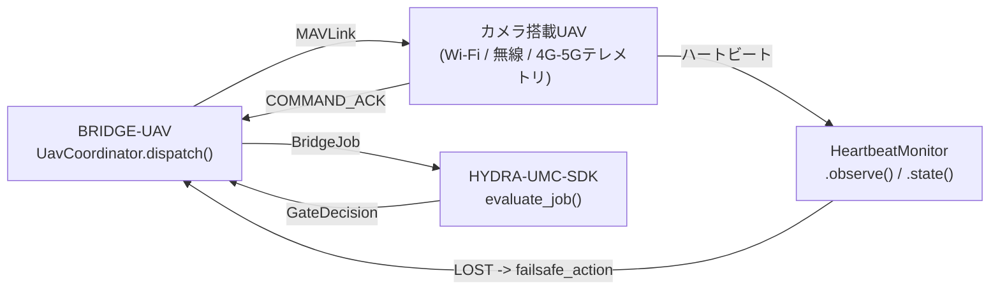

<!-- =============================================================================
HYDRA-UMC-BRIDGE-UAV - UAV coordination bridge
Copyright (C) JuanenRac (Electro Hobby 3D) <electrohobby3d@gmail.com>
GPL-3.0-or-later - see LICENSE
============================================================================= -->

<p align="center">
  
</p>

# 🚁 HYDRA-UMC-BRIDGE-UAV

<p align="center"><a href="README.md">🇺🇸 English</a> | <a href="README_spa.md">🇪🇸 Español</a> | <a href="README_fra.md">🇫🇷 Français</a> | <a href="README_ita.md">🇮🇹 Italiano</a> | <a href="README_deu.md">🇩🇪 Deutsch</a> | <a href="README_zho.md">🇨🇳 简体中文</a> | 🇯🇵 <b>日本語</b> | <a href="README_por.md">🇵🇹 Português</a></p>

### 🔗 HYDRA-UMCとカメラ搭載UAVとの間の依存関係なし連携境界

<p align="center">
  
  
  
  
  
  
</p>

---

> **誠実性チェック - 今日実際に動くもの:** 依存関係のないフライトリクエストコア（`coordinator.py` の `UavCoordinator`。すべてのディスパッチは `HYDRA-UMC-SDK` 自身の本物の `evaluate_job()` を通過する）、決定論的なリンク断ハートビートウォッチドッグ（`heartbeat.py` の `HeartbeatMonitor`）、および本物の MAVLink コマンドトランスポート（`mavlink_transport.py` の `MavlinkFlightControl`）は本物であり、154件の通過するユニットテストで検証されている（`python tools/build_test.py` - `test_coordinator.py`、`test_heartbeat.py`、`test_mavlink_transport.py`、および実際のものではなくプロトコルに忠実な手書きの MAVLink オートパイロットエミュレータに対してブリッジを動かす `test_mavlink_emulator.py`）。これらはいずれも、本物の `pymavlink` インストール、本物の無線・テレメトリーリンク、あるいは物理的な UAV・フライトコントローラに対しては検証されていない - `test_mavlink_transport.py` 独自の模擬 MAVLink 接続が `pymavlink` を完全に置き換えており（本物のライブラリがインストールされていなくてもこれらのテストは通過する）、実際の MAVLink・OSDK トランスポートがまだ選定・検証されていないため、実機向けの `run` コマンドもまだ存在しない。詳細は下記の「ロードマップと既知の制限」に既に明記されており、これまでに実際に出荷された内容は `CHANGELOG.md` を参照。

> **安全性とセキュリティの現状:** このエコシステムは認証された安全システムではありません。ハードウェアの E-STOP 経路、ファームウェアが強制する制限やインターロック、検証済みの動作コマンドはまだありません。ファームウェアイメージは CRC-32 と Ed25519 署名で検査し、リリースビルドは公開済みの開発用鍵を拒否します(リレーの先のツールヘッドと拡張ボードは引き続き URTC のブートローダーを使い、署名ではなく共有鍵の HMAC-SHA256 を使います)。TLS と相互 TLS は任意で、既定では無効です。独自基板はまだ実装も試験もされていません。ここに書かれた内容を人の安全のために頼る前に、[セキュリティベースライン](https://github.com/JuanenRac/HYDRA-UMC-DOCS/blob/main/docs/SECURITY_BASELINE.md)と[脅威モデル](https://github.com/JuanenRac/HYDRA-UMC-DOCS/blob/main/docs/THREAT_MODEL.md)をお読みください。

---

## 📋 ひと目で

| | |
|---|---|
| バージョン | `0.1.7` |
| 成熟度 | 機能する |
| テスト | 154 (`python tools/build_test.py`) |
| 技術 | Python / MAVLink / HYDRA-UMC-SDK |
| 実機での確認 | シミュレーションのみ：エミュレーター、模擬部品、シミュレーターで試験済み。このバージョンについて実機での動作記録はありません |

**移動：** [概要](#-概要) · [アーキテクチャ](#-アーキテクチャ) · [機能](#-機能) · [セキュリティと安全](#-セキュリティと安全) · [インターフェース](#-インターフェース) · [設定](#-設定) · [クイックスタート](#-クイックスタート) · [テスト](#-テスト) · [トラブルシューティング](#-トラブルシューティング) · [リポジトリの構成](#-リポジトリの構成) · [関連プロジェクト](#-関連プロジェクト)

## 🚦 プロジェクトの状況

各行はこのリポジトリの一部分で、信号は今日どこまで進んでいるかを示します。計画ではなく、リポジトリが示せるもの（テスト、ビルド、実行）に基づいて書かれています。

🟢 完了・検証済み · 🟡 動作する（既知の制限あり） · 🟠 一部のみ、または未検証 · 🔴 未実装または動作しない

| 領域 | 状態 | ここでの意味 |
|---|---|---|
| ソフトウェア | 🟡 | 主な目的では動作します。足りない点は上の正直さの確認に書かれています |
| テスト | 🟢 | 自動テスト 154 件。変更のたびに実行されます |
| 実機 | 🟠 | シミュレーションのみ：エミュレーター、模擬部品、シミュレーターで試験済み。このバージョンについて実機での動作記録はありません |
| ドキュメント | 🟢 | 8 言語の README。変更のたびにマニフェストと照合されます |

## 🎯 概要

**HYDRA-UMC-BRIDGE-UAV** は、HYDRA-UMCとカメラ搭載ドローン(UAV)との間の高レベルの連携境界であり、Wi-Fi、無線リンク、またはセルラー(4G/5G)テレメトリ接続経由で到達可能である。小規模で命名された高レベルの飛行リクエストの語彙(`ARM`、`TAKEOFF`、`GOTO_WAYPOINT`、`HOVER_AND_CAPTURE`、`RETURN_TO_LAUNCH`)を検証・転送し、それとは別に実在する必須のリンク喪失ハートビート・ウォッチドッグを実行する。飛行制御や姿勢安定化を計算することは一切なく、HYDRA-UMC-SERVER、MCUの限界、ウォッチドッグ、E-STOPを迂回することはできない。 現時点で機体からの戻り経路はコマンドの確認応答(`COMMAND_ACK`)のみで、テレメトリは読み取らない。

`HYDRA-UMC-BRIDGE-DROIDS` および `HYDRA-UMC-BRIDGE-AMR` とともに **Mobile & Autonomous Bridges** ファミリーに属し、静的な **External Automation Bridges**(CNC、LASER、OPENPNP、PRINTER3D、ROS2)と同じ `HYDRA-UMC-SDK` のジョブ・安全契約を共有している。

## 🧩 HYDRA-UMC での役割

**HYDRA-UMC-BRIDGE-UAV** は カメラ搭載の UAV（MAVLink） とロボットセルの間に位置します。相手側の報告を伝え、補助作業の前に共通ゲートへ問い合わせ、協調する機械の権限を決して引き継ぎません。

すべてのブリッジと同じ `HYDRA-UMC-SDK` の安全契約に従います。ジョブは共通の `evaluate_job()` ゲートが許可したときだけ受け付けられ、ゲートは安全側に倒れます。このブリッジに MQTT トランスポートはなく、コマンド `hydra-umc-bridge-uav run` として動きます。

## 🏛️ アーキテクチャ

<p align="center">
  
</p>

<details>
<summary>図のテキスト版（Mermaid）</summary>



</details>

**この作りにした理由**

* **なぜハートビート・ウォッチドッグは、コーディネーターに組み込まず独自のモジュールなのか。** リンク喪失は「このジョブは今許可されているか」とは異なる実在する独立した故障モードである —— `HeartbeatMonitor` は、個々のジョブとは独立して「このUAVから最後に聞いたことを、まだ信頼できるか」に答えるため、ジョブがたまたま送信されたときだけでなく、継続的に(たとえば毎回のテレメトリティックごとに)チェックできる。
* **なぜ `HeartbeatMonitor` は実際の時計を読み取るのではなく、明示的な `now` を受け取るのか。** 本プロジェクトが出発点とした貼り付けられたアーキテクチャノートは、UAVブリッジがこのウォッチドッグを必須とすることを明示している —— タイムアウト境界での正確な挙動(単に「いずれタイムアウトする」ではなく)を証明する唯一の方法は、不安定で低速な実スリープベースのテストスイートに頼らず、時間を明示的でテスト可能な入力にすることである。
* **なぜ `COMPLETE` と `ABORT` はどちらも `RETURN_TO_LAUNCH` に解決されるのか。** 完了したミッションと緊急中止は、UAVにとって同じ実在する正しい結果を持つ——帰還することである。静的プランにおいてこれらを同じリクエスト名に統合すること(重複排除であり、繰り返しではない)は、2つの異なる「帰還する」という動詞を発明するのではなく、これを正直に反映している。
* **なぜこのブリッジ自身のハートビートは、フライトコントローラー自身のフェイルセーフの代替に明示的にならないのか。** Pixhawk/PX4やDJI自身のファームウェアは、無線/テレメトリレベルですでに実在する準認証済みのリンク喪失フェイルセーフを実装している —— このブリッジの `HeartbeatMonitor` はHYDRA-UMC自身の状態のための連携層のシグナルであり、両者は独立して存在しなければならない。`docs/BRIDGE_GUIDE.md` 自身のハードウェア受け入れゲートを参照。
* **なぜDJI OSDKトランスポートアダプターがまだこのリポジトリにないのか。**(MAVLinkトランスポートは上記のとおり存在する。) 特定のフライトコントローラーの実際のコマンド/テレメトリプロトコルに、それが選定・テストされる前にコミットすることは、この依存関係のないローカルコアが検証できない前提を組み込むリスクを伴う。
* **エコシステムの他部分とどう関係するか。** BRIDGE-UAVは実際のUAVと `HYDRA-UMC-SDK` → `HYDRA-UMC-SERVER` → MCU安全との間に位置する —— 連携境界であり、飛行制御ノードでは決してなく、HYDRA-UMC-SERVER、MCUの限界、ウォッチドッグ、E-STOPを迂回することはできない。

## ✨ 機能

* ✅ **実在する依存関係なしの飛行リクエストコア:** `coordinator.py` の `UavCoordinator` はMAVLinkやベンダーSDKのインポートが一切ない —— 意図的に純粋なPythonであり、実際のUAVが接続されていないどのホストでもテスト可能である。*(実装済み、`tests/test_coordinator.py` でテスト済み)*
* ✅ **実在する命名済み飛行リクエスト語彙:** `ARM`, `TAKEOFF`, `GOTO_WAYPOINT`, `HOVER_AND_CAPTURE`, `RETURN_TO_LAUNCH`, `LAND` - 生の姿勢/スロットルコマンドは決して使いません。通常のミッション `COMPLETE` と緊急の `ABORT` は、どちらも同じ実在の `RETURN_TO_LAUNCH` リクエストに解決されます。`LAND` は実在し、明確に別物です - MAVLink 自身の `MAV_CMD_NAV_LAND` 対 `MAV_CMD_NAV_RETURN_TO_LAUNCH`([公式 MAVLink common メッセージセット](https://mavlink.io/en/messages/common.html)で確認済み)- RTL だけでは対応できない実際のケース、つまり先に帰還せずすぐ降下する場合(例: バッテリー残量が少なすぎる、または帰路が安全でない)のためです。`emergency_land_request()` は単独のリクエストとして提供され、`JobPhase` 駆動の `dispatch()` フローの外に意図的に置かれています - `HeartbeatMonitor` の独立したシグナルと同じ考え方です。*(実装済み)*
* ✅ **実在する必須のリンク喪失ハートビート・ウォッチドッグ:** `HeartbeatMonitor` は、明示的な `now` によって駆動される決定論的なフェイルセーフ状態機械である —— 実際の時計を読み取ることは一切なく、一度も観測されなければ最初のチェックから `LOST` を報告し、タイムアウトちょうどの瞬間はまだ `OK` として扱う(真に超過した場合のみ、設定された `RETURN_TO_LAUNCH`/`LAND` のフェイルセーフが発動する)。*(実装済み、`tests/test_heartbeat.py` で決定論的な境界値の完全なスイートによりテスト済み)*
* ✅ **ブリッジ自身の地上局ハートビート:** `gcs_heartbeat.py` の `GcsHeartbeat` が、バックグラウンドスレッドで `MAV_TYPE_GCS` タイプの MAVLink `HEARTBEAT` を送信します(既定 1 Hz、`HYDRA_UAV_GCS_HEARTBEAT_HZ` で 0.1〜10、`0` で無効)。ブリッジが停止すると、オートパイロット自身の地上局喪失フェイルセーフが働きます。送信できなかった拍はカウントされ報告されますが、例外として投げられることはありません。*(実装済み、`tests/test_gcs_heartbeat.py` で模擬リンクを使ってテスト済み。実機のオートパイロットでは未検証)* `hydra-umc-bridge-uav run --connection <URL>`(または `python -m hydra_umc_bridge_uav run ...`)は MAVLink リンクを開いてこのハートビートを送り続け、数秒ごとに状態行を出力し、Ctrl-C、SIGTERM、`--duration` できれいに停止します。機体にはそれ以外を送りません。リンクの記録用スタブでテスト済みで、実際のオートパイロットや SITL では実行していません。
* ✅ **実在する共有安全ゲート:** `UavCoordinator.dispatch()` を通じて送信されるすべてのジョブは、`HYDRA-UMC-SDK` の `bridge_contract` にある `evaluate_job()` によって評価される。これは他のすべての兄弟ブリッジとHYDRA-UMC-SERVERが使うのと同じゲートである。生産フェーズには外部機械が `IDLE` であり、HYDRA-UMCセルが `READY` であることが必要だが、`ABORT` は故障中でも要求可能なままである。*(実装済み)*
* ✅ **フェイルクローズのフェーズルーティングと静的エビデンス:** 未知の将来SDKフェーズは拒否される。`inspect_request_plan.py` は、独立した `LAND` リクエストを今や含む静的スキーマ `1.1` の飛行リクエストプランを、トランスポートを一切開かずに出力する。*(実装・テスト済み)*
* ✅ **実在するMAVLinkコマンドトランスポート:** `mavlink_transport.py` の `MavlinkFlightControl` は、既にゲートを通過したディスパッチを実際の `COMMAND_LONG` として送信し、実際の番号付き `MAV_CMD`(`MAV_CMD_NAV_TAKEOFF`/`MAV_CMD_DO_REPOSITION`/`MAV_CMD_NAV_LOITER_UNLIM`/`MAV_CMD_IMAGE_START_CAPTURE`/`MAV_CMD_NAV_RETURN_TO_LAUNCH`/`MAV_CMD_NAV_LAND`/`MAV_CMD_COMPONENT_ARM_DISARM`)にマッピングする —— 拒否されたディスパッチはネットワークに到達しない。*(実装済み、`tests/test_mavlink_transport.py` でテスト済み)*
* ✅ **明示的な高度基準、飛行エンベロープ、安全状態への要求:** `GOTO_WAYPOINT` は `COMMAND_INT`(位置は度 × 1e7、機首方位は維持)として送られ、`altitude_frame` を明示します - `"relative"`(離陸地点からのメートル、既定)または `"amsl"`。任意の `FlightEnvelope`(導入先が決める上限高度と原点からの半径)は範囲外を拒否します。`RETURN_TO_LAUNCH`、`LAND`、単独の `DISARM`(強制はしない)はゲートが拒否した場合でも送信され、`COMPLETE` による通常の帰還はセルや機械の状態に関わらず受け入れられます。`COMMAND_ACK` の待機は他のコマンドや他のシステムの応答を読み飛ばし、`IN_PROGRESS` は未完了として扱います。*(実装済み、テスト済み。ワイヤ形式はエミュレーターに対してのみ確認しており、PX4/ArduPilot の SITL や実際のオートパイロットでは未確認です。`TAKEOFF` の高度は `COMMAND_LONG` が基準を持たないため、引き続きオートパイロット自身の基準です)*
* ✅ **非破壊的なビルド/テスト:** `build-test.bat`/`.sh` はソースをコンパイルし、バージョンやCHANGELOGを変更せずに決定論的なユニットテストを実行する。*(実装済み、下記「ビルドとリリース」を参照)*
* 🔜 **DJI OSDKトランスポートアダプター**(非MAVLinkプラットフォーム向け)—— そのSDKが選定・テストされた後にのみ導入される。*(計画中)*
* ✅ **観測した機器の状態:** `UavCoordinator.dispatch()` はオートパイロットが報告した状態を受け取り、共有ゲートはジョブに書かれた `machine_state`（ブローカー上の誰でも発行できるメッセージ）の代わりにそれを使います。報告がない場合は従来どおり申告値を使います。*（実装済み、`tests/test_observed_state.py` でテスト済み）*

## 🔒 セキュリティと安全

| 脅威 | 防御 | 場所 |
|---|---|---|
| 安全でない状態のセルや機械へのジョブ | すべてのジョブは SDK の共通 `evaluate_job()` ゲートを通り、ゲートは安全側に倒れます。ブリッジ自身に受理・拒否のロジックはありません | SDK `bridge_contract` |
| 過大なジョブデータ | パラメーターは最大 32 個、キーは 64 文字、値は 1024 文字、識別子は 128 文字まで（`MAX_PARAMETERS`、`MAX_PARAMETER_KEY_CHARS`、`MAX_PARAMETER_VALUE_CHARS`、`MAX_IDENTIFIER_CHARS`） | SDK `bridge_contract` |
| 繰り返された、または再送された命令 | `IdempotencyStore` は各キーを 24 時間、最大 10 000 件まで記憶し、再送には再評価せず最初の応答を返します | SDK `job_intake` |
| 機体とのリンクの喪失 | `HeartbeatMonitor` は決定論的な状態機械で、フェイルセーフは `RETURN_TO_LAUNCH` または `LAND` です。ブリッジは自分の地上局 HEARTBEAT を既定 1 Hz で送ります（0.1〜10 Hz、`HYDRA_UAV_GCS_HEARTBEAT_HZ`） | `heartbeat.py`, `gcs_heartbeat.py` |
| 誰も承認していない命令 | `ARM`・`TAKEOFF`・`GOTO_WAYPOINT`・`HOVER_AND_CAPTURE` には承認が必要で、`DISARM` を除く安全状態の要求は常に受け付けられます | `simulated_uav.py` |
| 偽造された MAVLink メッセージ | 32 バイトのキー（生ファイルまたは 16 進 64 文字）による MAVLink 2 署名。`--signing-key-file` または `HYDRA_UMC_BRIDGE_UAV_SIGNING_KEY_FILE` で指定します。未署名のメッセージは、まだ署名しない機体向けに `--signing-allow-unsigned` を付けない限り拒否されます | `mavlink_transport.py`, `cli.py` |
| 取り違えた高度の基準 | 高度の基準は明示です：`relative`（`GLOBAL_RELATIVE_ALT_INT`）または `amsl`（`GLOBAL_INT`） | `mavlink_transport.py` |

**絶対にしないこと：** ゲートが承認した高レベルの飛行要求だけを実際の MAVLink コマンド（ARM/DISARM、TAKEOFF、DO_REPOSITION、LOITER_UNLIM、RTL、LAND、IMAGE_START_CAPTURE）に変換し、生の動作は送りません。

## 🔌 インターフェース

コマンド `hydra-umc-bridge-uav run`（または `python -m hydra_umc_bridge_uav run`）は MAVLink リンクを開き、地上局のハートビートを維持します。終了コード：`0` 正常終了、`1` リンクを開けない／ハートビートを送れない、`2` オプション誤り。

| 変数 | 既定値 | 設定する内容 |
|---|---|---|
| `--connection` | 必須 | pymavlink の URL。例：`udpin:0.0.0.0:14550`、`/dev/ttyUSB0` |
| `--heartbeat-hz` | `1.0` | 0.1〜10。既定値は `HYDRA_UAV_GCS_HEARTBEAT_HZ` から |
| `--heartbeat-timeout` | `10.0` | 機体の最初のハートビートを待つ秒数 |
| `--status-every`, `--duration` | `10.0`, `0` | 状態行の間隔の秒数（`0` なら表示しない）と、この秒数で停止（`0` は止めるまで実行） |
| `--signing-key-file`, `--signing-allow-unsigned` | オフ | MAVLink 2 署名キーのファイルと、まだ署名しない機体からの未署名メッセージの受け入れ |
| `--server-config` | オフ | サーバーの `data/server-config.json`。オプションも環境変数も指定しない場合、その `mavlink` セクション(Server Admin で設定)が鍵ファイルと未署名スイッチを与えます |

## ⚙️ 設定

| 変数 | 既定値 | 設定する内容 |
|---|---|---|
| `HYDRA_UAV_GCS_HEARTBEAT_HZ` | `1.0` | ブリッジの地上局ハートビートの周波数（0.1〜10）。`0` で停止 |
| `HYDRA_UMC_BRIDGE_UAV_SIGNING_KEY_FILE` | 未設定 | MAVLink 2 署名キーのパス（32 バイト、生または 16 進 64 文字）。`--signing-key-file` が優先されます |
| `HYDRA_UMC_BRIDGE_UAV_SIGNING_ALLOW_UNSIGNED` | 未設定 | `1` で鍵がある場合に未署名メッセージを受け入れます。`--signing-allow-unsigned` が優先され、次にこれ、次にサーバーの設定です |
| `HYDRA_UMC_BRIDGE_UAV_SERVER_CONFIG` | 未設定 | サーバーの `data/server-config.json` のパス(`--server-config` が優先されます) |

## 🚀 クイックスタート

Python 3.11 以上が必要です。テストとビルドスクリプトは、このリポジトリの隣にある `HYDRA-UMC-SDK`（`../HYDRA-UMC-SDK`）、または `HYDRA_UMC_SDK_ROOT` で指定した場所を前提にします。

ハードウェアなしで試す（エミュレーターと模擬部品でブリッジ全体を確認します）：

```bash
py -3 tools/build_test.py          # Windows
python3 tools/build_test.py         # Linux, macOS
```

ブリッジを実行します（追加パッケージ `mavlink` が必要：`pip install ".[mavlink]"`）：

```bash
hydra-umc-bridge-uav run --connection udpin:0.0.0.0:14550 --signing-key-file ~/uav-signing.key
```

## 🧪 テスト

`python tools/build_test.py` で自動 `unittest` 154 件を実行します（各モジュールのコンパイルも行います）。テストにハードウェア、ネットワーク、オプションのパッケージは不要で、`paho-mqtt`・`pyserial`・ベンダーのライブラリが必要なものは代用品を使うか、パッケージがなければスキップされます。

| テストファイル | テスト数 | 対象 |
|---|---|---|
| `test_coordinator.py`, `test_observed_state.py`, `test_simulated_uav.py` | - | ジョブから飛行要求への変換、観測された機体状態、どの状態からどの要求が許されるか |
| `test_mavlink_transport.py`, `test_mavlink_emulator.py`, `mavlink_emulator.py` | - | ダミーとエミュレーターに対する実際の MAVLink コマンド、高度の基準、署名 |
| `test_heartbeat.py`, `test_gcs_heartbeat.py`, `test_cli.py`, `test_edge_cases.py` | - | リンク喪失のフェイルセーフ、地上局ハートビート、コマンドラインと終了コード、境界ケース |

CI は `HYDRA_UMC_CI=1 python tools/ci_validate.py` を実行し、マニフェスト、文書、8 つの README、図を検査し、SDK のチェックアウトを使ってテストを実行します。

## 🏗️ ビルドとリリース

Python 3.11以上が必要。`tools/build_test.py` は `HYDRA-UMC-SDK` が兄弟ディレクトリ(`../HYDRA-UMC-SDK`)としてチェックアウトされているか、環境変数 `HYDRA_UMC_SDK_ROOT` で指定されていることを期待する。

```bash
# Windows
build-test.bat      # 検証のみ —— バージョン/CHANGELOGの変更なし
build.bat            # 検証後、成功時にバージョン + CHANGELOG を更新

# Linux/macOS
bash build-test.sh
bash build.sh
```

`build-test` は `src/` 配下の各モジュールを `py_compile` でコンパイルし、`unittest` の全スイート(`tests/` 配下のすべての `test_*.py`)を実行する —— 実際のUAV接続もネットワークもなく決定論的に動作し、バージョンやCHANGELOGを変更しない。`build` はまず同じ検証を実行し、成功した場合のみ `tools/bump_version.py` を呼び出して `pyproject.toml`、`hydra-umc.project.json`、`CHANGELOG.md` の間でバージョンを同期する。実際のハードウェア向け `run` コマンドはまだ存在しない —— それには検証済みのMAVLink/OSDKトランスポートアダプターと実際のUAVが必要である。

## 🩺 トラブルシューティング

| 表示 | 原因 | 対処 |
|---|---|---|
| `ModuleNotFoundError: hydra_umc_sdk` | SDK がインストールされておらず、このリポジトリの隣にもありません | `HYDRA-UMC-SDK` をこのリポジトリの隣に置くか、`HYDRA_UMC_SDK_ROOT` を設定します |
| exit code `1` | MAVLink リンクを開けない、またはハートビートを送れませんでした | `--connection`（URL またはシリアルデバイス）と `pymavlink` のインストール（`.[mavlink]`）を確認します |
| exit code `2` | 不正なオプション（0.1〜10 の範囲外の周波数や読めない署名キーなど） | オプションを直します。キーファイルは正確に 32 バイト（生または 16 進 64 文字）である必要があります |
| `"allowed": false` + `reason` | 共通ゲートまたはガードが命令を拒否しました | `reason` を読んで原因を直します。やみくもに再試行しないでください |

## 📂 リポジトリの構成

<p align="center">
  
</p>

<details>
<summary>ツリーのテキスト版</summary>

```text
HYDRA-UMC-BRIDGE-UAV/
├── src/hydra_umc_bridge_uav/
│   ├── coordinator.py             ジョブを名前付きの飛行要求へ
│   ├── mavlink_transport.py       承認済みの要求を実際の MAVLink コマンドに
│   ├── heartbeat.py               リンク喪失フェイルセーフの状態機械
│   ├── gcs_heartbeat.py           ブリッジ自身の地上局 HEARTBEAT
│   ├── mavlink_link.py            1 本の受信スレッド: 監視の更新とメッセージの振り分け
│   ├── cli.py                     `hydra-umc-bridge-uav run`
│   └── simulated_uav.py           どの状態からどの要求が許されるか
├── tests/                         154 件（MAVLink エミュレーター付き）
├── docs/                          ブリッジガイド
├── tools/                         ビルド・テスト実行、バージョン引き上げ、CI 検証、README と図の生成・検査
├── images/                        バナーと README の図
├── .github/                       CI ワークフローと Issue テンプレート
├── pyproject.toml                 パッケージのメタデータと依存関係
├── hydra-umc.project.json         マニフェスト：バージョン・成熟度・ファミリー
├── CHANGELOG.md                   各バージョンの変更点
├── build.sh build.bat             ビルドスクリプト（バージョンは変えません）
├── build-test.sh build-test.bat   ビルドスクリプト（バージョンは変えません）
├── test.sh test.bat               テストを実行
└── SECURITY.md SUPPORT.md CONTRIBUTING.md CODE_OF_CONDUCT.md LICENSE LICENSE.md
```

</details>

## 🗺️ ロードマップと既知の制限

**現時点の既知の制限**

**現時点で実在するもの:** バージョン `0.1.7`。依存関係なしの連携コア(`UavCoordinator`)に加えて、境界値が完全にテストされた実在するリンク喪失ハートビート・ウォッチドッグ(`HeartbeatMonitor`)、フェイルクローズのフェーズルーティング、静的な `plan-only` 飛行リクエストスキーマ、各リクエストを実際の番号付き `MAV_CMD` にマッピングする実在するMAVLinkコマンドトランスポート(`MavlinkFlightControl`)——武装化には今やリテラルなブール値 `confirm_arm is True` が必須となり(文字列 `'false'` のような単に真値であるだけの値は決して許可されない)、あらゆる数値の飛行パラメーターは有限性/範囲チェックの前に真の非ブール数値であることが確認されるようになり、送信されたコマンドは実在する `COMMAND_ACK`(`MAV_RESULT_ACCEPTED`)が返ってきて初めて確認済みとして報告されるようになった——SDKチェックアウトを伴いCIに組み込まれた非破壊的なbuild-testスクリプトを備えて機能している。

**統合境界:** このブリッジは連携境界に過ぎない —— 飛行制御ノードではなく、HYDRA-UMC-SERVER、MCUの限界、ウォッチドッグ、E-STOPを迂回することはできない。送信されるすべてのジョブは、依然としてすべての兄弟ブリッジが使う同じ共有ゲートを通過する。`HeartbeatMonitor` 自身のフェイルセーフシグナルは連携層の問題であり、フライトコントローラー自身の独立したリンク喪失フェイルセーフの代替では決してない。

**今後の課題:** 実際のMAVLink(Pixhawk/PX4)もDJI OSDKトランスポートも、物理的なUAVもまだ一切検証されていない —— 実際のアダプターは、具体的なフライトコントローラー/SDKが選定・テストされた後にのみ導入される。

## 🌍 言語

この README とリポジトリの文書は、英語・スペイン語・ドイツ語・フランス語・イタリア語・日本語・中国語・ポルトガル語（ポルトガル）の 8 言語で提供されています。8 つのファイルは同時に書かれ、同じ節と同じリンクを持つことを CI が確認します。 このリポジトリには独自の画面もメッセージカタログもないため、翻訳すべきインターフェース文字列はありません。

## 🔗 関連プロジェクト

本プロジェクトは、同じ作者(JuanenRac / Electro Hobby 3D)による HYDRA-UMC ロボティクスエコシステムの一部です。リクエストが実はこの中のどれかについてのものである可能性があるため、知っておく価値があります。

**親プロジェクト**
- **[HYDRA-UMC-SERVER](https://github.com/JuanenRac/HYDRA-UMC-SERVER)** — すべての制御クライアントが実際に通信する、本物のヘッドレスバックエンド(REST/WebSocket)。各コマンドがこのブリッジ自身のローカル安全ゲートを通過した後、本ブリッジが報告する認証済みエコシステム境界。

**兄弟プロジェクト** —— それぞれ独自のクライアントとして、同じく HYDRA-UMC-SERVER 自身の API と通信する
- **[HYDRA-UMC-STUDIO](https://github.com/JuanenRac/HYDRA-UMC-STUDIO)** — リアルタイムのマルチロボット 3D 可視化を備えたウェブ制御ダッシュボード。
- **[HYDRA-UMC-SUITE](https://github.com/JuanenRac/HYDRA-UMC-SUITE)** — 複数のサーバーを同時に扱えるデスクトップ(PySide6)スウォームコマンドセンター、スタンドアロン実行ファイルとしてパッケージ化。
- **[HYDRA-UMC-ANDROID-CONTROL](https://github.com/JuanenRac/HYDRA-UMC-ANDROID-CONTROL)** — 生体認証ログインとペアリングされた Wear OS コンパニオンを備えたネイティブ Android 制御アプリ。
- **[HYDRA-UMC-IOS-CONTROL](https://github.com/JuanenRac/HYDRA-UMC-IOS-CONTROL)** — リアルタイム WebSocket 同期を備えた iOS/iPadOS 制御アプリ(Flutter)。
- **[HYDRA-UMC-DSI](https://github.com/JuanenRac/HYDRA-UMC-DSI)** — 本体搭載の 7 インチ DSI タッチスクリーン向けネイティブタッチ UI、CM5 自体に組み込み。
- **[HYDRA-UMC-BRIDGE-AMR](https://github.com/JuanenRac/HYDRA-UMC-BRIDGE-AMR)** — VDA 5050 MQTT パブリッシャーによる AGV/AMR フリートの調整境界(エミュレートしたフリートに対してのみテスト済み) — このエコシステムにおける 3 つのモバイルフリートブリッジのひとつ。
- **[HYDRA-UMC-BRIDGE-CNC](https://github.com/JuanenRac/HYDRA-UMC-BRIDGE-CNC)** — GRBL ステータス/制御バイトへのアクセスを持つ、CNC セルの高レベルコーディネーター(エミュレーターに対してのみテスト済み)。
- **[HYDRA-UMC-BRIDGE-DROIDS](https://github.com/JuanenRac/HYDRA-UMC-BRIDGE-DROIDS)** — Boston Dynamics Spot コマンド送信機能を持つ、脚型/ヒューマノイドドロイドの調整境界(エミュレーターに対してのみテスト済み) — このエコシステムにおける 3 つのモバイルフリートブリッジのひとつ。
- **[HYDRA-UMC-BRIDGE-LASER](https://github.com/JuanenRac/HYDRA-UMC-BRIDGE-LASER)** — キー/筐体/インターロックの GPIO 信号 3 系統を読み取るレーザーセルのコーディネーター(模擬チップに対してのみテスト済み。レーザーの武装や発射はできない)。
- **[HYDRA-UMC-BRIDGE-OPENPNP](https://github.com/JuanenRac/HYDRA-UMC-BRIDGE-OPENPNP)** — OpenPnP ピックアンドプレースの基板フローを安全に統括する高レベルコーディネーター。
- **[HYDRA-UMC-BRIDGE-PRINTER3D](https://github.com/JuanenRac/HYDRA-UMC-BRIDGE-PRINTER3D)** — 実際にゲート制御されたジョブコマンドを持つ、Moonraker/Klipper 3D プリンター向けの安全な調整境界。
- **[HYDRA-UMC-BRIDGE-ROS2](https://github.com/JuanenRac/HYDRA-UMC-BRIDGE-ROS2)** — 遅延インポートの rclpy ROS 2 トランスポートを持つコーディネーター(ROS 2 環境ではまだ実行していない)。

**直接関連**
- **[HYDRA-UMC-SDK](https://github.com/JuanenRac/HYDRA-UMC-SDK)** — すべてのブリッジが自身のコマンドを検証する共有 JSON-Schema 契約とソフトウェアのジョブゲート境界(認証済みの安全機能ではない)。
- **[HYDRA-UMC-CONNECTOR-HUB](https://github.com/JuanenRac/HYDRA-UMC-CONNECTOR-HUB)** — 外部マシン用コネクタのための宣言的アダプターマニフェストのレジストリとバリデーター。SDK 自身の契約という発想を外部マシンにまで拡張し、産業用ゲートウェイ系のプロジェクトを置き換えることはありません。

**エコシステムの他のプロジェクト**

*コアハードウェア&プラットフォーム*
- **[HYDRA-UMC](https://github.com/JuanenRac/HYDRA-UMC)** — ロボットアームのマザーボードの設計——CM5 ホスト + デュアルコア STM32H745、CAN-OTA/SPI-OTA 経由で最大 8 本のツールアームを統括することを目指す(ファームウェアは初期段階で、実装済みの基板はまだない)。
- **[HYDRA-UMC-OS](https://github.com/JuanenRac/HYDRA-UMC-OS)** — CM5 向けの再現可能な Raspberry Pi OS プロダクト層——読み取り専用エージェント、検証済み設定/プロファイル、WiFi 初回接続プロビジョニング。

*コアバックエンド&クライアント*
- **[HYDRA-UMC-EDITOR-URDF](https://github.com/JuanenRac/HYDRA-UMC-EDITOR-URDF)** — 完成したモデルを STUDIO 自身のカタログへ送信するデスクトップ用グラフィカル URDF 作成/編集ツール。
- **[HYDRA-UMC-EDITOR-STL](https://github.com/JuanenRac/HYDRA-UMC-EDITOR-STL)** — HYDRA-UMC-EDITOR-URDF も編集する同じモデルカタログ内で、実在するパーツを変換/置換/削除/追加するデスクトップ STL モデルエディタ。

*URTC ツールプラットフォーム*
- **[URTC](https://github.com/JuanenRac/URTC)** — 物理的な Universal Robot Tool Controller 基板向けファームウェア、CAN バス経由の 25 以上のツールプロファイル。
- **[URTC-FLASHER](https://github.com/JuanenRac/URTC-FLASHER)** — URTC 基板用のデスクトップ GUI 書き込みツール、CAN-OTA およびフルチップ SWD/JTAG。
- **[URTC-TESTER](https://github.com/JuanenRac/URTC-TESTER)** — URTC 基板向けのデスクトップ CAN バスライブ診断ツール、ツールプロファイルごとに 1 パネル。
- **[URTC-WEB-STUDIO](https://github.com/JuanenRac/URTC-WEB-STUDIO)** — Web Serial API を使ったブラウザベースの URTC-TESTER の代替、ローカルインストール不要。
- **[URTC-GATEWAY](https://github.com/JuanenRac/URTC-GATEWAY)** — URTC の CAN バスの前に置くゲートウェイ：許可する識別子のリスト、レート制限、セッション鍵。コンピューター上でテスト済みで、実際のバスではまだ試していません。

*ビジョン AI ノード(Hailo-8)*
- **[HYDRA-UMC-VISION-NODE](https://github.com/JuanenRac/HYDRA-UMC-VISION-NODE)** — Hailo-8 ビジョンパイプラインの統合ハブ、段階ごとの実際のハードウェア準備状況チェック付き。
- **[HYDRA-UMC-DETECTION-HEF](https://github.com/JuanenRac/HYDRA-UMC-DETECTION-HEF)** — Hailo アーキテクチャ/チェックサムによる安全読み込み検証を備えた、実際のコンパイル済みモデルレジストリ。
- **[HYDRA-UMC-VISION-STREAMER](https://github.com/JuanenRac/HYDRA-UMC-VISION-STREAMER)** — 実際の HailoRT 統合境界を持つ、実際の GStreamer パイプライン + MediaMTX 設定生成器。
- **[HYDRA-UMC-VISUAL-SERVOING-API](https://github.com/JuanenRac/HYDRA-UMC-VISUAL-SERVOING-API)** — ゾーン状態を条件に承認する Position-Based Visual Servoing 補正則。カメラによる姿勢推定はまだない。
- **[HYDRA-UMC-SAFETY-ZONES](https://github.com/JuanenRac/HYDRA-UMC-SAFETY-ZONES)** — ファイルから物体位置を受け取る、ゾーン侵入・キャリブレーション鮮度・E-STOP 要求の v0 ロジック。検出器は接続されておらず、物理 E-STOP もまだ配線されていない。

*コグニティブ AI ノード(Hailo-10)*
- **[HYDRA-UMC-COGNITIVE-NODE](https://github.com/JuanenRac/HYDRA-UMC-COGNITIVE-NODE)** — Hailo-10 コグニティブパイプライン(LLM/VLA/音声オーケストレーション)の統合ハブ。
- **[HYDRA-UMC-VLA-ENGINE](https://github.com/JuanenRac/HYDRA-UMC-VLA-ENGINE)** — Vision-Language-Action モデル向けの、実際のアクショントークンのエンコード/デコードと軌道生成。
- **[HYDRA-UMC-VOICE-UI](https://github.com/JuanenRac/HYDRA-UMC-VOICE-UI)** — 確認ゲート付きの限定的な Watch リレーを備えた、実際の音声フロントエンド(VAD + 意図解析)。
- **[HYDRA-UMC-SEMANTIC-PLANNER](https://github.com/JuanenRac/HYDRA-UMC-SEMANTIC-PLANNER)** — MCU エラーコードに対する、実際のルールベースのタスク分解と意味的エラー復旧。
- **[HYDRA-UMC-DOCS-QA](https://github.com/JuanenRac/HYDRA-UMC-DOCS-QA)** — このエコシステム自身の Markdown ドキュメントに対する、標準ライブラリのみの実際の TF-IDF 文書検索。
- **[HYDRA-UMC-LOCAL-TECHNICIAN](https://github.com/JuanenRac/HYDRA-UMC-LOCAL-TECHNICIAN)** — エコシステム自身のための、ローカルでポリシーゲート付きのAIメンテナンス技術者 — 観察、診断し、修正を提案する;最上位の2つのリスクレベルは意図的にまだ実装されていない。

*オーケストレーション&スウォーム*
- **[HYDRA-UMC-ORCHESTRATOR](https://github.com/JuanenRac/HYDRA-UMC-ORCHESTRATOR)** — 実際の gRPC/Protobuf ヘルスレポート契約とミッションステートマシンを持つ統合ハブ。
- **[HYDRA-UMC-JOB-DISPATCHER](https://github.com/JuanenRac/HYDRA-UMC-JOB-DISPATCHER)** — 実際の HTTP API 上に構築された、優先度ベースの実際のジョブキュー(重複排除付き)。
- **[HYDRA-UMC-NODE-HEALING](https://github.com/JuanenRac/HYDRA-UMC-NODE-HEALING)** — リトライ/バックオフとアイデンティティ不一致検出を備えた、実際の gRPC ベースのフリートヘルスウォッチドッグ。
- **[HYDRA-UMC-PATH-PLANNER-3D](https://github.com/JuanenRac/HYDRA-UMC-PATH-PLANNER-3D)** — 実際の障害物/ワークスペース衝突検証を備えた、実際の RRT ベースの 3D 経路プランナー。
- **[HYDRA-UMC-SWARM-SYNC](https://github.com/JuanenRac/HYDRA-UMC-SWARM-SYNC)** — 複数セルの収束についてプロパティテストされた、実際の CRDT LWW-Element-Map 状態同期。

*デジタルツイン&シミュレーション*
- **[HYDRA-UMC-TWIN](https://github.com/JuanenRac/HYDRA-UMC-TWIN)** — 実際のバージョン互換性同期契約を持つ、デジタルツインエンジンの統合ハブ。
- **[HYDRA-UMC-HIL-BRIDGE](https://github.com/JuanenRac/HYDRA-UMC-HIL-BRIDGE)** — シミュレーションと実機の間にソフトウェアの衝突インターロックを備えたハードウェア・イン・ザ・ループのルーター(実機なしでテスト済み)。
- **[HYDRA-UMC-PHYSICS-REPLICA](https://github.com/JuanenRac/HYDRA-UMC-PHYSICS-REPLICA)** — 実際の URDF サブセットに対する、実際の順運動学と関節限界検証。
- **[HYDRA-UMC-SYNTHETIC-DATA-GEN](https://github.com/JuanenRac/HYDRA-UMC-SYNTHETIC-DATA-GEN)** — YOLO/COCO アノテーションのエクスポート機能を持つ、実際のプロシージャル 2D シーンジェネレーター。

*データ&分析*
- **[HYDRA-UMC-DATALAKE](https://github.com/JuanenRac/HYDRA-UMC-DATALAKE)** — 実際の取り込み/クエリ HTTP API を備えた、実際の sqlite3 ベースの時系列ストア。
- **[HYDRA-UMC-ANOMALY-DETECTOR](https://github.com/JuanenRac/HYDRA-UMC-ANOMALY-DETECTOR)** — ドリフト監視を備えた、実際の FFT + 統計ベースラインによる異常検知器。
- **[HYDRA-UMC-PRODUCTION-REPORTS](https://github.com/JuanenRac/HYDRA-UMC-PRODUCTION-REPORTS)** — DATALAKE の履歴に対する実際の OEE/稼働率計算、再現可能な CSV エクスポート付き。
- **[HYDRA-UMC-TELEMETRY-COLLECTOR](https://github.com/JuanenRac/HYDRA-UMC-TELEMETRY-COLLECTOR)** — シーケンス重複排除機能を備えた、DATALAKE への実際の CAN/WebSocket 取り込みパイプライン。

*産業用ゲートウェイ*
- **[HYDRA-UMC-GATEWAY-INDUSTRIAL](https://github.com/JuanenRac/HYDRA-UMC-GATEWAY-INDUSTRIAL)** — 実際のコマンド許可リスト/バックプレッシャー層を持つ、産業用プロトコルへ中継する統合ハブ。
- **[HYDRA-UMC-OPCUA-SERVER](https://github.com/JuanenRac/HYDRA-UMC-OPCUA-SERVER)** — 実際のバイナリプロトコルクライアントセッションで検証された、実際の OPC-UA アドレス空間。
- **[HYDRA-UMC-MQTT-BROKER](https://github.com/JuanenRac/HYDRA-UMC-MQTT-BROKER)** — クライアント単位のオプション認証とトピック ACL を備えた、実際の MQTT ブローカー。
- **[HYDRA-UMC-MTCONNECT-ADAPTER](https://github.com/JuanenRac/HYDRA-UMC-MTCONNECT-ADAPTER)** — 縮退モード出力を備えた、実際の MTConnect `/probe` および `/current` XML エンドポイント。

*補完ツール&エコシステム運用*
- **[HYDRA-UMC-DASHBOARD-AI](https://github.com/JuanenRac/HYDRA-UMC-DASHBOARD-AI)** — 誠実な統計フォールバックを備えた、DATALAKE/ANOMALY-DETECTOR 上のスマートサマリーと異常ハイライトパネル。
- **[HYDRA-UMC-TOOL-CLI](https://github.com/JuanenRac/HYDRA-UMC-TOOL-CLI)** — 実際の安定した終了コード契約を持つフリート CLI、HYDRA-UMC-SERVER 自身の API の本物のライブクライアント。
- **[HYDRA-UMC-WATCH](https://github.com/JuanenRac/HYDRA-UMC-WATCH)** — 触覚アラートのパターンとペアリング済みスマートフォンへの音声リレーを備えた WearOS コンパニオンアプリ(物理的なウォッチではまだ実行していない)。
- **[URTC-SMART-RACK](https://github.com/JuanenRac/URTC-SMART-RACK)** — 実際の工具 ID デコードと Smart Idle 予熱ロジックを備えた、基板搭載ラック用ファームウェア。
- **[URTC-VISION-TOOL](https://github.com/JuanenRac/URTC-VISION-TOOL)** — サーマル/RGB 検査ツールヘッド向けの、ファームウェアと実際の Python ビジョンコンパニオン。
- **[HYDRA-UMC-UPDATER](https://github.com/JuanenRac/HYDRA-UMC-UPDATER)** — このエコシステム内のすべてのリポジトリを検出・クローン・更新する、管理用デスクトップツール。
- **[HYDRA-UMC-OS-REBUILDER](https://github.com/JuanenRac/HYDRA-UMC-OS-REBUILDER)** — エコシステムの最新バージョンをプリロードした、書き込み可能なCM5イメージを構築するWindows/Linuxデスクトップツール。Raspberry Pi Imager方式の初回起動Wi-Fi/ユーザー/SSH設定を備える。
- **[HYDRA-UMC-OPS-AGENT](https://github.com/JuanenRac/HYDRA-UMC-OPS-AGENT)** — 保守インシデントコーディネーター: 低権限のエッジ役割がサニタイズされたインベントリ/ヘルスのスナップショットを収集し、コントロールプレーン役割がそれを読み取り専用でレンダリングして AI プロバイダーに診断の提案を依頼します - パッチを適用することも、何かをデプロイすることも決してありません。
- **[HYDRA-UMC-DEV-SERVER](https://github.com/JuanenRac/HYDRA-UMC-DEV-SERVER)** — 再現可能な開発ホスト（Raspberry Pi 5 / CM5）。エコシステムのソースコードを保管し、永続キューのもとで境界の明確なビルド/テストタスクを実行する。運用中の CM5 とは明確に異なる、開発専用の役割。

## 📚 ドキュメント

さらに読むには：

* [docs/BRIDGE_GUIDE.md](docs/BRIDGE_GUIDE.md) - 範囲、飛行要求、MAVLink、署名、フェイルセーフ、スクリプト
* [エコシステムのセキュリティ基準](https://github.com/JuanenRac/HYDRA-UMC-DOCS/blob/main/docs/SECURITY_BASELINE.md)
* [エコシステムの脅威モデル](https://github.com/JuanenRac/HYDRA-UMC-DOCS/blob/main/docs/THREAT_MODEL.md)
* [このリポジトリの変更履歴](CHANGELOG.md)
* [このリポジトリのライセンス](LICENSE.md)

## 🤝 コントリビュートとコミュニティ

* プルリクエストの前に `HYDRA_UMC_CI=1 py -3 tools/ci_validate.py`（または `HYDRA_UMC_CI=1 python3 tools/ci_validate.py`）を実行してください。`CI_VALIDATION=PASS` と表示される必要があります。この確認に `build.sh` や `build.bat` は使わないでください。ビルドは検査ではありません。
* 8 つの README は HYDRA-UMC-DOCS の 1 つのソースから書かれます。手で編集しないでください。ソースを変更し、`tools/make_readmes.py` で書き直します。
* 実行していないことを README に書かないでください。事実であれば「シミュレーションのみ」「実機では未確認」と書きます。
* [CONTRIBUTING.md](CONTRIBUTING.md)、[行動規範](CODE_OF_CONDUCT.md)、[SECURITY.md](SECURITY.md)、[SUPPORT.md](SUPPORT.md) を参照してください。

## 👤 作者

**JuanenRac (Electro Hobby 3D)** · electrohobby3d@gmail.com

## 📜 ライセンス

GPL-3.0-or-later - [LICENSE](LICENSE).
