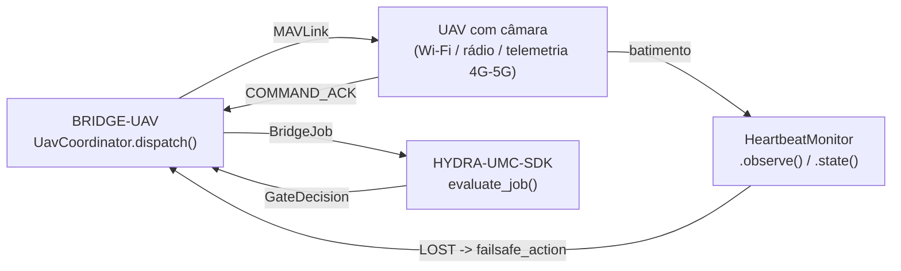

<!-- =============================================================================
HYDRA-UMC-BRIDGE-UAV - Camera-equipped UAV coordination bridge
Copyright (C) 2026 JuanenRac (Electro Hobby 3D) <electrohobby3d@gmail.com>
GPL-3.0-or-later - see LICENSE
============================================================================= -->

<p align="center">
  
</p>

# 🚁 HYDRA-UMC-BRIDGE-UAV

<p align="center"><a href="README.md">🇺🇸 English</a> | <a href="README_spa.md">🇪🇸 Español</a> | <a href="README_fra.md">🇫🇷 Français</a> | <a href="README_ita.md">🇮🇹 Italiano</a> | <a href="README_deu.md">🇩🇪 Deutsch</a> | <a href="README_zho.md">🇨🇳 简体中文</a> | <a href="README_jpn.md">🇯🇵 日本語</a> | 🇵🇹 <b>Português</b></p>

### 🔗 Fronteira de coordenação sem dependências entre o HYDRA-UMC e UAV com câmara

<p align="center">
  
  
  
</p>

---

> **Verificação de honestidade - o que realmente corre hoje:** o núcleo de pedidos de voo sem dependências (o `UavCoordinator` de `coordinator.py`, que encaminha cada despacho pelo `evaluate_job()` do próprio `HYDRA-UMC-SDK`), o vigilante determinista de batimentos por perda de ligação (o `HeartbeatMonitor` de `heartbeat.py`) e o transporte real de comandos MAVLink (o `MavlinkFlightControl` de `mavlink_transport.py`) são reais e estão cobertos por 84 testes unitários que passam (`python tools/build_test.py` - `test_coordinator.py`, `test_heartbeat.py`, `test_mavlink_transport.py`, mais `test_mavlink_emulator.py`, que executa o bridge contra um emulador de piloto automático MAVLink escrito à mão e fiel ao protocolo, não contra um real). Nada disto foi exercitado contra uma instalação real do `pymavlink`, uma ligação real de rádio/telemetria ou um UAV/controlador de voo físico: a ligação MAVLink falsa de `test_mavlink_transport.py` substitui por completo o `pymavlink` (nem sequer é preciso ter a biblioteca real instalada para estes testes passarem), e ainda não há comando `run` vivo porque não se escolheu nem validou nenhum transporte real MAVLink/OSDK. Ver «Estado atual e próximos passos» abaixo, que já o diz com clareza, e `CHANGELOG.md` para saber exatamente o que foi entregue até agora.
> **Estado de segurança (safety e security):** este ecossistema não é um sistema de segurança certificado. Ainda não existe um caminho de E-STOP por hardware, nem limites ou interlocks impostos pelo firmware, nem um comando de movimento verificado; as imagens de firmware são verificadas com CRC32 e um HMAC-SHA256 de chave partilhada, não com uma assinatura assimétrica; TLS e TLS mútuo são opcionais e estão desativados por defeito; nenhuma placa própria foi ainda montada ou testada. Leia a [base de segurança](https://github.com/JuanenRac/HYDRA-UMC-DOCS/blob/main/docs/SECURITY_BASELINE.md) e o [modelo de ameaças](https://github.com/JuanenRac/HYDRA-UMC-DOCS/blob/main/docs/THREAT_MODEL.md) antes de confiar em qualquer afirmação aqui para a segurança de uma pessoa.

## 📋 Num relance

| | |
|---|---|
| Versão | `0.1.5` |
| Maturidade | Funcional |
| Testes | 124 (`python tools/build_test.py`) |
| Tecnologia | Python / MAVLink / HYDRA-UMC-SDK |
| Em hardware real | Só simulado: testado com emuladores, dublês de teste ou simuladores; não há registo de execução em hardware real para esta versão |

## 1. 🛠️ VISÃO TÉCNICA GERAL

O **HYDRA-UMC-BRIDGE-UAV** é a fronteira de coordenação de alto nível entre o HYDRA-UMC e um drone com câmara (UAV), acessível por Wi-Fi, uma ligação de rádio ou uma ligação de telemetria celular (4G/5G). Valida e reencaminha um pequeno vocabulário com nome de pedidos de voo de alto nível (`ARM`, `TAKEOFF`, `GOTO_WAYPOINT`, `HOVER_AND_CAPTURE`, `RETURN_TO_LAUNCH`, `LAND`) e, em separado, executa um vigilante real e obrigatório de batimentos por perda de ligação. Nunca calcula controlo de voo nem estabilização e não pode contornar o HYDRA-UMC-SERVER, os limites do MCU, os watchdogs nem a paragem de emergência (E-STOP). Hoje o único caminho de regresso a partir do veículo é a confirmação do comando (`COMMAND_ACK`); não se lê telemetria.

Pertence à família de **Bridges móveis e autónomos**, ao lado do `HYDRA-UMC-BRIDGE-DROIDS` e do `HYDRA-UMC-BRIDGE-AMR`, e partilha o mesmo contrato de trabalho e segurança do `HYDRA-UMC-SDK` que os **Bridges de automação externa** fixos (CNC, LASER, OPENPNP, PRINTER3D, ROS2).

### Funcionalidades principais:
* ✅ **Núcleo de pedidos de voo real e sem dependências:** o `UavCoordinator` de `coordinator.py` não importa nenhum MAVLink/SDK de fabricante: é Python simples de propósito, testável em qualquer máquina sem um UAV real ligado. *(implementado, testado em `tests/test_coordinator.py`)*
* ✅ **Vocabulário real de pedidos de voo com nome:** `ARM`, `TAKEOFF`, `GOTO_WAYPOINT`, `HOVER_AND_CAPTURE`, `RETURN_TO_LAUNCH`, `LAND`: nunca um comando em bruto de atitude/aceleração. Uma missão normal `COMPLETE` e um `ABORT` de emergência resolvem-se ambos no mesmo pedido real `RETURN_TO_LAUNCH`. `LAND` é real e genuinamente distinto: o `MAV_CMD_NAV_LAND` do próprio MAVLink frente ao `MAV_CMD_NAV_RETURN_TO_LAUNCH` (verificado contra o [conjunto oficial de mensagens comuns do MAVLink](https://mavlink.io/en/messages/common.html)), para o caso real que o RTL por si só não cobre: descer já, não voar primeiro para casa (p. ex. bateria demasiado fraca, ou o caminho para casa não é seguro). `emergency_land_request()` expõe-o como pedido autónomo, de propósito fora do fluxo `dispatch()` guiado por `JobPhase`, com o mesmo raciocínio do sinal separado do próprio `HeartbeatMonitor`. *(implementado)*
* ✅ **Um vigilante real e obrigatório de batimentos por perda de ligação:** `HeartbeatMonitor` é uma máquina de estados determinista de falha segura, conduzida por um `now` explícito: nunca lê um relógio real, indica `LOST` desde a primeira verificação se nunca observou nada e trata o instante exatamente igual ao limite como ainda `OK` (só excedê-lo de verdade dispara a falha segura configurada `RETURN_TO_LAUNCH`/`LAND`). *(implementado, testado com uma suíte completa de limites deterministas em `tests/test_heartbeat.py`)*
* ✅ **HEARTBEAT próprio da ponte como estação de terra:** o `GcsHeartbeat` de `gcs_heartbeat.py` envia um `HEARTBEAT` MAVLink do tipo `MAV_TYPE_GCS` numa thread (1 Hz por predefinição, `HYDRA_UAV_GCS_HEARTBEAT_HZ` entre 0,1 e 10, `0` para desligar), para que o failsafe de perda de estação do piloto automático atue se a ponte morrer. Um batimento que não possa ser enviado é contado e comunicado, nunca lançado como erro. *(implementado, testado com uma ligação simulada em `tests/test_gcs_heartbeat.py`; ainda não experimentado com um piloto automático real)* `hydra-umc-bridge-uav run --connection <URL>` (ou `python -m hydra_umc_bridge_uav run ...`) abre a ligação MAVLink e mantém este heartbeat, imprime uma linha de estado de poucos em poucos segundos e termina limpamente com Ctrl-C, SIGTERM ou `--duration`; não envia mais nada ao veículo. Testado contra um registador da ligação; nunca executado contra um piloto automático real nem SITL.
* ✅ **Porta de segurança partilhada real:** cada trabalho despachado por `UavCoordinator.dispatch()` é avaliado pelo `evaluate_job()` do `bridge_contract` do `HYDRA-UMC-SDK`, a mesma porta que usam todos os bridges irmãos e o HYDRA-UMC-SERVER; uma fase produtiva exige uma máquina externa `IDLE` e uma célula do HYDRA-UMC `READY`, enquanto `ABORT` continua a poder pedir-se durante uma falha. *(implementado)*
* ✅ **Encaminhamento de fases com falha segura e evidência estática:** uma fase futura desconhecida do SDK é negada. `inspect_request_plan.py` emite o plano estático de pedidos de voo do esquema `1.1` (agora com o pedido autónomo `LAND`) sem abrir nenhum transporte. *(implementado, testado)*
* ✅ **Transporte real de comandos MAVLink:** o `MavlinkFlightControl` de `mavlink_transport.py` envia um despacho já aprovado como `COMMAND_LONG` real, associado a um `MAV_CMD` real e numerado (`MAV_CMD_NAV_TAKEOFF`/`MAV_CMD_DO_REPOSITION`/`MAV_CMD_NAV_LOITER_UNLIM`/`MAV_CMD_IMAGE_START_CAPTURE`/`MAV_CMD_NAV_RETURN_TO_LAUNCH`/`MAV_CMD_NAV_LAND`/`MAV_CMD_COMPONENT_ARM_DISARM`); um despacho rejeitado nunca chega à rede. *(implementado, testado em `tests/test_mavlink_transport.py`)*
* ✅ **Referencial de altitude explícito, envelope de voo e pedidos de estado seguro:** o `GOTO_WAYPOINT` sai como `COMMAND_INT` (posição em graus × 1e7, rumo mantido) com um `altitude_frame` explícito - `"relative"` (metros acima do ponto de descolagem, por omissão) ou `"amsl"`; um `FlightEnvelope` opcional (teto e raio a partir da origem, definidos pela instalação) recusa o que ficar fora; `RETURN_TO_LAUNCH`, `LAND` e o `DISARM` autónomo (nunca forçado) são enviados mesmo que a porta os tenha recusado, e um regresso normal de `COMPLETE` é aceite digam o que disserem a célula e a máquina; a espera do `COMMAND_ACK` salta as confirmações de outros comandos e de outros sistemas e trata `IN_PROGRESS` como ainda não concluído. *(implementado, testado; o formato no fio só é verificado contra o emulador - nunca contra o SITL do PX4/ArduPilot nem um piloto automático real, e a altitude de `TAKEOFF` continua a ser a referência própria do piloto automático, porque um `COMMAND_LONG` não leva referencial)*
* ✅ **Compilação/teste que não altera nada:** `build-test.bat`/`.sh` compilam o código-fonte e executam testes unitários deterministas sem alterar a versão nem o CHANGELOG. *(implementado, ver COMPILAR E EXECUTAR abaixo)*
* 🔜 **Um adaptador de transporte DJI OSDK** (para uma plataforma que não seja MAVLink): só se introduzirá depois de se escolher e testar esse SDK. *(planeado)*
* ✅ **Estado observado da máquina:** `UavCoordinator.dispatch()` aceita o estado que o piloto automático comunicou, que a porta partilhada usa em vez do `machine_state` escrito no trabalho (uma mensagem que qualquer pessoa no broker pode publicar); sem comunicação continua a usar-se o declarado. *(implementado, testado em `tests/test_observed_state.py`)*

---

## 2. 🔄 FLUXO DE COORDENAÇÃO DO UAV



---

## 3. 🧱 ARQUITETURA E DECISÕES DE DESENHO

* **Porque o vigilante de batimentos é um módulo próprio e não está integrado no coordenador.** A perda de ligação é um modo de falha real e distinto de «este trabalho está permitido agora»: o `HeartbeatMonitor` responde a «posso continuar a confiar no que ouvi por último deste UAV» independentemente de qualquer trabalho concreto, de modo que se pode verificar continuamente (p. ex. a cada tique de telemetria) e não só quando calha despachar-se um trabalho.
* **Porque o `HeartbeatMonitor` recebe um `now` explícito em vez de ler um relógio real.** A nota de arquitetura colada de que este projeto partiu é explícita em que um bridge de UAV EXIGE este vigilante; a única maneira de provar o seu comportamento exato no limite do tempo (e não só «acaba por expirar») sem uma suíte de testes instável, lenta e baseada em esperas reais é tornar o tempo uma entrada explícita e testável.
* **Porque `COMPLETE` e `ABORT` se resolvem ambos em `RETURN_TO_LAUNCH`.** Uma missão terminada e um aborto de emergência têm o mesmo resultado real correto para um UAV: voltar a casa. Reuni-los sob o mesmo nome de pedido no plano estático (sem repetição) reflete-o com honestidade em vez de inventar dois verbos diferentes de «ir para casa».
* **Porque o batimento deste bridge NÃO substitui expressamente a falha segura do próprio controlador de voo.** O Pixhawk/PX4 e o firmware da DJI já implementam uma falha segura real e quase certificada por perda de ligação ao nível do rádio/telemetria; o `HeartbeatMonitor` deste bridge é um sinal da camada de coordenação para o estado do próprio HYDRA-UMC, e ambos têm de existir de forma independente; ver a porta de aceitação de hardware de `docs/BRIDGE_GUIDE.md`.
* **Porque ainda não há um adaptador de transporte DJI OSDK neste repositório.** (O transporte MAVLink existe, ver acima.) Comprometer-se com o protocolo real de comandos/telemetria de um controlador de voo antes de ele ser escolhido e testado arriscaria fixar pressupostos que este núcleo local e sem dependências não consegue verificar.
* **Como se encaixa no resto do ecossistema.** O BRIDGE-UAV fica entre um UAV real e o `HYDRA-UMC-SDK` → `HYDRA-UMC-SERVER` → segurança do MCU: é uma fronteira de coordenação, nunca um nó de controlo de voo, e não pode contornar o HYDRA-UMC-SERVER, os limites do MCU, os watchdogs nem a paragem de emergência (E-STOP).

---

## 📂 ESTRUTURA DE DIRETORIAS

```text
HYDRA-UMC-BRIDGE-UAV/
├── src/
│   └── hydra_umc_bridge_uav/
│       ├── __init__.py
│       ├── coordinator.py       # UavCoordinator: porta de pedidos de voo sem dependências
│       ├── heartbeat.py         # HeartbeatMonitor: falha segura real e determinista por perda de ligação
│       ├── gcs_heartbeat.py     # HEARTBEAT próprio de estação de terra com ritmo configurável
│       ├── mavlink_transport.py # Envia um UavDispatch já aprovado como COMMAND_LONG / COMMAND_INT real do MAVLink
│       └── simulated_uav.py     # Tabela de estados de voo + veículo simulado: telemetria, autorização e armamento separados, sem transporte
├── tests/
│   ├── test_coordinator.py      # Testes unitários deterministas do núcleo de coordenação
│   ├── test_observed_state.py   # A porta usa o estado da máquina que o piloto automático comunica
│   ├── test_heartbeat.py        # Testes deterministas de limites do vigilante de batimentos
│   ├── test_simulated_uav.py    # Testes da tabela de estados e do veículo simulado
│   ├── test_mavlink_transport.py # Testes do formato MAV_CMD real contra uma ligação MAVLink falsa
│   ├── mavlink_emulator.py       # Emulador de piloto automático MAVLink fiel ao protocolo (dublê de teste realista)
│   └── test_mavlink_emulator.py  # Comportamento do bridge contra o emulador de piloto automático MAVLink
├── tools/
│   ├── build_test.py            # Executor de compilação + testes que não altera nada (build-test.bat/.sh)
│   ├── bump_version.py          # Sincroniza pyproject.toml, o manifesto e CHANGELOG.md
│   ├── ci_validate.py           # Base de CI sem dependências e não destrutiva (usada por .github/workflows/ci.yml)
│   └── inspect_request_plan.py  # Mostra o plano estático de pedidos de voo (sem abrir nenhum transporte)
├── docs/
│   └── BRIDGE_GUIDE.md          # Âmbito, plataformas compatíveis, scripts, porta de aceitação de hardware
├── images/
│   └── HYDRA_UMC_BANNER.svg     # Banner do README
├── build-test.bat / build-test.sh  # Só valida, nunca modifica o repositório
├── build.bat / build.sh            # Valida e compila (compilar nunca altera a versão)
├── pyproject.toml               # Metadados do pacote; depende do HYDRA-UMC-SDK (git)
├── hydra-umc.project.json       # Manifesto do ecossistema (versão, maturidade, família)
├── CHANGELOG.md
├── CODE_OF_CONDUCT.md / CONTRIBUTING.md / SECURITY.md / SUPPORT.md
├── LICENSE / LICENSE.md
└── README.md / README_*.md      # Este ficheiro e as suas 7 traduções
```

---

## 4. ⚙️ COMPILAR E EXECUTAR

Requer Python 3.11+. `tools/build_test.py` espera o `HYDRA-UMC-SDK` extraído como diretoria irmã (`../HYDRA-UMC-SDK`) ou indicado pela variável de ambiente `HYDRA_UMC_SDK_ROOT`.

```bash
# Windows
build-test.bat      # só valida - sem alteração de versão/CHANGELOG
build.bat            # Valida e compila (compilar nunca altera a versão)

# Linux/macOS
bash build-test.sh
bash build.sh
```

`build-test` compila com `py_compile` cada módulo em `src/` e executa a suíte `unittest` completa (todos os ficheiros `test_*.py` de `tests/`) de forma determinista, sem ligação a nenhum UAV real, sem rede e sem alteração de versão/CHANGELOG. `build` executa primeiro essa mesma validação e, só se correr bem, chama `tools/bump_version.py` para sincronizar a versão em `pyproject.toml`, `hydra-umc.project.json` e `CHANGELOG.md`. Ainda não há comando `run` de hardware vivo: exige um adaptador de transporte MAVLink/OSDK validado e um UAV real.

---

## ✅ Estado atual e próximos passos

**Real hoje:** versão `0.1.5`, funcional como núcleo de coordenação sem dependências (`UavCoordinator`) mais um vigilante real de batimentos por perda de ligação (`HeartbeatMonitor`) totalmente testado nos limites, encaminhamento de fases com falha segura, um esquema estático de pedidos de voo `plan-only` e um emissor real de comandos MAVLink (`MavlinkFlightControl`) que associa cada pedido ao seu `MAV_CMD` real e numerado; armar exige agora o booleano literal `confirm_arm is True` (nunca um valor meramente verdadeiro como a cadeia `'false'`), cada parâmetro numérico de voo é verificado como número real e não booleano antes de qualquer verificação de finitude/intervalo, e um comando enviado só se indica como confirmado quando regressa o seu `COMMAND_ACK` real com `MAV_RESULT_ACCEPTED`; e scripts build-test que não alteram nada ligados ao CI com um checkout do SDK.

**Fronteira de integração:** este bridge é apenas uma fronteira de coordenação: não é um nó de controlo de voo e não pode contornar o HYDRA-UMC-SERVER, os limites do MCU, os watchdogs nem a paragem de emergência (E-STOP); cada trabalho despachado continua a passar pela mesma porta partilhada que usam todos os bridges irmãos. O sinal de falha segura do próprio `HeartbeatMonitor` é uma questão da camada de coordenação, nunca um substituto da falha segura independente de perda de ligação do controlador de voo.

**Ainda por fazer:** ainda não se validou nenhum transporte real MAVLink (Pixhawk/PX4) nem DJI OSDK, nem nenhum UAV físico: um adaptador real só se introduzirá depois de se escolher e testar um controlador de voo/SDK concreto.

---

## 🔗 Projetos relacionados

Este projeto faz parte do ecossistema de robótica HYDRA-UMC do mesmo autor (JuanenRac / Electro Hobby 3D). Vale a pena conhecê-los, porque um pedido pode ser, na verdade, sobre um destes e não sobre este repositório.

**Projeto-mãe**
- **[HYDRA-UMC-SERVER](https://github.com/JuanenRac/HYDRA-UMC-SERVER)** — o verdadeiro backend sem interface (REST/WebSocket) com que falam todos os clientes de controlo; a fronteira autenticada do ecossistema a que este bridge reporta depois de cada comando ter passado pela porta de segurança local do próprio bridge.

**Projetos irmãos** — também falam com a API do próprio HYDRA-UMC-SERVER, cada um como cliente próprio
- **[HYDRA-UMC-STUDIO](https://github.com/JuanenRac/HYDRA-UMC-STUDIO)** — painel web de controlo com visualização 3D em tempo real de vários robôs.
- **[HYDRA-UMC-SUITE](https://github.com/JuanenRac/HYDRA-UMC-SUITE)** — centro de comando de enxame para desktop (PySide6) para vários servidores ao mesmo tempo, empacotado como executável independente.
- **[HYDRA-UMC-ANDROID-CONTROL](https://github.com/JuanenRac/HYDRA-UMC-ANDROID-CONTROL)** — aplicação Android nativa de controlo, com início de sessão biométrico e um companheiro Wear OS emparelhado.
- **[HYDRA-UMC-IOS-CONTROL](https://github.com/JuanenRac/HYDRA-UMC-IOS-CONTROL)** — aplicação de controlo para iOS/iPadOS (Flutter) com sincronização WebSocket em tempo real.
- **[HYDRA-UMC-DSI](https://github.com/JuanenRac/HYDRA-UMC-DSI)** — interface tátil nativa para o ecrã tátil DSI de 7" integrado, executada no próprio CM5.
- **[HYDRA-UMC-BRIDGE-AMR](https://github.com/JuanenRac/HYDRA-UMC-BRIDGE-AMR)** — fronteira de coordenação para frotas AGV/AMR através de um publicador MQTT VDA 5050 (testado apenas contra uma frota emulada) — um dos 3 bridges de frotas móveis do ecossistema.
- **[HYDRA-UMC-BRIDGE-CNC](https://github.com/JuanenRac/HYDRA-UMC-BRIDGE-CNC)** — coordenador de células CNC de alto nível com acesso ao estado GRBL e aos bytes de controlo (testado apenas contra um emulador).
- **[HYDRA-UMC-BRIDGE-DROIDS](https://github.com/JuanenRac/HYDRA-UMC-BRIDGE-DROIDS)** — fronteira de coordenação para droides com patas/humanoides, com um emissor de comandos para o Boston Dynamics Spot (testado apenas contra um emulador) — um dos 3 bridges de frotas móveis do ecossistema.
- **[HYDRA-UMC-BRIDGE-LASER](https://github.com/JuanenRac/HYDRA-UMC-BRIDGE-LASER)** — coordenador de células laser que lê 3 sinais GPIO (chave, caixa e interlock) (testado apenas contra um chip simulado; não pode armar nem disparar um laser).
- **[HYDRA-UMC-BRIDGE-OPENPNP](https://github.com/JuanenRac/HYDRA-UMC-BRIDGE-OPENPNP)** — coordenador seguro de fluxo de placa de alto nível para pick-and-place com OpenPnP.
- **[HYDRA-UMC-BRIDGE-PRINTER3D](https://github.com/JuanenRac/HYDRA-UMC-BRIDGE-PRINTER3D)** — fronteira de coordenação segura para impressoras 3D Moonraker/Klipper, com comandos de trabalho reais protegidos por portas.
- **[HYDRA-UMC-BRIDGE-ROS2](https://github.com/JuanenRac/HYDRA-UMC-BRIDGE-ROS2)** — coordenador com um transporte ROS 2 baseado em rclpy importado sob demanda (ainda não executado contra uma instalação ROS 2).

**Diretamente relacionados**
- **[HYDRA-UMC-SDK](https://github.com/JuanenRac/HYDRA-UMC-SDK)** — o contrato JSON-Schema partilhado e a fronteira de software de controlo de trabalhos contra a qual cada bridge valida os seus comandos (não é uma função de segurança certificada).
- **[HYDRA-UMC-CONNECTOR-HUB](https://github.com/JuanenRac/HYDRA-UMC-CONNECTOR-HUB)** — registo declarativo de manifestos de adaptador e validador para conectores de máquinas externas; estende a ideia de contrato do SDK a máquinas externas sem substituir os projetos de gateway industrial.

**Também fazem parte do ecossistema**

*Hardware e plataforma centrais*
- **[HYDRA-UMC](https://github.com/JuanenRac/HYDRA-UMC)** — o desenho da placa-mãe do braço robótico: anfitrião CM5 + STM32H745 de dois núcleos, pensado para orquestrar até 8 braços de ferramenta por CAN-OTA/SPI-OTA (firmware numa fase inicial; ainda sem placa montada).
- **[HYDRA-UMC-OS](https://github.com/JuanenRac/HYDRA-UMC-OS)** — camada de produto reproduzível do Raspberry Pi OS para o CM5: agente só de leitura, configuração/perfis validados, aprovisionamento Wi-Fi de primeiro contacto.

*Backend central e clientes*
- **[HYDRA-UMC-EDITOR-URDF](https://github.com/JuanenRac/HYDRA-UMC-EDITOR-URDF)** — criador/editor gráfico de URDF para desktop que envia os modelos concluídos para o catálogo do STUDIO.
- **[HYDRA-UMC-EDITOR-STL](https://github.com/JuanenRac/HYDRA-UMC-EDITOR-STL)** — editor de modelos STL para desktop que transforma/substitui/remove/adiciona peças reais no mesmo catálogo de modelos que o HYDRA-UMC-EDITOR-URDF também edita.

*Plataforma de ferramentas URTC*
- **[URTC](https://github.com/JuanenRac/URTC)** — firmware da placa física Universal Robot Tool Controller, mais de 25 perfis de ferramenta por barramento CAN.
- **[URTC-FLASHER](https://github.com/JuanenRac/URTC-FLASHER)** — ferramenta gráfica de gravação para desktop das placas URTC, por CAN-OTA e também SWD/JTAG de chip completo.
- **[URTC-TESTER](https://github.com/JuanenRac/URTC-TESTER)** — ferramenta de diagnóstico CAN em tempo real para desktop das placas URTC, com um painel por perfil de ferramenta.
- **[URTC-WEB-STUDIO](https://github.com/JuanenRac/URTC-WEB-STUDIO)** — alternativa no navegador ao URTC-TESTER através da Web Serial API, sem instalação local.
- **[URTC-GATEWAY](https://github.com/JuanenRac/URTC-GATEWAY)** — gateway à frente do barramento CAN do URTC: lista de identificadores permitidos, limite de taxa e chave de sessão; software testado num computador, ainda não num barramento real.

*Nó de IA de visão (Hailo-8)*
- **[HYDRA-UMC-VISION-NODE](https://github.com/JuanenRac/HYDRA-UMC-VISION-NODE)** — centro de integração do pipeline de visão Hailo-8, com uma verificação real de prontidão de hardware por fase.
- **[HYDRA-UMC-DETECTION-HEF](https://github.com/JuanenRac/HYDRA-UMC-DETECTION-HEF)** — registo real de modelos compilados com verificação segura de carga por arquitetura Hailo e soma de verificação.
- **[HYDRA-UMC-VISION-STREAMER](https://github.com/JuanenRac/HYDRA-UMC-VISION-STREAMER)** — pipeline GStreamer real e gerador de configuração MediaMTX com uma fronteira de integração HailoRT real.
- **[HYDRA-UMC-VISUAL-SERVOING-API](https://github.com/JuanenRac/HYDRA-UMC-VISUAL-SERVOING-API)** — lei de correção de servovisão baseada em posição com autorização condicionada ao estado da zona; ainda sem estimativa de pose por câmara.
- **[HYDRA-UMC-SAFETY-ZONES](https://github.com/JuanenRac/HYDRA-UMC-SAFETY-ZONES)** — lógica v0 de violação de zonas, atualidade da calibração e pedido de E-STOP que lê as posições dos objetos de um ficheiro; nenhum detetor a alimenta e ainda não há E-STOP físico ligado.

*Nó de IA cognitiva (Hailo-10)*
- **[HYDRA-UMC-COGNITIVE-NODE](https://github.com/JuanenRac/HYDRA-UMC-COGNITIVE-NODE)** — centro de integração do pipeline cognitivo do Hailo-10 (orquestração de LLM/VLA/voz).
- **[HYDRA-UMC-VLA-ENGINE](https://github.com/JuanenRac/HYDRA-UMC-VLA-ENGINE)** — codificação/descodificação real de tokens de ação e geração de trajetórias para um modelo Visão-Linguagem-Ação.
- **[HYDRA-UMC-VOICE-UI](https://github.com/JuanenRac/HYDRA-UMC-VOICE-UI)** — front-end de voz real (VAD + analisador de intenções) com um relé para o relógio limitado e protegido por confirmação.
- **[HYDRA-UMC-SEMANTIC-PLANNER](https://github.com/JuanenRac/HYDRA-UMC-SEMANTIC-PLANNER)** — decomposição real de tarefas baseada em regras e recuperação semântica de erros sobre os códigos de erro do MCU.
- **[HYDRA-UMC-DOCS-QA](https://github.com/JuanenRac/HYDRA-UMC-DOCS-QA)** — pesquisa real de documentos TF-IDF só com a biblioteca padrão sobre a documentação Markdown deste ecossistema.
- **[HYDRA-UMC-LOCAL-TECHNICIAN](https://github.com/JuanenRac/HYDRA-UMC-LOCAL-TECHNICIAN)** — técnico de manutenção de IA local, protegido por políticas, para o próprio ecossistema: observa, diagnostica e propõe correções; os dois níveis de maior risco não estão implementados de propósito.

*Orquestração e enxame*
- **[HYDRA-UMC-ORCHESTRATOR](https://github.com/JuanenRac/HYDRA-UMC-ORCHESTRATOR)** — centro de integração com um contrato real de relatório de saúde gRPC/Protobuf e uma máquina de estados de missões.
- **[HYDRA-UMC-JOB-DISPATCHER](https://github.com/JuanenRac/HYDRA-UMC-JOB-DISPATCHER)** — fila real de trabalhos por prioridade com deduplicação, sobre uma API HTTP real.
- **[HYDRA-UMC-NODE-HEALING](https://github.com/JuanenRac/HYDRA-UMC-NODE-HEALING)** — vigilante real de saúde da frota por gRPC com repetição/recuo e deteção de identidade incoerente.
- **[HYDRA-UMC-PATH-PLANNER-3D](https://github.com/JuanenRac/HYDRA-UMC-PATH-PLANNER-3D)** — planeador real de trajetórias 3D baseado em RRT com validação real de colisões com obstáculos e espaço de trabalho.
- **[HYDRA-UMC-SWARM-SYNC](https://github.com/JuanenRac/HYDRA-UMC-SWARM-SYNC)** — sincronização real de estado CRDT LWW-Element-Map, testada por propriedades para a convergência de várias células.

*Gémeo digital e simulação*
- **[HYDRA-UMC-TWIN](https://github.com/JuanenRac/HYDRA-UMC-TWIN)** — centro de integração do motor de gémeo digital, com um contrato real de sincronização de compatibilidade de versões.
- **[HYDRA-UMC-HIL-BRIDGE](https://github.com/JuanenRac/HYDRA-UMC-HIL-BRIDGE)** — encaminhador hardware-in-the-loop com um interlock de software de colisão entre a simulação e o hardware real (testado sem hardware real).
- **[HYDRA-UMC-PHYSICS-REPLICA](https://github.com/JuanenRac/HYDRA-UMC-PHYSICS-REPLICA)** — cinemática direta real e validação de limites de juntas sobre um subconjunto real de URDF.
- **[HYDRA-UMC-SYNTHETIC-DATA-GEN](https://github.com/JuanenRac/HYDRA-UMC-SYNTHETIC-DATA-GEN)** — gerador procedural real de cenas 2D com exportação de anotações YOLO/COCO.

*Dados e análise*
- **[HYDRA-UMC-DATALAKE](https://github.com/JuanenRac/HYDRA-UMC-DATALAKE)** — armazém real de séries temporais sobre sqlite3 com uma API HTTP real de ingestão/consulta.
- **[HYDRA-UMC-ANOMALY-DETECTOR](https://github.com/JuanenRac/HYDRA-UMC-ANOMALY-DETECTOR)** — detetor real de anomalias por FFT e linha de base estatística, com monitorização de deriva.
- **[HYDRA-UMC-PRODUCTION-REPORTS](https://github.com/JuanenRac/HYDRA-UMC-PRODUCTION-REPORTS)** — cálculo real de OEE/disponibilidade sobre o histórico do DATALAKE, com exportação CSV reprodutível.
- **[HYDRA-UMC-TELEMETRY-COLLECTOR](https://github.com/JuanenRac/HYDRA-UMC-TELEMETRY-COLLECTOR)** — pipeline real de ingestão CAN/WebSocket para o DATALAKE, com deduplicação por sequência.

*Gateway industrial*
- **[HYDRA-UMC-GATEWAY-INDUSTRIAL](https://github.com/JuanenRac/HYDRA-UMC-GATEWAY-INDUSTRIAL)** — centro de integração que retransmite para protocolos industriais, com uma camada real de lista de comandos permitidos e contrapressão.
- **[HYDRA-UMC-OPCUA-SERVER](https://github.com/JuanenRac/HYDRA-UMC-OPCUA-SERVER)** — espaço de endereços OPC-UA real, verificado com uma sessão de cliente real do protocolo binário.
- **[HYDRA-UMC-MQTT-BROKER](https://github.com/JuanenRac/HYDRA-UMC-MQTT-BROKER)** — broker MQTT real com autenticação opcional por cliente e ACL de tópicos.
- **[HYDRA-UMC-MTCONNECT-ADAPTER](https://github.com/JuanenRac/HYDRA-UMC-MTCONNECT-ADAPTER)** — endpoints XML MTConnect `/probe` e `/current` reais com saída em modo degradado.

*Ferramentas complementares e operações do ecossistema*
- **[HYDRA-UMC-DASHBOARD-AI](https://github.com/JuanenRac/HYDRA-UMC-DASHBOARD-AI)** — painéis de Resumos Inteligentes e Realce de Anomalias sobre o DATALAKE/ANOMALY-DETECTOR, com um recurso estatístico honesto.
- **[HYDRA-UMC-TOOL-CLI](https://github.com/JuanenRac/HYDRA-UMC-TOOL-CLI)** — CLI da frota com um contrato de códigos de saída real e estável, um cliente vivo genuíno da API do HYDRA-UMC-SERVER.
- **[HYDRA-UMC-WATCH](https://github.com/JuanenRac/HYDRA-UMC-WATCH)** — aplicação companheira WearOS com padrões de alerta tátil e um relé de voz para o telemóvel emparelhado (ainda não executada num relógio físico).
- **[URTC-SMART-RACK](https://github.com/JuanenRac/URTC-SMART-RACK)** — firmware de um rack de montagem de placas com descodificação real do ID da ferramenta e lógica de pré-aquecimento Smart Idle.
- **[URTC-VISION-TOOL](https://github.com/JuanenRac/URTC-VISION-TOOL)** — firmware mais um companheiro de visão em Python real para uma cabeça de ferramenta de inspeção térmica/RGB.
- **[HYDRA-UMC-UPDATER](https://github.com/JuanenRac/HYDRA-UMC-UPDATER)** — ferramenta administrativa de desktop que descobre, clona e atualiza todos os repositórios deste ecossistema.
- **[HYDRA-UMC-OS-REBUILDER](https://github.com/JuanenRac/HYDRA-UMC-OS-REBUILDER)** — ferramenta de desktop para Windows/Linux que constrói uma imagem do CM5 pronta a gravar com as versões mais recentes do ecossistema, com configuração de primeiro arranque de Wi-Fi/utilizador/SSH ao estilo do Raspberry Pi Imager.
- **[HYDRA-UMC-OPS-AGENT](https://github.com/JuanenRac/HYDRA-UMC-OPS-AGENT)** — coordenador de incidentes de manutenção: um papel de borda de poucos privilégios recolhe um inventário/estado higienizado, um papel de plano de controlo mostra-o só de leitura e pede a um fornecedor de IA que sugira um diagnóstico; nunca aplica um patch nem implanta nada.
- **[HYDRA-UMC-DEV-SERVER](https://github.com/JuanenRac/HYDRA-UMC-DEV-SERVER)** — anfitrião de desenvolvimento reproduzível (Raspberry Pi 5 / CM5) que guarda o código-fonte do ecossistema e executa tarefas limitadas de compilação/teste numa fila durável; um papel de desenvolvimento dedicado, explicitamente não um CM5 operacional.

---

## 📚 Documentação e comunidade

- **[CONTRIBUTING.md](CONTRIBUTING.md)** — pilha tecnológica e diretrizes de código para um pull request.
- **[CODE_OF_CONDUCT.md](CODE_OF_CONDUCT.md)** — as normas de comportamento esperadas nesta comunidade.
- **[SECURITY.md](SECURITY.md)** — como comunicar uma vulnerabilidade e as áreas de segurança em que este projeto se concentra.
- **[SUPPORT.md](SUPPORT.md)** — onde fazer perguntas e comunicar erros.
- **[LICENSE.md](LICENSE.md)** — a licença deste projeto.

## 👤 AUTOR
**JuanenRac** (Electro Hobby 3D)
📧 electrohobby3d@gmail.com
📺 [youtube.com/@electrohobby3d](https://youtube.com/@electrohobby3d)

## 📜 LICENÇA
GPL-3.0-or-later - consulte LICENSE para mais detalhes.

