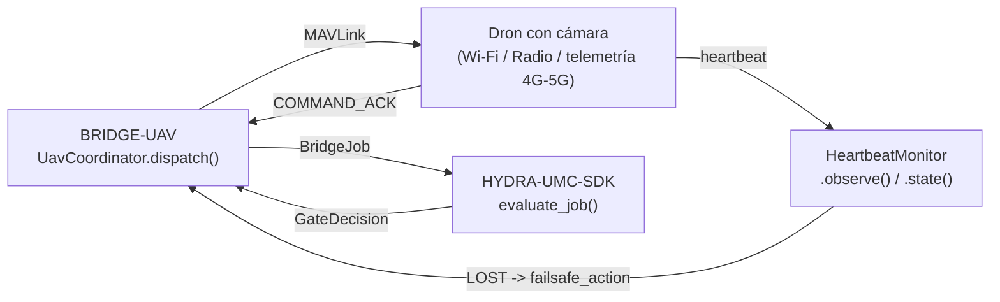

<!-- =============================================================================
HYDRA-UMC-BRIDGE-UAV - UAV coordination bridge
Copyright (C) JuanenRac (Electro Hobby 3D) <electrohobby3d@gmail.com>
GPL-3.0-or-later - see LICENSE
============================================================================= -->

<p align="center">
  
</p>

# 🚁 HYDRA-UMC-BRIDGE-UAV

<p align="center"><a href="README.md">🇺🇸 English</a> | 🇪🇸 <b>Español</b> | <a href="README_fra.md">🇫🇷 Français</a> | <a href="README_ita.md">🇮🇹 Italiano</a> | <a href="README_deu.md">🇩🇪 Deutsch</a> | <a href="README_zho.md">🇨🇳 简体中文</a> | <a href="README_jpn.md">🇯🇵 日本語</a> | <a href="README_por.md">🇵🇹 Português</a></p>

### 🔗 Frontera de coordinación sin dependencias entre HYDRA-UMC y drones (UAV) con cámara

<p align="center">
  
  
  
  
  
  
</p>

---

> **Comprobación de honestidad - qué funciona realmente hoy:** el núcleo de solicitudes de vuelo sin dependencias (`coordinator.py` con `UavCoordinator`, que hace pasar cada despacho por el propio `evaluate_job()` de `HYDRA-UMC-SDK`), el vigilante determinista de pérdida de enlace por heartbeat (`heartbeat.py` con `HeartbeatMonitor`), y el transporte de comandos MAVLink real (`mavlink_transport.py` con `MavlinkFlightControl`) son reales y están cubiertos por 84 tests unitarios que pasan (`python tools/build_test.py` - `test_coordinator.py`, `test_heartbeat.py`, `test_mavlink_transport.py`, más `test_mavlink_emulator.py`, que ejecuta el bridge contra un emulador de piloto automático MAVLink fiel al protocolo pero escrito a mano, no uno real). Nada de esto se ha probado contra una instalación real de `pymavlink`, un enlace de radio/telemetría real, o un UAV/controlador de vuelo físico - la propia conexión MAVLink falsa de `test_mavlink_transport.py` sustituye a `pymavlink` por completo (la librería real ni siquiera necesita estar instalada para que estos tests pasen), y todavía no existe un comando `run` en vivo porque no se ha seleccionado ni validado ningún transporte MAVLink/OSDK real. Ver "Estado actual y próximos pasos" más abajo, que ya lo indica con claridad, y `CHANGELOG.md` para lo que se ha entregado exactamente hasta ahora.

> **Estado de seguridad física y de ciberseguridad:** este ecosistema no es un sistema de seguridad certificado. Todavía no existe una ruta de E-STOP por hardware, ni límites ni enclavamientos aplicados por el firmware, ni un comando de movimiento verificado; las imágenes de firmware se comprueban con CRC-32 y una firma Ed25519, y una compilación de versión rechaza las claves de desarrollo publicadas (los cabezales de herramienta y las placas de expansión detrás del relé siguen con cargadores de URTC, que usan un HMAC-SHA256 de clave compartida en lugar de una firma); TLS y TLS mutuo son opcionales y están desactivados por defecto; aún no se ha poblado ni probado ninguna placa propia. Lee la [línea base de seguridad](https://github.com/JuanenRac/HYDRA-UMC-DOCS/blob/main/docs/SECURITY_BASELINE.md) y el [modelo de amenazas](https://github.com/JuanenRac/HYDRA-UMC-DOCS/blob/main/docs/THREAT_MODEL.md) antes de fiarte de cualquier afirmación de aquí para la seguridad de una persona.

---

## 📋 De un vistazo

| | |
|---|---|
| Versión | `0.1.5` |
| Madurez | Funcional |
| Tests | 146 (`python tools/build_test.py`) |
| Tecnología | Python / MAVLink / HYDRA-UMC-SDK |
| En hardware real | Solo simulado: probado con emuladores, dobles de prueba o simuladores; no consta ninguna ejecución en hardware real para esta versión |

**Ir a:** [Resumen](#-resumen) · [Arquitectura](#-arquitectura) · [Funciones](#-funciones) · [Seguridad y protección](#-seguridad-y-protección) · [Interfaces](#-interfaces) · [Configuración](#-configuración) · [Inicio rápido](#-inicio-rápido) · [Pruebas](#-pruebas) · [Resolución de problemas](#-resolución-de-problemas) · [Estructura del repositorio](#-estructura-del-repositorio) · [Proyectos relacionados](#-proyectos-relacionados)

## 🚦 Estado del proyecto

Cada línea es una parte de este repositorio y la luz dice hasta dónde llega hoy. Se escribe con lo que el repositorio puede demostrar (pruebas, compilaciones, ejecuciones), no con lo previsto.

🟢 Hecho y verificado · 🟡 Funciona, con límites conocidos · 🟠 Hecho a medias o sin verificar · 🔴 Sin hacer o sin funcionar

| Área | Estado | Qué significa aquí |
|---|---|---|
| Software | 🟡 | Funciona para su propósito principal; la comprobación de honestidad de arriba lista lo que aún falta |
| Pruebas | 🟢 | 146 pruebas automáticas, ejecutadas en cada cambio |
| Hardware real | 🟠 | Solo simulado: probado con emuladores, dobles de prueba o simuladores; no consta ninguna ejecución en hardware real para esta versión |
| Documentación | 🟢 | README en ocho idiomas, comprobado contra el manifiesto en cada cambio |

## 🎯 Resumen

**HYDRA-UMC-BRIDGE-UAV** es la frontera de coordinación de alto nivel entre HYDRA-UMC y un dron (UAV) con cámara, accesible por Wi-Fi, un enlace de radio o una conexión de telemetría celular (4G/5G). Valida y reenvía un vocabulario reducido y con nombre de peticiones de vuelo de alto nivel (`ARM`, `TAKEOFF`, `GOTO_WAYPOINT`, `HOVER_AND_CAPTURE`, `RETURN_TO_LAUNCH`), y por separado ejecuta un watchdog real y obligatorio de pérdida de enlace (heartbeat). Nunca calcula control de vuelo ni estabilización, y no puede saltarse a HYDRA-UMC-SERVER, los límites del MCU, los watchdogs ni el E-STOP. Hoy el único camino de vuelta desde el vehículo es el acuse de recibo del comando (`COMMAND_ACK`); no se lee telemetría.

Pertenece a la familia **Mobile & Autonomous Bridges** junto a `HYDRA-UMC-BRIDGE-DROIDS` y `HYDRA-UMC-BRIDGE-AMR`, y comparte el mismo contrato de trabajo y seguridad de `HYDRA-UMC-SDK` que los **External Automation Bridges** estacionarios (CNC, LASER, OPENPNP, PRINTER3D, ROS2).

## 🧩 Papel en HYDRA-UMC

**HYDRA-UMC-BRIDGE-UAV** está entre un UAV con cámara (MAVLink) y la celda de robots. Cuenta lo que dice ese lado, consulta la puerta compartida antes de cualquier trabajo auxiliar y nunca asume la autoridad de la máquina con la que coordina.

Comparte con todos los bridges el contrato de seguridad de `HYDRA-UMC-SDK`: un trabajo solo se acepta cuando la puerta compartida `evaluate_job()` lo permite, y esa puerta falla cerrada. Este bridge no tiene transporte MQTT; se ejecuta como el comando `hydra-umc-bridge-uav run`.

## 🏛️ Arquitectura

<p align="center">
  
</p>

<details>
<summary>Versión en texto del diagrama (Mermaid)</summary>



</details>

**Por qué está hecho así**

* **Por qué el watchdog de heartbeat es su propio módulo, no parte del coordinador.** La pérdida de enlace es un modo de fallo real y distinto de "¿está permitido este trabajo ahora mismo" - `HeartbeatMonitor` responde a "¿puedo seguir confiando en lo último que supe de este UAV" independientemente de cualquier trabajo concreto, así que se puede comprobar de forma continua (p. ej. en cada paquete de telemetría) y no solo cuando un trabajo se despacha.
* **Por qué `HeartbeatMonitor` recibe un `now` explícito en vez de leer un reloj real.** La nota de arquitectura pegada de la que partió este proyecto es explícita en que un bridge de UAV REQUIERE este watchdog - la única forma de demostrar su comportamiento exacto en el límite del timeout (no solo "acaba expirando en algún momento") sin una suite de tests lenta y basada en sleeps reales es hacer que el tiempo sea una entrada explícita y comprobable.
* **Por qué `COMPLETE` y `ABORT` resuelven ambos a `RETURN_TO_LAUNCH`.** Una misión terminada y un aborto de emergencia tienen el mismo resultado real correcto para un UAV: volver a casa. Colapsarlos en el mismo nombre de petición en el plan estático (deduplicado, no repetido) refleja eso con honestidad en vez de inventar dos verbos distintos de "volver".
* **Por qué el heartbeat propio de este bridge explícitamente NO sustituye al failsafe del controlador de vuelo.** El firmware de Pixhawk/PX4 y de DJI ya implementa un failsafe real de pérdida de enlace a nivel de radio/telemetría - el `HeartbeatMonitor` de este bridge es una señal de la propia capa de coordinación para el estado de HYDRA-UMC, y ambos deben existir de forma independiente; ver la propia puerta de aceptación de hardware en `docs/BRIDGE_GUIDE.md`.
* **Por qué aún no hay un adaptador de transporte DJI OSDK en este repositorio.** (El transporte MAVLink existe, véase arriba.) Comprometerse con el protocolo real de comandos/telemetría de un controlador de vuelo concreto antes de seleccionarlo y probarlo arriesgaría a dar por sentadas suposiciones que este núcleo local y sin dependencias no puede verificar.
* **Cómo encaja esto en el resto del ecosistema.** BRIDGE-UAV se sitúa entre un UAV real y `HYDRA-UMC-SDK` → `HYDRA-UMC-SERVER` → seguridad MCU - es una frontera de coordinación, nunca un nodo de control de vuelo, y no puede saltarse HYDRA-UMC-SERVER, los límites del MCU, los watchdogs ni el E-STOP.

## ✨ Funciones

* ✅ **Núcleo real de peticiones de vuelo, sin dependencias:** `coordinator.py`'s `UavCoordinator` no importa MAVLink ni ningún SDK de fabricante - es deliberadamente Python puro, comprobable en cualquier máquina sin un UAV real conectado. *(implementado, probado en `tests/test_coordinator.py`)*
* ✅ **Vocabulario real de peticiones de vuelo con nombre:** `ARM`, `TAKEOFF`, `GOTO_WAYPOINT`, `HOVER_AND_CAPTURE`, `RETURN_TO_LAUNCH`, `LAND` - nunca un comando bruto de actitud/acelerador. Un `COMPLETE` de misión normal y un `ABORT` de emergencia resuelven ambos a la misma petición real `RETURN_TO_LAUNCH`. `LAND` es real y genuinamente distinto - `MAV_CMD_NAV_LAND` frente a `MAV_CMD_NAV_RETURN_TO_LAUNCH` de MAVLink (comprobado contra el [conjunto oficial de mensajes comunes de MAVLink](https://mavlink.io/en/messages/common.html)) - para el caso real que RTL por sí solo no cubre: descender ya, no volar primero a casa (p. ej. batería demasiado baja, o el camino de vuelta no es seguro). `emergency_land_request()` lo expone como una petición independiente, deliberadamente fuera del flujo `dispatch()` guiado por `JobPhase` - mismo razonamiento que la señal separada de `HeartbeatMonitor`. *(implementado)*
* ✅ **Watchdog real y obligatorio de pérdida de enlace:** `HeartbeatMonitor` es una máquina de estados de fallo determinista, guiada por un `now` explícito - nunca lee un reloj real, informa `LOST` desde la primera comprobación si nunca se observó nada, y trata el instante exacto del timeout como todavía `OK` (solo superarlo de verdad dispara el failsafe configurado `RETURN_TO_LAUNCH`/`LAND`). *(implementado, probado con una suite determinista completa de casos límite en `tests/test_heartbeat.py`)*
* ✅ **HEARTBEAT propio del puente como estación de tierra:** `GcsHeartbeat` de `gcs_heartbeat.py` envía un `HEARTBEAT` MAVLink de tipo `MAV_TYPE_GCS` en un hilo (1 Hz por defecto, `HYDRA_UAV_GCS_HEARTBEAT_HZ` entre 0,1 y 10, `0` para apagarlo), de modo que el failsafe de pérdida de estación del autopiloto actúe si el puente muere. Un latido que no se puede enviar se cuenta y se informa, nunca lanza error. *(implementado, probado con un enlace simulado en `tests/test_gcs_heartbeat.py`; aún no probado con un autopiloto real)* `hydra-umc-bridge-uav run --connection <URL>` (o `python -m hydra_umc_bridge_uav run ...`) abre el enlace MAVLink y mantiene este latido, imprime una línea de estado cada pocos segundos y se detiene limpiamente con Ctrl-C, SIGTERM o `--duration`; no envía nada más al vehículo. Probado contra un registrador del enlace; nunca se ha ejecutado contra un autopiloto real ni SITL.
* ✅ **Puerta de seguridad compartida real:** cada trabajo despachado mediante `UavCoordinator.dispatch()` se evalúa con `evaluate_job()` de `bridge_contract` de `HYDRA-UMC-SDK`, la misma puerta que usan todos los bridges hermanos y HYDRA-UMC-SERVER; una fase productiva exige una máquina externa `IDLE` y una celda HYDRA-UMC `READY`, mientras que `ABORT` sigue siendo solicitable durante un fallo. *(implementado)*
* ✅ **Enrutado de fase con fallo cerrado y evidencia estática:** una fase futura del SDK desconocida se rechaza. `inspect_request_plan.py` emite el plan de peticiones de vuelo estático del esquema `1.1` (que ahora incluye la petición independiente `LAND`) sin abrir ningún transporte. *(implementado, probado)*
* ✅ **Transporte real de comandos MAVLink:** `mavlink_transport.py`'s `MavlinkFlightControl` envía un despacho ya validado como un `COMMAND_LONG` real, mapeado a un `MAV_CMD` real y numerado (`MAV_CMD_NAV_TAKEOFF`/`MAV_CMD_DO_REPOSITION`/`MAV_CMD_NAV_LOITER_UNLIM`/`MAV_CMD_IMAGE_START_CAPTURE`/`MAV_CMD_NAV_RETURN_TO_LAUNCH`/`MAV_CMD_NAV_LAND`/`MAV_CMD_COMPONENT_ARM_DISARM`) - un despacho rechazado nunca llega a la red. *(implementado, probado en `tests/test_mavlink_transport.py`)*
* ✅ **Marco de altitud explícito, envolvente de vuelo y peticiones de estado seguro:** `GOTO_WAYPOINT` sale como `COMMAND_INT` (posición en grados × 1e7, rumbo conservado) con un `altitude_frame` explícito - `"relative"` (metros sobre el punto de despegue, el valor por defecto) o `"amsl"`; una `FlightEnvelope` opcional (techo y radio desde el origen, fijados por el despliegue) rechaza lo que quede fuera; `RETURN_TO_LAUNCH`, `LAND` y el `DISARM` independiente (nunca forzado) se envían aunque la puerta los haya rechazado, y un retorno normal de `COMPLETE` se acepta diga lo que diga la celda o la máquina; la espera del `COMMAND_ACK` salta los acuses de otros comandos y de otros sistemas y trata `IN_PROGRESS` como aún no terminado. *(implementado, probado; el formato en el cable solo se comprueba contra el emulador - nunca contra el SITL de PX4/ArduPilot ni un autopiloto real, y la altitud de `TAKEOFF` sigue siendo la referencia propia del autopiloto, porque un `COMMAND_LONG` no lleva marco)*
* ✅ **Build/test sin mutación:** `build-test.bat`/`.sh` compilan el código fuente y ejecutan tests deterministas sin cambiar versión ni CHANGELOG. *(implementado, ver BUILD Y EJECUCIÓN más abajo)*
* 🔜 **Un adaptador de transporte DJI OSDK** (para una plataforma que no use MAVLink) - se introducirá solo tras seleccionar y probar ese SDK. *(planeado)*
* ✅ **Estado observado de la máquina:** `UavCoordinator.dispatch()` acepta el estado que informó el piloto automático, que la puerta compartida usa en lugar del `machine_state` escrito en el trabajo (un mensaje que cualquiera en el broker puede publicar); sin informe se sigue usando lo declarado. *(implementado, probado en `tests/test_observed_state.py`)*

## 🔒 Seguridad y protección

| Amenaza | Defensa | Dónde |
|---|---|---|
| Un trabajo para una celda o máquina que no está en estado seguro | Todo trabajo pasa por la puerta compartida `evaluate_job()` del SDK, que falla cerrada; el bridge no tiene lógica propia de aceptar o rechazar | SDK `bridge_contract` |
| Datos de trabajo desmesurados | Como máximo 32 parámetros, claves de hasta 64 caracteres, valores de hasta 1024, identificadores de hasta 128 (`MAX_PARAMETERS`, `MAX_PARAMETER_KEY_CHARS`, `MAX_PARAMETER_VALUE_CHARS`, `MAX_IDENTIFIER_CHARS`) | SDK `bridge_contract` |
| Una orden repetida o reenviada | Un `IdempotencyStore` recuerda cada clave 24 horas y como máximo 10 000 entradas; una repetición recibe la primera respuesta en vez de evaluarse otra vez | SDK `job_intake` |
| Perder el enlace con el vehículo | `HeartbeatMonitor` es una máquina de estados determinista cuyo modo seguro es `RETURN_TO_LAUNCH` o `LAND`; el bridge envía su propio HEARTBEAT de estación de tierra a 1 Hz por defecto (0,1 a 10 Hz, `HYDRA_UAV_GCS_HEARTBEAT_HZ`) | `heartbeat.py`, `gcs_heartbeat.py` |
| Una orden que nadie autorizó | `ARM`, `TAKEOFF`, `GOTO_WAYPOINT` y `HOVER_AND_CAPTURE` necesitan autorización; las peticiones de estado seguro, salvo `DISARM`, se aceptan siempre | `simulated_uav.py` |
| Un mensaje MAVLink falsificado | Firma MAVLink 2 con una clave de 32 bytes (fichero crudo o 64 caracteres hexadecimales) de `--signing-key-file` o `HYDRA_UMC_BRIDGE_UAV_SIGNING_KEY_FILE`; los mensajes sin firma se rechazan salvo que se dé `--signing-allow-unsigned` para un vehículo que aún no firma | `mavlink_transport.py`, `cli.py` |
| Un marco de altitud confundido | El marco de altitud es explícito: `relative` (`GLOBAL_RELATIVE_ALT_INT`) o `amsl` (`GLOBAL_INT`) | `mavlink_transport.py` |

**Lo que nunca hace:** solo convierte en órdenes MAVLink reales las peticiones de vuelo de alto nivel que la puerta aprobó (ARM/DISARM, TAKEOFF, DO_REPOSITION, LOITER_UNLIM, RTL, LAND, IMAGE_START_CAPTURE) y nunca envía movimiento crudo.

## 🔌 Interfaces

El comando `hydra-umc-bridge-uav run` (o `python -m hydra_umc_bridge_uav run`) abre el enlace MAVLink y mantiene el latido de la estación de tierra. Códigos de salida: `0` parada normal, `1` no se pudo abrir el enlace o enviar un latido, `2` opción incorrecta.

| Variable | Por defecto | Qué fija |
|---|---|---|
| `--connection` | obligatorio | una URL de pymavlink, por ejemplo `udpin:0.0.0.0:14550` o `/dev/ttyUSB0` |
| `--heartbeat-hz` | `1.0` | de 0,1 a 10; el valor por defecto sale de `HYDRA_UAV_GCS_HEARTBEAT_HZ` |
| `--heartbeat-timeout` | `10.0` | segundos de espera del primer latido del vehículo |
| `--status-every`, `--duration` | `10.0`, `0` | segundos entre líneas de estado (`0` no imprime ninguna); parar tras estos segundos (`0` funciona hasta que se pare) |
| `--signing-key-file`, `--signing-allow-unsigned` | desactivado | fichero de la clave de firma MAVLink 2; aceptar mensajes sin firma de un vehículo que aún no firma |
| `--server-config` | desactivado | el `data/server-config.json` del Server: su sección `mavlink` (fijada desde Server Admin) da el fichero de clave y el interruptor de mensajes sin firma cuando no lo dicen la opción ni el entorno |

## ⚙️ Configuración

| Variable | Por defecto | Qué fija |
|---|---|---|
| `HYDRA_UAV_GCS_HEARTBEAT_HZ` | `1.0` | frecuencia del latido de estación de tierra del bridge, de 0,1 a 10; `0` lo apaga |
| `HYDRA_UMC_BRIDGE_UAV_SIGNING_KEY_FILE` | sin definir | ruta de la clave de firma MAVLink 2 (32 bytes, cruda o 64 caracteres hexadecimales); manda `--signing-key-file` |
| `HYDRA_UMC_BRIDGE_UAV_SIGNING_ALLOW_UNSIGNED` | sin definir | `1` acepta mensajes sin firma con una clave; manda `--signing-allow-unsigned`, luego esto, luego la configuración del Server |
| `HYDRA_UMC_BRIDGE_UAV_SERVER_CONFIG` | sin definir | ruta del `data/server-config.json` del Server (manda `--server-config`) |

## 🚀 Inicio rápido

Requiere Python 3.11 o superior. Las pruebas y los scripts de compilación esperan `HYDRA-UMC-SDK` clonado junto a este repositorio (`../HYDRA-UMC-SDK`) o indicado con `HYDRA_UMC_SDK_ROOT`.

Pruébalo sin hardware (esto comprueba todo el bridge contra sus emuladores y dobles de prueba):

```bash
py -3 tools/build_test.py          # Windows
python3 tools/build_test.py         # Linux, macOS
```

Ejecuta el bridge (necesita el extra `mavlink`: `pip install ".[mavlink]"`):

```bash
hydra-umc-bridge-uav run --connection udpin:0.0.0.0:14550 --signing-key-file ~/uav-signing.key
```

## 🧪 Pruebas

146 casos automáticos de `unittest` se ejecutan con `python tools/build_test.py` (que también compila cada módulo). Las pruebas no necesitan hardware, red ni paquetes opcionales: las que necesitarían `paho-mqtt`, `pyserial` o una biblioteca del fabricante usan un sustituto o se saltan si falta el paquete.

| Fichero de pruebas | Pruebas | Qué cubre |
|---|---|---|
| `test_coordinator.py`, `test_observed_state.py`, `test_simulated_uav.py` | - | paso de trabajo a petición de vuelo, el estado observado del vehículo, qué petición es legal desde qué estado |
| `test_mavlink_transport.py`, `test_mavlink_emulator.py`, `mavlink_emulator.py` | - | órdenes MAVLink reales contra dobles y un emulador, marcos de altitud, firma |
| `test_heartbeat.py`, `test_gcs_heartbeat.py`, `test_cli.py`, `test_edge_cases.py` | - | el fallo de enlace, el latido de estación de tierra, la línea de órdenes y sus códigos de salida, casos límite |

El CI ejecuta `HYDRA_UMC_CI=1 python tools/ci_validate.py`, que comprueba el manifiesto, los documentos, los ocho README y las imágenes, y ejecuta las pruebas con una copia del SDK.

## 🏗️ Compilación y publicación

Requiere Python 3.11+. `tools/build_test.py` espera `HYDRA-UMC-SDK` clonado como directorio hermano (`../HYDRA-UMC-SDK`) o indicado mediante la variable de entorno `HYDRA_UMC_SDK_ROOT`.

```bash
# Windows
build-test.bat      # solo valida — sin cambio de versión/CHANGELOG
build.bat            # Valida y compila (compilar nunca cambia la versión)

# Linux/macOS
bash build-test.sh
bash build.sh
```

`build-test` compila cada módulo bajo `src/` con `py_compile` y ejecuta la suite completa de `unittest` (todos los ficheros `test_*.py` de `tests/`) - de forma determinista, sin conexión real a ningún UAV, sin red y sin cambio de versión/CHANGELOG. `build` ejecuta esa misma validación primero y, solo si tiene éxito, llama a `tools/bump_version.py` para sincronizar la versión entre `pyproject.toml`, `hydra-umc.project.json` y `CHANGELOG.md`. Todavía no existe un comando `run` con hardware real - eso requiere un adaptador de transporte MAVLink/OSDK validado y un UAV real.

## 🩺 Resolución de problemas

| Ves | Porque | Haz |
|---|---|---|
| `ModuleNotFoundError: hydra_umc_sdk` | El SDK no está instalado ni junto a este repositorio | Clona `HYDRA-UMC-SDK` junto a este repositorio o define `HYDRA_UMC_SDK_ROOT` |
| exit code `1` | No se pudo abrir el enlace MAVLink o no se pudo enviar ningún latido | Revisa `--connection` (URL o dispositivo serie) y que `pymavlink` esté instalado (`.[mavlink]`) |
| exit code `2` | Una opción incorrecta, por ejemplo una frecuencia fuera de 0,1 a 10 o una clave de firma ilegible | Corrige la opción; el fichero de clave debe tener exactamente 32 bytes (crudo o 64 caracteres hexadecimales) |
| `"allowed": false` + `reason` | La puerta compartida o una guarda rechazó la orden | Lee `reason` y arregla la causa; no reintentes a ciegas |

## 📂 Estructura del repositorio

<p align="center">
  
</p>

<details>
<summary>Versión en texto del árbol</summary>

```text
HYDRA-UMC-BRIDGE-UAV/
├── src/hydra_umc_bridge_uav/
│   ├── coordinator.py             trabajo a una petición de vuelo con nombre
│   ├── mavlink_transport.py       peticiones aprobadas como órdenes MAVLink reales
│   ├── heartbeat.py               máquina de estados de fallo de enlace
│   ├── gcs_heartbeat.py           el HEARTBEAT propio de estación de tierra
│   ├── cli.py                     `hydra-umc-bridge-uav run`
│   └── simulated_uav.py           qué petición es legal desde qué estado
├── tests/                         146 pruebas, con un emulador MAVLink
├── docs/                          guía del bridge
├── tools/                         ejecutor de compilación y pruebas, subida de versión, validador de CI, generadores y comprobaciones de README e imágenes
├── images/                        banner y las imágenes del README
├── .github/                       flujo de CI y plantillas de incidencias
├── pyproject.toml                 metadatos del paquete y dependencias
├── hydra-umc.project.json         manifiesto: versión, madurez, familia
├── CHANGELOG.md                   qué cambió en cada versión
├── build.sh build.bat             scripts de compilación (nunca cambian la versión)
├── build-test.sh build-test.bat   scripts de compilación (nunca cambian la versión)
├── test.sh test.bat               ejecutan las pruebas
└── SECURITY.md SUPPORT.md CONTRIBUTING.md CODE_OF_CONDUCT.md LICENSE LICENSE.md
```

</details>

## 🗺️ Hoja de ruta y límites conocidos

**Límites conocidos hoy**

**Real hoy:** versión `0.1.5`, funcional como núcleo de coordinación sin dependencias (`UavCoordinator`) más un watchdog real de pérdida de enlace totalmente probado en sus casos límite (`HeartbeatMonitor`), enrutado de fase con fallo cerrado, un esquema de peticiones de vuelo estático `plan-only`, un transporte real de comandos MAVLink (`MavlinkFlightControl`) que mapea cada petición a su `MAV_CMD` real y numerado - armar ahora exige el booleano literal `confirm_arm is True` (nunca un valor meramente verdadero como la cadena `'false'`), todo parámetro numérico de vuelo se comprueba como número real no booleano antes de cualquier comprobación de finitud/rango, y un comando enviado solo se reporta como confirmado una vez llega su `COMMAND_ACK` real con `MAV_RESULT_ACCEPTED` -, y scripts de build-test sin mutación integrados en CI con un checkout del SDK.

**Frontera de integración:** este bridge es solo una frontera de coordinación - no es un nodo de control de vuelo, y no puede saltarse HYDRA-UMC-SERVER, los límites del MCU, los watchdogs ni el E-STOP; cada trabajo despachado sigue pasando por la misma puerta compartida que usan todos los bridges hermanos. La señal de failsafe propia de `HeartbeatMonitor` es un asunto de la capa de coordinación, nunca un sustituto del failsafe independiente del propio controlador de vuelo.

**Todavía pendiente:** aún no se ha validado ningún transporte real MAVLink (Pixhawk/PX4) ni DJI OSDK, ni un UAV físico - un adaptador real se introducirá solo después de seleccionar y probar un controlador de vuelo/SDK concreto.

## 🌍 Idiomas

Este README y los documentos del repositorio existen en ocho idiomas: inglés, español, alemán, francés, italiano, japonés, chino y portugués (Portugal). Se escriben a la vez y el CI comprueba que los ocho ficheros tengan las mismas secciones y los mismos enlaces. Este repositorio no tiene pantalla ni catálogo de mensajes propios, así que no hay cadenas de interfaz que traducir.

## 🔗 Proyectos relacionados

Este proyecto es parte del ecosistema de robótica HYDRA-UMC del mismo autor (JuanenRac / Electro Hobby 3D). Vale la pena conocerlo, ya que una petición podría en realidad ser sobre alguno de estos en vez de sobre este repositorio.

**Proyecto Padre**
- **[HYDRA-UMC-SERVER](https://github.com/JuanenRac/HYDRA-UMC-SERVER)** — el backend headless real (REST/WebSocket) con el que habla de verdad cada cliente de control; la frontera autenticada del ecosistema a la que reporta este bridge una vez cada comando ha superado la barrera de seguridad local de este propio bridge.

**Proyectos Hermanos** — también hablan con la propia API de HYDRA-UMC-SERVER, cada uno como su propio cliente
- **[HYDRA-UMC-STUDIO](https://github.com/JuanenRac/HYDRA-UMC-STUDIO)** — panel de control web con visualización 3D multi-robot en tiempo real.
- **[HYDRA-UMC-SUITE](https://github.com/JuanenRac/HYDRA-UMC-SUITE)** — centro de mando de enjambre de escritorio (PySide6) para varios servidores a la vez, empaquetado como ejecutable independiente.
- **[HYDRA-UMC-ANDROID-CONTROL](https://github.com/JuanenRac/HYDRA-UMC-ANDROID-CONTROL)** — app nativa de control para Android con inicio de sesión biométrico y un compañero Wear OS emparejado.
- **[HYDRA-UMC-IOS-CONTROL](https://github.com/JuanenRac/HYDRA-UMC-IOS-CONTROL)** — app de control para iOS/iPadOS (Flutter) con sincronización en tiempo real por WebSocket.
- **[HYDRA-UMC-DSI](https://github.com/JuanenRac/HYDRA-UMC-DSI)** — interfaz táctil nativa para la pantalla táctil DSI de 7" a bordo, embebida en el propio CM5.
- **[HYDRA-UMC-BRIDGE-AMR](https://github.com/JuanenRac/HYDRA-UMC-BRIDGE-AMR)** — barrera de coordinación para flotas AGV/AMR mediante un publicador MQTT VDA 5050 (probado solo contra una flota emulada) — uno de los 3 bridges de flota móvil del ecosistema.
- **[HYDRA-UMC-BRIDGE-CNC](https://github.com/JuanenRac/HYDRA-UMC-BRIDGE-CNC)** — coordinador de alto nivel para celdas CNC con acceso a estado/bytes de control GRBL (probado solo contra un emulador).
- **[HYDRA-UMC-BRIDGE-DROIDS](https://github.com/JuanenRac/HYDRA-UMC-BRIDGE-DROIDS)** — barrera de coordinación para droides con patas/humanoides, con un emisor de comandos para Boston Dynamics Spot (probado solo contra un emulador) — uno de los 3 bridges de flota móvil del ecosistema.
- **[HYDRA-UMC-BRIDGE-LASER](https://github.com/JuanenRac/HYDRA-UMC-BRIDGE-LASER)** — coordinador de celdas láser que lee 3 señales GPIO de llave/carcasa/enclavamiento (probado solo contra un chip simulado; no puede armar ni disparar un láser).
- **[HYDRA-UMC-BRIDGE-OPENPNP](https://github.com/JuanenRac/HYDRA-UMC-BRIDGE-OPENPNP)** — coordinador de alto nivel seguro para el flujo de placas de pick-and-place OpenPnP.
- **[HYDRA-UMC-BRIDGE-PRINTER3D](https://github.com/JuanenRac/HYDRA-UMC-BRIDGE-PRINTER3D)** — barrera de coordinación segura para impresoras 3D Moonraker/Klipper, con comandos de trabajo reales y controlados.
- **[HYDRA-UMC-BRIDGE-ROS2](https://github.com/JuanenRac/HYDRA-UMC-BRIDGE-ROS2)** — coordinador con un transporte ROS 2 rclpy importado de forma perezosa (todavía no ejecutado contra una instalación de ROS 2).

**Directamente Relacionados**
- **[HYDRA-UMC-SDK](https://github.com/JuanenRac/HYDRA-UMC-SDK)** — el contrato JSON-Schema compartido y la barrera de software de puerta de trabajos contra la que cada bridge valida sus comandos (no es una función de seguridad certificada).
- **[HYDRA-UMC-CONNECTOR-HUB](https://github.com/JuanenRac/HYDRA-UMC-CONNECTOR-HUB)** — registro declarativo y validador de manifiestos de adaptador para conectores de máquinas externas; extiende la propia idea de contrato del SDK a máquinas externas sin sustituir a los proyectos de pasarela industrial.

**También Forma Parte del Ecosistema**

*Hardware y Plataforma Base*
- **[HYDRA-UMC](https://github.com/JuanenRac/HYDRA-UMC)** — el diseño de la placa madre del brazo robótico: host CM5 + coprocesador STM32H745 de doble núcleo, pensado para coordinar hasta 8 brazos herramienta por CAN-OTA/SPI-OTA (firmware en fase temprana; todavía no hay ninguna placa poblada).
- **[HYDRA-UMC-OS](https://github.com/JuanenRac/HYDRA-UMC-OS)** — capa de producto reproducible sobre Raspberry Pi OS para el CM5: agente de solo lectura, config/perfiles validados, aprovisionamiento WiFi de primer contacto.

*Backend Central y Clientes*
- **[HYDRA-UMC-EDITOR-URDF](https://github.com/JuanenRac/HYDRA-UMC-EDITOR-URDF)** — creador/editor gráfico de URDF de escritorio que envía los modelos terminados al propio catálogo de STUDIO.
- **[HYDRA-UMC-EDITOR-STL](https://github.com/JuanenRac/HYDRA-UMC-EDITOR-STL)** — editor de escritorio de modelos STL, que transforma/reemplaza/quita/añade piezas reales en el mismo catálogo de modelos que también edita HYDRA-UMC-EDITOR-URDF.

*Plataforma de Herramientas URTC*
- **[URTC](https://github.com/JuanenRac/URTC)** — firmware para la placa física del Universal Robot Tool Controller, más de 25 perfiles de herramienta por bus CAN.
- **[URTC-FLASHER](https://github.com/JuanenRac/URTC-FLASHER)** — herramienta de escritorio con GUI para flashear placas URTC, CAN-OTA más SWD/JTAG de chip completo.
- **[URTC-TESTER](https://github.com/JuanenRac/URTC-TESTER)** — herramienta de escritorio de diagnóstico CAN-bus en vivo para placas URTC, un panel por perfil de herramienta.
- **[URTC-WEB-STUDIO](https://github.com/JuanenRac/URTC-WEB-STUDIO)** — alternativa basada en navegador a URTC-TESTER mediante la Web Serial API, sin instalación local.
- **[URTC-GATEWAY](https://github.com/JuanenRac/URTC-GATEWAY)** — pasarela delante del bus CAN de URTC: lista de identificadores permitidos, límite de tasa y clave de sesión; software probado en ordenador, aún no en un bus real.

*Nodo IA de Visión (Hailo-8)*
- **[HYDRA-UMC-VISION-NODE](https://github.com/JuanenRac/HYDRA-UMC-VISION-NODE)** — nodo de integración para el pipeline de visión Hailo-8, con una comprobación real de disponibilidad de hardware por etapa.
- **[HYDRA-UMC-DETECTION-HEF](https://github.com/JuanenRac/HYDRA-UMC-DETECTION-HEF)** — registro real de modelos compilados con verificación de carga segura por arquitectura Hailo/checksum.
- **[HYDRA-UMC-VISION-STREAMER](https://github.com/JuanenRac/HYDRA-UMC-VISION-STREAMER)** — generador real de pipeline GStreamer + config MediaMTX, con una frontera de integración HailoRT real.
- **[HYDRA-UMC-VISUAL-SERVOING-API](https://github.com/JuanenRac/HYDRA-UMC-VISUAL-SERVOING-API)** — ley de corrección Position-Based Visual Servoing con autorización condicionada al estado de zona; todavía sin estimación de pose por cámara.
- **[HYDRA-UMC-SAFETY-ZONES](https://github.com/JuanenRac/HYDRA-UMC-SAFETY-ZONES)** — lógica v0 de invasión de zona, vigencia de calibración y solicitud de E-STOP que toma las posiciones de los objetos de un fichero; ningún detector la alimenta y todavía no hay un E-STOP físico conectado.

*Nodo IA Cognitivo (Hailo-10)*
- **[HYDRA-UMC-COGNITIVE-NODE](https://github.com/JuanenRac/HYDRA-UMC-COGNITIVE-NODE)** — nodo de integración para el pipeline cognitivo Hailo-10 (orquestación de LLM/VLA/voz).
- **[HYDRA-UMC-VLA-ENGINE](https://github.com/JuanenRac/HYDRA-UMC-VLA-ENGINE)** — codificación/decodificación real de tokens de acción y generación de trayectoria para un modelo Vision-Language-Action.
- **[HYDRA-UMC-VOICE-UI](https://github.com/JuanenRac/HYDRA-UMC-VOICE-UI)** — front-end de voz real (VAD + analizador de intención) con un relé a Watch acotado y con confirmación.
- **[HYDRA-UMC-SEMANTIC-PLANNER](https://github.com/JuanenRac/HYDRA-UMC-SEMANTIC-PLANNER)** — descomposición real de tareas basada en reglas y recuperación semántica de errores sobre códigos de error del MCU.
- **[HYDRA-UMC-DOCS-QA](https://github.com/JuanenRac/HYDRA-UMC-DOCS-QA)** — búsqueda real de documentos TF-IDF (solo librería estándar) sobre los propios documentos Markdown de este ecosistema.
- **[HYDRA-UMC-LOCAL-TECHNICIAN](https://github.com/JuanenRac/HYDRA-UMC-LOCAL-TECHNICIAN)** — técnico de mantenimiento con IA local y con puertas de política para el propio ecosistema - observa, diagnostica y propone arreglos; los dos niveles de riesgo más altos están deliberadamente sin implementar todavía.

*Orquestación y Enjambre*
- **[HYDRA-UMC-ORCHESTRATOR](https://github.com/JuanenRac/HYDRA-UMC-ORCHESTRATOR)** — nodo de integración con un contrato real de informe de salud gRPC/Protobuf y una máquina de estados de misión.
- **[HYDRA-UMC-JOB-DISPATCHER](https://github.com/JuanenRac/HYDRA-UMC-JOB-DISPATCHER)** — cola de trabajos real basada en prioridad con deduplicación, sobre una API HTTP real.
- **[HYDRA-UMC-NODE-HEALING](https://github.com/JuanenRac/HYDRA-UMC-NODE-HEALING)** — watchdog de salud de flota real basado en gRPC, con reintento/backoff y detección de discrepancia de identidad.
- **[HYDRA-UMC-PATH-PLANNER-3D](https://github.com/JuanenRac/HYDRA-UMC-PATH-PLANNER-3D)** — planificador de rutas 3D real basado en RRT, con validación real de colisión de obstáculos/espacio de trabajo.
- **[HYDRA-UMC-SWARM-SYNC](https://github.com/JuanenRac/HYDRA-UMC-SWARM-SYNC)** — sincronización de estado real mediante CRDT LWW-Element-Map, con pruebas de propiedades para convergencia multi-celda.

*Gemelo Digital y Simulación*
- **[HYDRA-UMC-TWIN](https://github.com/JuanenRac/HYDRA-UMC-TWIN)** — nodo de integración para el motor de gemelo digital, con un contrato real de sincronización por compatibilidad de versión.
- **[HYDRA-UMC-HIL-BRIDGE](https://github.com/JuanenRac/HYDRA-UMC-HIL-BRIDGE)** — enrutador hardware-in-the-loop con un enclavamiento de software por colisión entre simulación y hardware real (probado sin hardware real).
- **[HYDRA-UMC-PHYSICS-REPLICA](https://github.com/JuanenRac/HYDRA-UMC-PHYSICS-REPLICA)** — cinemática directa real y validación de límites articulares sobre un subconjunto real de URDF.
- **[HYDRA-UMC-SYNTHETIC-DATA-GEN](https://github.com/JuanenRac/HYDRA-UMC-SYNTHETIC-DATA-GEN)** — generador real de escenas 2D procedurales con exportación de anotaciones YOLO/COCO.

*Datos y Analítica*
- **[HYDRA-UMC-DATALAKE](https://github.com/JuanenRac/HYDRA-UMC-DATALAKE)** — almacén de series temporales real respaldado por sqlite3, con una API HTTP real de ingesta/consulta.
- **[HYDRA-UMC-ANOMALY-DETECTOR](https://github.com/JuanenRac/HYDRA-UMC-ANOMALY-DETECTOR)** — detector de anomalías real basado en FFT + línea base estadística, con monitorización de deriva.
- **[HYDRA-UMC-PRODUCTION-REPORTS](https://github.com/JuanenRac/HYDRA-UMC-PRODUCTION-REPORTS)** — cálculo real de OEE/disponibilidad sobre el histórico de DATALAKE, con exportación CSV reproducible.
- **[HYDRA-UMC-TELEMETRY-COLLECTOR](https://github.com/JuanenRac/HYDRA-UMC-TELEMETRY-COLLECTOR)** — pipeline real de ingesta CAN/WebSocket hacia DATALAKE, con deduplicación por secuencia.

*Pasarela Industrial*
- **[HYDRA-UMC-GATEWAY-INDUSTRIAL](https://github.com/JuanenRac/HYDRA-UMC-GATEWAY-INDUSTRIAL)** — nodo de integración que retransmite a protocolos industriales, con una capa real de lista blanca de comandos/contrapresión.
- **[HYDRA-UMC-OPCUA-SERVER](https://github.com/JuanenRac/HYDRA-UMC-OPCUA-SERVER)** — espacio de direcciones OPC-UA real, verificado con una sesión de cliente real del protocolo binario.
- **[HYDRA-UMC-MQTT-BROKER](https://github.com/JuanenRac/HYDRA-UMC-MQTT-BROKER)** — broker MQTT real con autenticación por cliente opcional y ACL de tópicos.
- **[HYDRA-UMC-MTCONNECT-ADAPTER](https://github.com/JuanenRac/HYDRA-UMC-MTCONNECT-ADAPTER)** — endpoints XML reales `/probe` y `/current` de MTConnect, con salida en modo degradado.

*Herramientas Complementarias y Operaciones del Ecosistema*
- **[HYDRA-UMC-DASHBOARD-AI](https://github.com/JuanenRac/HYDRA-UMC-DASHBOARD-AI)** — paneles de Resúmenes Inteligentes y Resaltado de Anomalías sobre DATALAKE/ANOMALY-DETECTOR, con un respaldo estadístico honesto.
- **[HYDRA-UMC-TOOL-CLI](https://github.com/JuanenRac/HYDRA-UMC-TOOL-CLI)** — CLI de flota con un contrato real y estable de códigos de salida, cliente real y en vivo de la propia API de HYDRA-UMC-SERVER.
- **[HYDRA-UMC-WATCH](https://github.com/JuanenRac/HYDRA-UMC-WATCH)** — app compañera de WearOS con patrones de alerta háptica y un relé de voz al teléfono emparejado (todavía no ejecutada en un reloj físico).
- **[URTC-SMART-RACK](https://github.com/JuanenRac/URTC-SMART-RACK)** — firmware para un rack de montaje de placas con decodificación real de ID de herramienta y lógica de precalentamiento Smart Idle.
- **[URTC-VISION-TOOL](https://github.com/JuanenRac/URTC-VISION-TOOL)** — firmware más un compañero de visión real en Python para un cabezal de inspección térmica/RGB.
- **[HYDRA-UMC-UPDATER](https://github.com/JuanenRac/HYDRA-UMC-UPDATER)** — herramienta administrativa de escritorio que descubre, clona y actualiza cada repositorio de este ecosistema.
- **[HYDRA-UMC-OS-REBUILDER](https://github.com/JuanenRac/HYDRA-UMC-OS-REBUILDER)** — herramienta de escritorio Windows/Linux que construye una imagen de la CM5 lista para grabar, precargada con las versiones más actuales del ecosistema, con configuración de primer arranque de Wi-Fi/usuario/SSH al estilo de Raspberry Pi Imager.
- **[HYDRA-UMC-OPS-AGENT](https://github.com/JuanenRac/HYDRA-UMC-OPS-AGENT)** — coordinador de incidencias de mantenimiento: un rol edge de bajo privilegio recopila un snapshot de inventario/salud saneado, un rol control-plane lo renderiza de solo lectura y pide a un proveedor de IA que sugiera un diagnóstico - nunca aplica un parche ni despliega nada.
- **[HYDRA-UMC-DEV-SERVER](https://github.com/JuanenRac/HYDRA-UMC-DEV-SERVER)** — host de desarrollo reproducible (Raspberry Pi 5 / CM5) que almacena el código del ecosistema y ejecuta tareas acotadas de compilación/pruebas bajo una cola duradera; un rol de desarrollo dedicado, explícitamente distinto de un CM5 operativo.

## 📚 Documentación

Dónde leer más:

* [docs/BRIDGE_GUIDE.md](docs/BRIDGE_GUIDE.md) - alcance, peticiones de vuelo, MAVLink, firma, el modo seguro, scripts
* [Base de seguridad del ecosistema](https://github.com/JuanenRac/HYDRA-UMC-DOCS/blob/main/docs/SECURITY_BASELINE.md)
* [Modelo de amenazas del ecosistema](https://github.com/JuanenRac/HYDRA-UMC-DOCS/blob/main/docs/THREAT_MODEL.md)
* [Historial de cambios de este repositorio](CHANGELOG.md)
* [Licencia de este repositorio](LICENSE.md)

## 🤝 Contribuir y comunidad

* Antes de un pull request ejecuta `HYDRA_UMC_CI=1 py -3 tools/ci_validate.py` (o `HYDRA_UMC_CI=1 python3 tools/ci_validate.py`): debe imprimir `CI_VALIDATION=PASS`. No ejecutes `build.sh` ni `build.bat` para esta comprobación; compilar no es comprobar.
* Los ocho README se escriben desde una sola fuente en HYDRA-UMC-DOCS; no los edites a mano. Cambia la fuente y vuelve a escribirlos con `tools/make_readmes.py`.
* No afirmes en un README lo que no se ha ejecutado: di «simulado» o «sin probar en hardware» cuando esa sea la verdad.
* Mira [CONTRIBUTING.md](CONTRIBUTING.md), el [código de conducta](CODE_OF_CONDUCT.md), [SECURITY.md](SECURITY.md) y [SUPPORT.md](SUPPORT.md).

## 👤 AUTOR

**JuanenRac (Electro Hobby 3D)** · electrohobby3d@gmail.com

## 📜 LICENCIA

GPL-3.0-or-later - [LICENSE](LICENSE).
