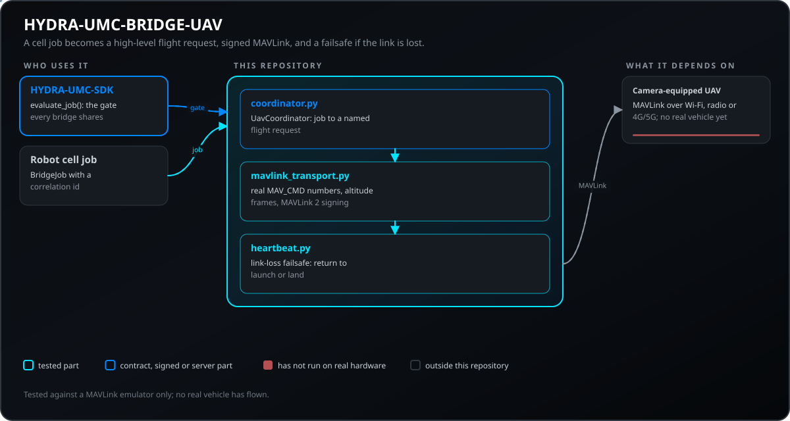
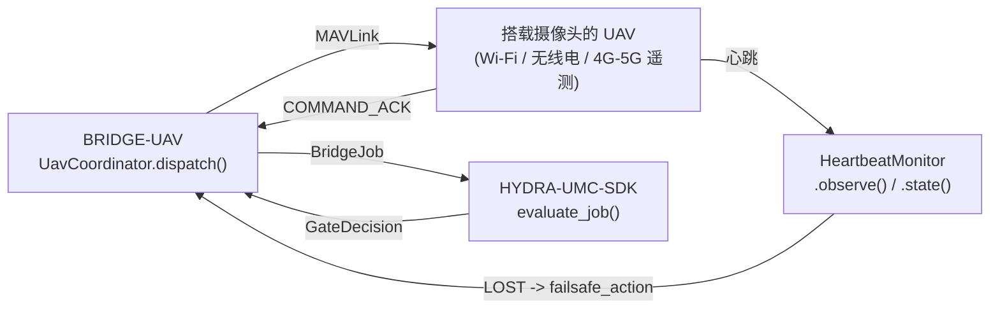
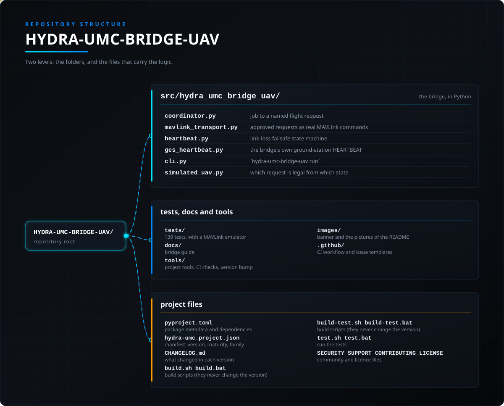

<!-- =============================================================================
HYDRA-UMC-BRIDGE-UAV - UAV coordination bridge
Copyright (C) JuanenRac (Electro Hobby 3D) <electrohobby3d@gmail.com>
GPL-3.0-or-later - see LICENSE
============================================================================= -->

<p align="center">
  
</p>

# 🚁 HYDRA-UMC-BRIDGE-UAV

<p align="center"><a href="README.md">🇺🇸 English</a> | <a href="README_spa.md">🇪🇸 Español</a> | <a href="README_fra.md">🇫🇷 Français</a> | <a href="README_ita.md">🇮🇹 Italiano</a> | <a href="README_deu.md">🇩🇪 Deutsch</a> | 🇨🇳 <b>简体中文</b> | <a href="README_jpn.md">🇯🇵 日本語</a> | <a href="README_por.md">🇵🇹 Português</a></p>

### 🔗 HYDRA-UMC 与搭载摄像头的无人机(UAV)之间无依赖的协调边界

<p align="center">
  
  
  
  
  
  
</p>

---

> **诚实检查——今天真正可运行的部分：** 无依赖的飞行请求核心（`coordinator.py` 中的 `UavCoordinator`，每次派发都会经过 `HYDRA-UMC-SDK` 自身真正的 `evaluate_job()`）、确定性的心跳断链看门狗（`heartbeat.py` 中的 `HeartbeatMonitor`），以及真正的 MAVLink 命令传输（`mavlink_transport.py` 中的 `MavlinkFlightControl`）都是真实的，并由 84 个通过的单元测试覆盖（`python tools/build_test.py` —— `test_coordinator.py`、`test_heartbeat.py`、`test_mavlink_transport.py`，以及让该桥接对抗一个协议忠实但纯手写的 MAVLink 自动驾驶仪模拟器（而非真实设备）的 `test_mavlink_emulator.py`）。以上这些都从未针对真实安装的 `pymavlink`、真实的无线电/遥测链路或实体 UAV/飞控进行过验证——`test_mavlink_transport.py` 自带的伪造 MAVLink 连接完全替代了 `pymavlink`（这些测试甚至不需要安装真正的库就能通过），并且目前还没有实时的 `run` 命令，因为尚未选定或验证任何真实的 MAVLink/OSDK 传输方案。详见下文的"当前状态与后续步骤"（已经如实说明了这一点），以及 `CHANGELOG.md` 中目前具体已交付的内容。

> **安全与安防现状:**本生态系统不是经认证的安全系统。目前尚无硬件 E-STOP 通路,没有由固件强制执行的限位或联锁,也没有经过验证的运动指令;固件映像使用 CRC32 和共享密钥的 HMAC-SHA256 校验,而非非对称签名;TLS 与双向 TLS 均为可选项,默认关闭;自制电路板尚未组装或测试。在依赖此处任何说法来保障人身安全之前,请先阅读[安全基线](https://github.com/JuanenRac/HYDRA-UMC-DOCS/blob/main/docs/SECURITY_BASELINE.md)和[威胁模型](https://github.com/JuanenRac/HYDRA-UMC-DOCS/blob/main/docs/THREAT_MODEL.md)。

---

## 📋 速览

| | |
|---|---|
| 版本 | `0.1.5` |
| 成熟度 | 可用 |
| 测试 | 132 (`python tools/build_test.py`) |
| 技术栈 | Python / MAVLink / HYDRA-UMC-SDK |
| 真实硬件 | 仅模拟：使用模拟器、替身或仿真测试；此版本没有在真实硬件上运行的记录 |

**跳转：** [概述](#-概述) · [架构](#-架构) · [功能](#-功能) · [安全与防护](#-安全与防护) · [接口](#-接口) · [配置](#-配置) · [快速开始](#-快速开始) · [测试](#-测试) · [故障排除](#-故障排除) · [仓库结构](#-仓库结构) · [相关项目](#-相关项目)

## 🚦 项目状态

每一行是本仓库的一个部分，灯号表示它今天做到了哪一步。内容依据仓库能够展示的证据（测试、构建、运行），而不是计划。

🟢 已完成并验证 · 🟡 可用，有已知限制 · 🟠 部分完成或尚未验证 · 🔴 未完成或不可用

| 领域 | 状态 | 在这里的含义 |
|---|---|---|
| 软件 | 🟡 | 主要用途可用；上面的诚实性检查列出了仍然缺少的内容 |
| 测试 | 🟢 | 132 项自动测试，每次变更都会运行 |
| 真实硬件 | 🟠 | 仅模拟：使用模拟器、替身或仿真测试；此版本没有在真实硬件上运行的记录 |
| 文档 | 🟢 | 八种语言的 README，每次变更都会与清单核对 |

## 🎯 概述

**HYDRA-UMC-BRIDGE-UAV** 是 HYDRA-UMC 与搭载摄像头的无人机(UAV)之间的高层协调边界,可通过 Wi-Fi、无线电链路或蜂窝(4G/5G)遥测连接访问。它校验并转发一套小型的、具名的高层飞行请求词汇(`ARM`、`TAKEOFF`、`GOTO_WAYPOINT`、`HOVER_AND_CAPTURE`、`RETURN_TO_LAUNCH`),并单独运行一个真实的、强制性的链路丢失心跳(heartbeat)看门狗。它从不计算飞行控制或姿态稳定,也不能绕过 HYDRA-UMC-SERVER、MCU 限位、看门狗或急停(E-STOP)。 目前来自飞行器的唯一回传路径是命令确认(`COMMAND_ACK`);不读取遥测数据。

它与 `HYDRA-UMC-BRIDGE-DROIDS` 和 `HYDRA-UMC-BRIDGE-AMR` 同属 **Mobile & Autonomous Bridges** 家族,并与固定式的 **External Automation Bridges**(CNC、LASER、OPENPNP、PRINTER3D、ROS2)共享同一个 `HYDRA-UMC-SDK` 任务与安全契约。

## 🧩 在 HYDRA-UMC 中的角色

**HYDRA-UMC-BRIDGE-UAV** 位于带摄像头的无人机（MAVLink）与机器人单元之间。它转述对方所说的内容，在任何辅助作业前询问共用关口，且绝不接管所协调机器的决定权。

与所有桥接一样遵循 `HYDRA-UMC-SDK` 的安全契约：只有共用的 `evaluate_job()` 关口放行，任务才会被接受，且该关口失败时保持关闭。本桥接没有 MQTT 传输，以命令 `hydra-umc-bridge-uav run` 运行。

## 🏛️ 架构

<p align="center">
  
</p>

<details>
<summary>图表的文本版本（Mermaid）</summary>



</details>

**为什么这样构建**

* **为什么心跳看门狗是独立的模块,而不是被并入协调器。** 链路丢失是一种真实的、与"这个任务现在是否被允许"完全不同的故障模式——`HeartbeatMonitor` 独立于任何具体任务,回答的是"我是否还能信任上一次从这台 UAV 收到的信息",因此它可以被持续检查(例如在每个遥测周期检查一次),而不仅仅是在恰好派发任务时才检查。
* **为什么 `HeartbeatMonitor` 接收显式的 `now`,而不是读取真实时钟。** 本项目起步时所依据的架构笔记明确指出,一个 UAV 桥接必须(REQUIRES)具备这个看门狗——要证明它在超时边界上的精确行为(而不只是"它最终会超时"),唯一的办法就是不依赖一个基于真实 sleep、缓慢且不稳定的测试套件,而是把时间变成一个显式的、可测试的输入。
* **为什么 `COMPLETE` 和 `ABORT` 都会解析为 `RETURN_TO_LAUNCH`。** 对一台 UAV 而言,完成任务和紧急中止有着相同的真实正确结果:回家。在静态计划中把它们收敛为同一个请求名称(去重,而不是重复列出),诚实地反映了这一点,而不是发明两个不同的"回家"动词。
* **为什么本桥接自身的心跳明确地不能替代飞控自身的故障保护。** Pixhawk/PX4 和 DJI 自身的固件已经在无线电/遥测层面实现了真实的、近乎经过认证的链路丢失故障保护——本桥接的 `HeartbeatMonitor` 是面向 HYDRA-UMC 自身状态的协调层信号,两者必须独立并存;参见 `docs/BRIDGE_GUIDE.md` 自身的硬件验收门控。
* **为什么本仓库尚无 DJI OSDK 传输适配器。**(MAVLink 传输已存在,见上文。) 在选定并测试某个具体飞控真实的命令/遥测协议之前就对其做出承诺,会有引入这个本地无依赖核心无法验证的假设的风险。
* **它如何融入整个生态系统。** BRIDGE-UAV 位于真实的 UAV 与 `HYDRA-UMC-SDK` → `HYDRA-UMC-SERVER` → MCU 安全之间——它是一个协调边界,绝不是飞行控制节点,也不能绕过 HYDRA-UMC-SERVER、MCU 限位、看门狗或急停。

## ✨ 功能

* ✅ **真实的无依赖飞行请求核心:** `coordinator.py` 中的 `UavCoordinator` 完全没有导入 MAVLink 或任何厂商 SDK——它刻意保持为纯 Python,可以在任何主机上测试,无需连接真实的 UAV。*(已实现,并在 `tests/test_coordinator.py` 中测试)*
* ✅ **真实的具名飞行请求词汇:** `ARM`, `TAKEOFF`, `GOTO_WAYPOINT`, `HOVER_AND_CAPTURE`, `RETURN_TO_LAUNCH`, `LAND`——绝不是原始的姿态/油门命令。正常任务的 `COMPLETE` 与紧急的 `ABORT` 都会解析为同一个真实的 `RETURN_TO_LAUNCH` 请求。`LAND` 是真实且确实不同的——MAVLink 自身的 `MAV_CMD_NAV_LAND` 与 `MAV_CMD_NAV_RETURN_TO_LAUNCH`(已对照[官方 MAVLink common 消息集](https://mavlink.io/en/messages/common.html)核实)——用于仅靠 RTL 无法覆盖的真实情形:立即下降,而不是先飞回家(例如电池电量过低,或返航路径不安全)。`emergency_land_request()` 将其作为独立请求提供,有意置于由 `JobPhase` 驱动的 `dispatch()` 流程之外——理由与 `HeartbeatMonitor` 自身独立的信号相同。*(已实现)*
* ✅ **一个真实的、强制性的链路丢失心跳看门狗:** `HeartbeatMonitor` 是一个确定性的、由显式 `now` 驱动的故障保护状态机——它从不读取真实时钟,如果从未收到过观测就会从第一次检查开始就报告 `LOST`,并把恰好等于超时时刻的情况仍视为 `OK`(只有真正超出超时才会触发配置好的 `RETURN_TO_LAUNCH`/`LAND` 故障保护)。*(已实现,并在 `tests/test_heartbeat.py` 中通过一整套确定性边界测试进行了测试)*
* ✅ **桥接器自身的地面站心跳:** `gcs_heartbeat.py` 中的 `GcsHeartbeat` 在后台线程中发送类型为 `MAV_TYPE_GCS` 的 MAVLink `HEARTBEAT`(默认 1 Hz,`HYDRA_UAV_GCS_HEARTBEAT_HZ` 取值 0.1 到 10,`0` 为关闭),这样桥接器停止时,自动驾驶仪自身的地面站丢失失效保护会触发。无法发送的心跳会被计数并上报,绝不抛出异常。*(已实现,在 `tests/test_gcs_heartbeat.py` 中用模拟链路测试;尚未在真实自动驾驶仪上试过)* `hydra-umc-bridge-uav run --connection <URL>`（或 `python -m hydra_umc_bridge_uav run ...`）会打开 MAVLink 链路并持续发送此心跳，每隔几秒输出一行状态，并在 Ctrl-C、SIGTERM 或 `--duration` 时干净地停止；它不会向飞行器发送其他任何内容。已针对链路记录器测试；从未针对真实自动驾驶仪或 SITL 运行过。
* ✅ **真实的共享安全门控:** 每个通过 `UavCoordinator.dispatch()` 派发的任务都会由 `HYDRA-UMC-SDK` 的 `bridge_contract` 中的 `evaluate_job()` 评估,这与所有兄弟桥接以及 HYDRA-UMC-SERVER 使用的是同一个门控;生产性阶段需要外部机器处于 `IDLE` 且 HYDRA-UMC 单元处于 `READY`,而 `ABORT` 在故障期间仍可请求。*(已实现)*
* ✅ **安全拒绝的阶段路由与静态证据:** 未知的未来 SDK 阶段会被拒绝。`inspect_request_plan.py` 会输出静态模式 `1.1` 的飞行请求计划(现已包含独立的 `LAND` 请求),且不会打开任何传输通道。*(已实现,已测试)*
* ✅ **真实的 MAVLink 命令传输:** `mavlink_transport.py` 的 `MavlinkFlightControl` 将一个已通过门控的派发发送为真实的 `COMMAND_LONG`,映射到真实的、编号的 `MAV_CMD`(`MAV_CMD_NAV_TAKEOFF`/`MAV_CMD_DO_REPOSITION`/`MAV_CMD_NAV_LOITER_UNLIM`/`MAV_CMD_IMAGE_START_CAPTURE`/`MAV_CMD_NAV_RETURN_TO_LAUNCH`/`MAV_CMD_NAV_LAND`/`MAV_CMD_COMPONENT_ARM_DISARM`)——被拒绝的派发永远不会到达网络。*(已实现,并在 `tests/test_mavlink_transport.py` 中测试)*
* ✅ **明确的高度基准、飞行包线与安全状态请求:** `GOTO_WAYPOINT` 以 `COMMAND_INT` 发出(位置为度 × 1e7,保持当前航向),并带有明确的 `altitude_frame` - `"relative"`(相对起飞点的米数,默认)或 `"amsl"`;可选的 `FlightEnvelope`(由部署方设定的高度上限和距起点半径)会拒绝超出范围的目标;`RETURN_TO_LAUNCH`、`LAND` 和独立的 `DISARM`(从不强制)即使被闸门拒绝也会发送,`COMPLETE` 的正常返航无论单元和机器状态如何都会被接受;等待 `COMMAND_ACK` 时会跳过其他命令和其他系统的确认,并把 `IN_PROGRESS` 视为尚未完成。*(已实现,已测试;线上格式仅针对模拟器验证 - 从未针对 PX4/ArduPilot SITL 或真实自驾仪验证,`TAKEOFF` 的高度仍是自驾仪自己的基准,因为 `COMMAND_LONG` 不携带坐标系)*
* ✅ **非变更式构建/测试:** `build-test.bat`/`.sh` 编译源码并运行确定性单元测试,不改变版本或 CHANGELOG。*(已实现,见下方"构建与发布")*
* 🔜 **一个 DJI OSDK 传输适配器**(面向非 MAVLink 平台)——只有在选定并测试了该 SDK 之后才会引入。*(计划中)*
* ✅ **观测到的机器状态：** `UavCoordinator.dispatch()` 接受自动驾驶仪上报的状态，共享闸门使用它而不是作业中写的 `machine_state`（任何人都能在代理上发布的消息）；没有上报时仍使用声明值。*（已实现，已在 `tests/test_observed_state.py` 中测试）*

## 🔒 安全与防护

| 威胁 | 防御 | 位置 |
|---|---|---|
| 对处于不安全状态的单元或机器下达任务 | 每个任务都经过 SDK 共用的 `evaluate_job()` 关口，该关口失败时保持关闭；桥接本身没有接受/拒绝逻辑 | SDK `bridge_contract` |
| 过大的任务数据 | 最多 32 个参数，键最长 64 个字符，值最长 1024，标识符最长 128（`MAX_PARAMETERS`、`MAX_PARAMETER_KEY_CHARS`、`MAX_PARAMETER_VALUE_CHARS`、`MAX_IDENTIFIER_CHARS`） | SDK `bridge_contract` |
| 重复或重放的命令 | `IdempotencyStore` 将每个键记住 24 小时、最多 10 000 条；重复请求得到第一次的答复而不是重新评估 | SDK `job_intake` |
| 与飞行器失去链路 | `HeartbeatMonitor` 是确定性状态机，其故障保护为 `RETURN_TO_LAUNCH` 或 `LAND`；桥接默认以 1 Hz 发送自己的地面站 HEARTBEAT（0.1 到 10 Hz，`HYDRA_UAV_GCS_HEARTBEAT_HZ`） | `heartbeat.py`, `gcs_heartbeat.py` |
| 无人授权的命令 | `ARM`、`TAKEOFF`、`GOTO_WAYPOINT` 和 `HOVER_AND_CAPTURE` 需要授权；除 `DISARM` 外的安全状态请求始终被接受 | `simulated_uav.py` |
| 伪造的 MAVLink 消息 | 使用 32 字节密钥（原始文件或 64 个十六进制字符）进行 MAVLink 2 签名，来自 `--signing-key-file` 或 `HYDRA_UMC_BRIDGE_UAV_SIGNING_KEY_FILE`；未签名的消息会被拒绝，除非为尚不签名的飞行器给出 `--signing-allow-unsigned` | `mavlink_transport.py`, `cli.py` |
| 混淆的高度参照系 | 高度参照系是明确的：`relative`（`GLOBAL_RELATIVE_ALT_INT`）或 `amsl`（`GLOBAL_INT`） | `mavlink_transport.py` |

**它绝不做的事：** 它只把关口批准的高层飞行请求转为真实的 MAVLink 命令（ARM/DISARM、TAKEOFF、DO_REPOSITION、LOITER_UNLIM、RTL、LAND、IMAGE_START_CAPTURE），绝不发送原始运动。

## 🔌 接口

命令 `hydra-umc-bridge-uav run`（或 `python -m hydra_umc_bridge_uav run`）打开 MAVLink 链路并保持地面站心跳。退出码：`0` 正常停止，`1` 无法打开链路或无法发送心跳，`2` 选项错误。

| 变量 | 默认值 | 设置内容 |
|---|---|---|
| `--connection` | 必填 | pymavlink URL，例如 `udpin:0.0.0.0:14550` 或 `/dev/ttyUSB0` |
| `--heartbeat-hz` | `1.0` | 0.1 到 10；默认值来自 `HYDRA_UAV_GCS_HEARTBEAT_HZ` |
| `--heartbeat-timeout` | `10.0` | 等待飞行器首个心跳的秒数 |
| `--status-every`, `--duration` | `10.0`, `0` | 状态行的间隔秒数（`0` 表示不打印）；运行这么多秒后停止（`0` 表示一直运行） |
| `--signing-key-file`, `--signing-allow-unsigned` | 关闭 | MAVLink 2 签名密钥文件；接受尚不签名的飞行器发来的未签名消息 |

## ⚙️ 配置

| 变量 | 默认值 | 设置内容 |
|---|---|---|
| `HYDRA_UAV_GCS_HEARTBEAT_HZ` | `1.0` | 桥接地面站心跳的频率，0.1 到 10；`0` 关闭 |
| `HYDRA_UMC_BRIDGE_UAV_SIGNING_KEY_FILE` | 未设置 | MAVLink 2 签名密钥的路径（32 字节，原始或 64 个十六进制字符）；`--signing-key-file` 优先 |

## 🚀 快速开始

需要 Python 3.11 或更高版本。测试和构建脚本期望 `HYDRA-UMC-SDK` 位于本仓库旁边（`../HYDRA-UMC-SDK`），或由 `HYDRA_UMC_SDK_ROOT` 指定。

无需硬件即可试用（用模拟器和替身检查整个桥接）：

```bash
py -3 tools/build_test.py          # Windows
python3 tools/build_test.py         # Linux, macOS
```

运行桥接（需要附加包 `mavlink`：`pip install ".[mavlink]"`）：

```bash
hydra-umc-bridge-uav run --connection udpin:0.0.0.0:14550 --signing-key-file ~/uav-signing.key
```

## 🧪 测试

运行 `python tools/build_test.py` 会执行 132 个自动 `unittest` 用例（同时编译每个模块）。测试不需要硬件、网络或可选软件包：需要 `paho-mqtt`、`pyserial` 或厂商库的用例使用替身，缺少软件包时则跳过。

| 测试文件 | 测试数 | 覆盖内容 |
|---|---|---|
| `test_coordinator.py`, `test_observed_state.py`, `test_simulated_uav.py` | - | 任务到飞行请求的映射、观测到的飞行器状态、各状态下允许的请求 |
| `test_mavlink_transport.py`, `test_mavlink_emulator.py`, `mavlink_emulator.py` | - | 针对替身和模拟器的真实 MAVLink 命令、高度参照系、签名 |
| `test_heartbeat.py`, `test_gcs_heartbeat.py`, `test_cli.py`, `test_edge_cases.py` | - | 链路丢失故障保护、地面站心跳、命令行及其退出码、边界情况 |

CI 运行 `HYDRA_UMC_CI=1 python tools/ci_validate.py`，检查清单、文档、八个 README 和图片，并使用 SDK 副本运行测试。

## 🏗️ 构建与发布

需要 Python 3.11+。`tools/build_test.py` 期望 `HYDRA-UMC-SDK` 作为兄弟目录被检出(`../HYDRA-UMC-SDK`),或通过环境变量 `HYDRA_UMC_SDK_ROOT` 指定。

```bash
# Windows
build-test.bat      # 仅验证 —— 不改变版本/CHANGELOG
build.bat            # 先验证,成功后更新版本 + CHANGELOG

# Linux/macOS
bash build-test.sh
bash build.sh
```

`build-test` 使用 `py_compile` 编译 `src/` 下的每个模块,并运行完整的 `unittest` 套件(`tests/` 下的所有 `test_*.py` 文件)——以确定性的方式进行,没有真实 UAV 连接,没有网络,也不会改变版本/CHANGELOG。`build` 会先运行同样的验证,只有成功后才调用 `tools/bump_version.py`,在 `pyproject.toml`、`hydra-umc.project.json` 和 `CHANGELOG.md` 之间同步版本号。目前尚无真正的硬件 `run` 命令——这需要经过验证的 MAVLink/OSDK 传输适配器和真实的 UAV。

## 🩺 故障排除

| 你看到 | 原因 | 处理 |
|---|---|---|
| `ModuleNotFoundError: hydra_umc_sdk` | 未安装 SDK，且不在本仓库旁边 | 把 `HYDRA-UMC-SDK` 克隆到本仓库旁边，或设置 `HYDRA_UMC_SDK_ROOT` |
| exit code `1` | 无法打开 MAVLink 链路或无法发送心跳 | 检查 `--connection`（URL 或串口设备）以及是否已安装 `pymavlink`（`.[mavlink]`） |
| exit code `2` | 选项错误，例如心跳频率超出 0.1 到 10 或签名密钥不可读 | 修正选项；密钥文件必须正好是 32 字节（原始或 64 个十六进制字符） |
| `"allowed": false` + `reason` | 共用关口或某项保护拒绝了命令 | 阅读 `reason` 并排除原因；不要盲目重试 |

## 📂 仓库结构

<p align="center">
  
</p>

<details>
<summary>目录树的文本版本</summary>

```text
HYDRA-UMC-BRIDGE-UAV/
├── src/hydra_umc_bridge_uav/
│   ├── coordinator.py             任务到具名飞行请求
│   ├── mavlink_transport.py       已批准的请求转为真实 MAVLink 命令
│   ├── heartbeat.py               链路丢失故障保护状态机
│   ├── gcs_heartbeat.py           桥接自己的地面站 HEARTBEAT
│   ├── cli.py                     `hydra-umc-bridge-uav run`
│   └── simulated_uav.py           各状态下允许哪些请求
├── tests/                         132 项测试（含 MAVLink 模拟器）
├── docs/                          桥接指南
├── tools/                         构建与测试运行器、版本提升、CI 校验、README 与图片的生成和检查
├── images/                        横幅图与 README 的图片
├── .github/                       CI 工作流和 Issue 模板
├── pyproject.toml                 包元数据与依赖
├── hydra-umc.project.json         清单：版本、成熟度、系列
├── CHANGELOG.md                   每个版本的变化
├── build.sh build.bat             构建脚本（从不改变版本）
├── build-test.sh build-test.bat   构建脚本（从不改变版本）
├── test.sh test.bat               运行测试
└── SECURITY.md SUPPORT.md CONTRIBUTING.md CODE_OF_CONDUCT.md LICENSE LICENSE.md
```

</details>

## 🗺️ 路线图与已知限制

**当前已知限制**

**目前真实的部分:** 版本 `0.1.5`,作为一个无依赖协调核心(`UavCoordinator`)是功能齐备的,并配有一个真实的、经过完整边界测试的链路丢失心跳看门狗(`HeartbeatMonitor`)、安全拒绝的阶段路由、静态 `plan-only` 飞行请求模式、一个将每个请求映射到其真实编号 `MAV_CMD` 的真实 MAVLink 命令传输(`MavlinkFlightControl`)——解锁现在要求字面上的布尔值 `confirm_arm is True`(绝不接受仅仅为真的值,例如字符串 `'false'`),每一个数值型飞行参数在做任何有限性/范围检查之前都会先被确认为真正的非布尔数字,并且发送的命令只有在收到带 `MAV_RESULT_ACCEPTED` 的真实 `COMMAND_ACK` 后才会被视为已确认——以及已接入 CI 并带 SDK 检出的非变更式 build-test 脚本。

**集成边界:** 本桥接只是一个协调边界——它不是飞行控制节点,也不能绕过 HYDRA-UMC-SERVER、MCU 限位、看门狗或急停;每个被派发的任务仍然要经过所有兄弟桥接使用的同一个共享门控。`HeartbeatMonitor` 自身的故障保护信号是协调层的事务,绝不能替代飞控自身独立的链路丢失故障保护。

**仍待完成:** 尚未验证任何真实的 MAVLink(Pixhawk/PX4)或 DJI OSDK 传输方式,也没有物理 UAV——真实的适配器只会在选定并测试了具体的飞控/SDK 之后才会引入。

## 🌍 语言

本 README 和仓库文档提供八种语言：英语、西班牙语、德语、法语、意大利语、日语、中文和葡萄牙语（葡萄牙）。它们同时编写，并由 CI 检查八个文件拥有相同的章节和相同的链接。 本仓库没有自己的界面或消息目录，因此没有需要翻译的界面文字。

## 🔗 相关项目

本项目是同一作者(JuanenRac / Electro Hobby 3D)打造的 HYDRA-UMC 机器人生态系统的一部分。值得了解,因为某个请求实际上可能是关于这些项目之一,而非本仓库本身。

**父项目**
- **[HYDRA-UMC-SERVER](https://github.com/JuanenRac/HYDRA-UMC-SERVER)** — 每个控制客户端真正通信的真实无头后端(REST/WebSocket);每条指令通过本桥接自身的本地安全门限后,本桥接向其汇报的经过认证的生态系统边界。

**兄弟项目** —— 同样与 HYDRA-UMC-SERVER 自身 API 通信,各自作为独立客户端
- **[HYDRA-UMC-STUDIO](https://github.com/JuanenRac/HYDRA-UMC-STUDIO)** — 具有实时多机器人 3D 可视化的网页控制面板。
- **[HYDRA-UMC-SUITE](https://github.com/JuanenRac/HYDRA-UMC-SUITE)** — 面向多台服务器的桌面(PySide6)集群指挥中心，打包为独立可执行文件。
- **[HYDRA-UMC-ANDROID-CONTROL](https://github.com/JuanenRac/HYDRA-UMC-ANDROID-CONTROL)** — 具有生物识别登录和配对 Wear OS 伴侣应用的原生 Android 控制应用。
- **[HYDRA-UMC-IOS-CONTROL](https://github.com/JuanenRac/HYDRA-UMC-IOS-CONTROL)** — 具有实时 WebSocket 同步的 iOS/iPadOS 控制应用(Flutter)。
- **[HYDRA-UMC-DSI](https://github.com/JuanenRac/HYDRA-UMC-DSI)** — 面向机载 7 英寸 DSI 触摸屏的原生触控界面，直接嵌入 CM5 本体。
- **[HYDRA-UMC-BRIDGE-AMR](https://github.com/JuanenRac/HYDRA-UMC-BRIDGE-AMR)** — 通过 VDA 5050 MQTT 发布者为 AGV/AMR 车队提供的协调边界(仅针对仿真车队测试) — 本生态系统 3 个移动车队桥接之一。
- **[HYDRA-UMC-BRIDGE-CNC](https://github.com/JuanenRac/HYDRA-UMC-BRIDGE-CNC)** — 具备 GRBL 状态/控制字节访问能力的高层 CNC 单元协调器(仅针对模拟器测试)。
- **[HYDRA-UMC-BRIDGE-DROIDS](https://github.com/JuanenRac/HYDRA-UMC-BRIDGE-DROIDS)** — 面向足式/人形机器人的协调边界,带有 Boston Dynamics Spot 指令发送器(仅针对模拟器测试) — 本生态系统 3 个移动车队桥接之一。
- **[HYDRA-UMC-BRIDGE-LASER](https://github.com/JuanenRac/HYDRA-UMC-BRIDGE-LASER)** — 读取 3 路钥匙/外壳/联锁 GPIO 信号的激光单元协调器(仅针对模拟芯片测试;无法使激光器上膛或发射)。
- **[HYDRA-UMC-BRIDGE-OPENPNP](https://github.com/JuanenRac/HYDRA-UMC-BRIDGE-OPENPNP)** — 面向 OpenPnP 贴片机板级流程的安全高层协调器。
- **[HYDRA-UMC-BRIDGE-PRINTER3D](https://github.com/JuanenRac/HYDRA-UMC-BRIDGE-PRINTER3D)** — 面向 Moonraker/Klipper 3D 打印机的安全协调边界，具备真实的受控作业指令。
- **[HYDRA-UMC-BRIDGE-ROS2](https://github.com/JuanenRac/HYDRA-UMC-BRIDGE-ROS2)** — 带有惰性导入 rclpy ROS 2 传输层的协调器(尚未在 ROS 2 环境中运行)。

**直接相关**
- **[HYDRA-UMC-SDK](https://github.com/JuanenRac/HYDRA-UMC-SDK)** — 每个桥接都据此校验自身指令的共享 JSON-Schema 契约与软件作业门限边界(并非经认证的安全功能)。
- **[HYDRA-UMC-CONNECTOR-HUB](https://github.com/JuanenRac/HYDRA-UMC-CONNECTOR-HUB)** — 面向外部机器连接器的声明式适配器清单注册与校验工具；把 SDK 自身的契约理念扩展到外部机器，而不取代工业网关类项目。

**生态系统中的其他项目**

*核心硬件与平台*
- **[HYDRA-UMC](https://github.com/JuanenRac/HYDRA-UMC)** — 机器人手臂主板设计——CM5 主机 + 双核 STM32H745,目标是通过 CAN-OTA/SPI-OTA 协调最多 8 条工具臂(固件处于早期阶段,尚无已组装的电路板)。
- **[HYDRA-UMC-OS](https://github.com/JuanenRac/HYDRA-UMC-OS)** — 面向 CM5 的可复现 Raspberry Pi OS 产品层——只读代理、经过验证的配置/配置文件、WiFi 首次配网。

*核心后端与客户端*
- **[HYDRA-UMC-EDITOR-URDF](https://github.com/JuanenRac/HYDRA-UMC-EDITOR-URDF)** — 将完成的模型推送到 STUDIO 自身目录的桌面版图形化 URDF 创建/编辑工具。
- **[HYDRA-UMC-EDITOR-STL](https://github.com/JuanenRac/HYDRA-UMC-EDITOR-STL)** — 桌面 STL 模型编辑器，在 HYDRA-UMC-EDITOR-URDF 编辑的同一模型目录中变换/替换/移除/添加真实部件。

*URTC 工具平台*
- **[URTC](https://github.com/JuanenRac/URTC)** — 面向实体 Universal Robot Tool Controller 板卡的固件，通过 CAN 总线支持 25 种以上工具配置。
- **[URTC-FLASHER](https://github.com/JuanenRac/URTC-FLASHER)** — 面向 URTC 板卡的桌面图形烧录工具，支持 CAN-OTA 以及全芯片 SWD/JTAG。
- **[URTC-TESTER](https://github.com/JuanenRac/URTC-TESTER)** — 面向 URTC 板卡的桌面实时 CAN 总线诊断工具，每种工具配置对应一个面板。
- **[URTC-WEB-STUDIO](https://github.com/JuanenRac/URTC-WEB-STUDIO)** — 通过 Web Serial API 实现的浏览器版 URTC-TESTER 替代方案，无需本地安装。
- **[URTC-GATEWAY](https://github.com/JuanenRac/URTC-GATEWAY)** — URTC CAN 总线前的网关：允许的标识符列表、速率限制和会话密钥；软件已在计算机上测试，尚未在真实总线上测试。

*视觉 AI 节点(Hailo-8)*
- **[HYDRA-UMC-VISION-NODE](https://github.com/JuanenRac/HYDRA-UMC-VISION-NODE)** — 面向 Hailo-8 视觉流水线的集成中枢，具备逐阶段的真实硬件就绪检测。
- **[HYDRA-UMC-DETECTION-HEF](https://github.com/JuanenRac/HYDRA-UMC-DETECTION-HEF)** — 具备 Hailo 架构/校验和安全加载验证的真实编译模型注册表。
- **[HYDRA-UMC-VISION-STREAMER](https://github.com/JuanenRac/HYDRA-UMC-VISION-STREAMER)** — 具备真实 HailoRT 集成边界的真实 GStreamer 流水线 + MediaMTX 配置生成器。
- **[HYDRA-UMC-VISUAL-SERVOING-API](https://github.com/JuanenRac/HYDRA-UMC-VISUAL-SERVOING-API)** — 以区域状态为授权条件的 Position-Based Visual Servoing 修正律;尚无摄像头位姿估计。
- **[HYDRA-UMC-SAFETY-ZONES](https://github.com/JuanenRac/HYDRA-UMC-SAFETY-ZONES)** — 从文件读取物体位置的 v0 区域入侵、校准新鲜度与 E-STOP 请求逻辑;没有检测器为其供数,也尚未连接任何物理 E-STOP。

*认知 AI 节点(Hailo-10)*
- **[HYDRA-UMC-COGNITIVE-NODE](https://github.com/JuanenRac/HYDRA-UMC-COGNITIVE-NODE)** — 面向 Hailo-10 认知流水线(LLM/VLA/语音编排)的集成中枢。
- **[HYDRA-UMC-VLA-ENGINE](https://github.com/JuanenRac/HYDRA-UMC-VLA-ENGINE)** — 面向 Vision-Language-Action 模型的真实动作 token 编解码与轨迹生成。
- **[HYDRA-UMC-VOICE-UI](https://github.com/JuanenRac/HYDRA-UMC-VOICE-UI)** — 具备受限、需确认的 Watch 中继的真实语音前端(VAD + 意图解析)。
- **[HYDRA-UMC-SEMANTIC-PLANNER](https://github.com/JuanenRac/HYDRA-UMC-SEMANTIC-PLANNER)** — 基于真实规则的任务分解，以及针对 MCU 错误码的语义化错误恢复。
- **[HYDRA-UMC-DOCS-QA](https://github.com/JuanenRac/HYDRA-UMC-DOCS-QA)** — 面向本生态系统自身 Markdown 文档的真实纯标准库 TF-IDF 文档检索。
- **[HYDRA-UMC-LOCAL-TECHNICIAN](https://github.com/JuanenRac/HYDRA-UMC-LOCAL-TECHNICIAN)** — 面向生态系统自身的本地、按策略门控的 AI 维护技师——观察、诊断并提出修复建议;两个最高风险等级目前特意尚未实现。

*编排与集群*
- **[HYDRA-UMC-ORCHESTRATOR](https://github.com/JuanenRac/HYDRA-UMC-ORCHESTRATOR)** — 具备真实 gRPC/Protobuf 健康报告契约与任务状态机的集成中枢。
- **[HYDRA-UMC-JOB-DISPATCHER](https://github.com/JuanenRac/HYDRA-UMC-JOB-DISPATCHER)** — 基于真实 HTTP API 的真实优先级任务队列，支持去重。
- **[HYDRA-UMC-NODE-HEALING](https://github.com/JuanenRac/HYDRA-UMC-NODE-HEALING)** — 具备重试/退避与身份不匹配检测的真实基于 gRPC 的车队健康看门狗。
- **[HYDRA-UMC-PATH-PLANNER-3D](https://github.com/JuanenRac/HYDRA-UMC-PATH-PLANNER-3D)** — 具备真实障碍物/工作空间碰撞校验的真实基于 RRT 的三维路径规划器。
- **[HYDRA-UMC-SWARM-SYNC](https://github.com/JuanenRac/HYDRA-UMC-SWARM-SYNC)** — 经过多单元收敛属性测试的真实 CRDT LWW-Element-Map 状态同步。

*数字孪生与仿真*
- **[HYDRA-UMC-TWIN](https://github.com/JuanenRac/HYDRA-UMC-TWIN)** — 面向数字孪生引擎的集成中枢，具备真实的版本兼容性同步契约。
- **[HYDRA-UMC-HIL-BRIDGE](https://github.com/JuanenRac/HYDRA-UMC-HIL-BRIDGE)** — 在仿真与真实硬件之间带有软件碰撞联锁的硬件在环路由器(未在真实硬件上测试)。
- **[HYDRA-UMC-PHYSICS-REPLICA](https://github.com/JuanenRac/HYDRA-UMC-PHYSICS-REPLICA)** — 面向真实 URDF 子集的真实正向运动学与关节限位校验。
- **[HYDRA-UMC-SYNTHETIC-DATA-GEN](https://github.com/JuanenRac/HYDRA-UMC-SYNTHETIC-DATA-GEN)** — 具备 YOLO/COCO 标注导出功能的真实程序化 2D 场景生成器。

*数据与分析*
- **[HYDRA-UMC-DATALAKE](https://github.com/JuanenRac/HYDRA-UMC-DATALAKE)** — 具备真实数据摄入/查询 HTTP API 的真实 sqlite3 时序数据存储。
- **[HYDRA-UMC-ANOMALY-DETECTOR](https://github.com/JuanenRac/HYDRA-UMC-ANOMALY-DETECTOR)** — 具备漂移监测能力的真实 FFT + 统计基线异常检测器。
- **[HYDRA-UMC-PRODUCTION-REPORTS](https://github.com/JuanenRac/HYDRA-UMC-PRODUCTION-REPORTS)** — 基于 DATALAKE 历史数据的真实 OEE/可用率计算，支持可复现的 CSV 导出。
- **[HYDRA-UMC-TELEMETRY-COLLECTOR](https://github.com/JuanenRac/HYDRA-UMC-TELEMETRY-COLLECTOR)** — 面向 DATALAKE 的真实 CAN/WebSocket 数据摄入管道，支持序列去重。

*工业网关*
- **[HYDRA-UMC-GATEWAY-INDUSTRIAL](https://github.com/JuanenRac/HYDRA-UMC-GATEWAY-INDUSTRIAL)** — 中继至工业协议的集成中枢，具备真实的指令白名单/背压控制层。
- **[HYDRA-UMC-OPCUA-SERVER](https://github.com/JuanenRac/HYDRA-UMC-OPCUA-SERVER)** — 经真实二进制协议客户端会话验证的真实 OPC-UA 地址空间。
- **[HYDRA-UMC-MQTT-BROKER](https://github.com/JuanenRac/HYDRA-UMC-MQTT-BROKER)** — 具备可选按客户端认证与主题 ACL 的真实 MQTT 代理。
- **[HYDRA-UMC-MTCONNECT-ADAPTER](https://github.com/JuanenRac/HYDRA-UMC-MTCONNECT-ADAPTER)** — 具备降级模式输出的真实 MTConnect `/probe` 与 `/current` XML 端点。

*辅助工具与生态系统运维*
- **[HYDRA-UMC-DASHBOARD-AI](https://github.com/JuanenRac/HYDRA-UMC-DASHBOARD-AI)** — 基于 DATALAKE/ANOMALY-DETECTOR 的智能摘要与异常高亮面板，具备诚实的统计回退机制。
- **[HYDRA-UMC-TOOL-CLI](https://github.com/JuanenRac/HYDRA-UMC-TOOL-CLI)** — 具备真实、稳定退出码契约的车队 CLI，是 HYDRA-UMC-SERVER 自身 API 的真实在线客户端。
- **[HYDRA-UMC-WATCH](https://github.com/JuanenRac/HYDRA-UMC-WATCH)** — 带有触觉提醒模式与配对手机语音中继的 WearOS 伴侣应用(尚未在实体手表上运行)。
- **[URTC-SMART-RACK](https://github.com/JuanenRac/URTC-SMART-RACK)** — 面向板卡安装机架的固件，具备真实的工具 ID 解码与 Smart Idle 预热逻辑。
- **[URTC-VISION-TOOL](https://github.com/JuanenRac/URTC-VISION-TOOL)** — 面向热成像/RGB 检测工具头的固件及真实 Python 视觉伴侣程序。
- **[HYDRA-UMC-UPDATER](https://github.com/JuanenRac/HYDRA-UMC-UPDATER)** — 发现、克隆并更新本生态系统中每个仓库的管理类桌面工具。
- **[HYDRA-UMC-OS-REBUILDER](https://github.com/JuanenRac/HYDRA-UMC-OS-REBUILDER)** —— 构建即刻可烧录、预装生态系统最新版本的 CM5 镜像的 Windows/Linux 桌面工具,具备类似 Raspberry Pi Imager 风格的首次启动 Wi-Fi/用户/SSH 配置。
- **[HYDRA-UMC-OPS-AGENT](https://github.com/JuanenRac/HYDRA-UMC-OPS-AGENT)** — 维护事件协调器：一个低权限的边缘角色采集经过脱敏的库存/健康快照，一个控制面角色以只读方式渲染它，并请求某个 AI 提供方给出诊断建议——从不应用补丁，也从不部署任何内容。
- **[HYDRA-UMC-DEV-SERVER](https://github.com/JuanenRac/HYDRA-UMC-DEV-SERVER)** — 可复现的开发主机（Raspberry Pi 5 / CM5），保存整个生态系统的源代码，并在持久队列下运行有界的构建/测试任务；这是专用的开发角色，明确区别于运行中的 CM5。

## 📚 文档

更多阅读：

* [docs/BRIDGE_GUIDE.md](docs/BRIDGE_GUIDE.md) - 范围、飞行请求、MAVLink、签名、故障保护、脚本
* [生态系统的安全基线](https://github.com/JuanenRac/HYDRA-UMC-DOCS/blob/main/docs/SECURITY_BASELINE.md)
* [生态系统的威胁模型](https://github.com/JuanenRac/HYDRA-UMC-DOCS/blob/main/docs/THREAT_MODEL.md)
* [本仓库的更新日志](CHANGELOG.md)
* [本仓库的许可证](LICENSE.md)

## 🤝 参与贡献与社区

* 提交 pull request 之前，请运行 `HYDRA_UMC_CI=1 py -3 tools/ci_validate.py`（或 `HYDRA_UMC_CI=1 python3 tools/ci_validate.py`）：它必须输出 `CI_VALIDATION=PASS`。此检查不要运行 `build.sh` 或 `build.bat`；构建不是检查。
* 八个 README 由 HYDRA-UMC-DOCS 中的同一个源生成；请勿手工编辑。修改源文件，再用 `tools/make_readmes.py` 重新生成。
* 不要在 README 中声称尚未运行过的内容：属实时请写“仅模拟”或“尚未在硬件上试过”。
* 请参阅 [CONTRIBUTING.md](CONTRIBUTING.md)、[行为准则](CODE_OF_CONDUCT.md)、[SECURITY.md](SECURITY.md) 和 [SUPPORT.md](SUPPORT.md)。

## 👤 作者

**JuanenRac (Electro Hobby 3D)** · electrohobby3d@gmail.com

## 📜 许可证

GPL-3.0-or-later - [LICENSE](LICENSE).
